# gds2palace FEM workflow for IHP User’s Guide 

Volker Mühlhaus,volker@muehlhaus.com
---
Document version: 2026-10-17

## Contents
[What's New](#whats-new)  
[About this workflow](#about-this-workflow)  
[Workflow](#workflow)  
[Required software and Python modules](#required-software-and-python-modules)  
&ensp;[Recommended installation of gds2palace as Python module](#recommended-installation-of-gds2palace-as-python-module)  
&ensp;[Alternative, no longer recommended: local gds2palace directory](#alternative-no-longer-recommended-local-gds2palace-directory)  
&ensp;[External tools (not Python modules)](#external-tools-not-python-modules)  
[Installing AWS Palace](#installing-aws-palace)  
&ensp;[Installing the Palace solver using Apptainer](#installing-the-palace-solver-using-apptainer)  
&ensp;[Installing the Palace solver using spack package manager](#installing-the-palace-solver-using-spack-package-manager)  
&ensp;[Running Palace (after installation)](#running-palace-after-installation)  
[Quick tour](#quick-tour)  
&ensp;[Simulation model: Input files](#simulation-model-input-files)  
&ensp;[Simulation model: Simulation control](#simulation-model-simulation-control)  
&ensp;[Simulation model: Ports](#simulation-model-ports)  
&ensp;[Running the model code to create Palace input files](#running-the-model-code-to-create-palace-input-files)  
&ensp;[Running Palace FEM simulation from our input files](#running-palace-fem-simulation-from-our-input-files)  
[Simulation model file in detail](#simulation-model-file-in-detail)  
&ensp;[Input files](#input-files)  
&ensp;[settings](#settings)  
&ensp;[Port configuration](#port-configuration)  
&ensp;[Filenames and flow control](#filenames-and-flow-control)  
[Examples](#examples)  
[Conductor loss modelling](#conductor-loss-modelling)  
[Dielectric loss modelling](#dielectric-loss-modelling)  
[Advanced topics](#advanced-topics)  
&ensp;[Adaptive mesh refinement at selected frequencies only](#adaptive-mesh-refinement-at-selected-frequencies-only)  
&ensp;[Using wave ports instead of lumped ports not supported](#using-wave-ports-instead-of-lumped-ports-not-supported)  
&ensp;[Using S-Parameter output, model extraction](#using-s-parameter-output-model-extraction)  
&ensp;[Lumped circuit model extraction](#lumped-circuit-model-extraction)  
&ensp;[Mathematical "black box" vector fit](#mathematical-black-box-vector-fit)  
[Using gds2palace with Elmer FEM for EM simulation](#using-gds2palace-with-elmer-fem-for-em-simulation)  
&ensp;[Installing Elmer FEM](#installing-elmer-fem)  
&ensp;[From a Palace model to an Elmer model](#from-a-palace-model-to-an-elmer-model)  
&ensp;[Frequency sweep](#frequency-sweep)  
&ensp;[Mesh order and solver method](#mesh-order-and-solver-method)  
&ensp;[Boundary conditions and current limitations](#boundary-conditions-and-current-limitations)  
&ensp;[Running the Elmer EM simulation and getting S-parameters](#running-the-elmer-em-simulation-and-getting-s-parameters)  
[Using gds2palace with Elmer FEM for thermal simulation](#using-gds2palace-with-elmer-fem-for-thermal-simulation)  
&ensp;[Stackup XML: thermal material properties](#stackup-xml-thermal-material-properties)  
&ensp;[Heat sources and constant-temperature boundaries](#heat-sources-and-constant-temperature-boundaries)  
&ensp;[Model script settings](#model-script-settings)  
&ensp;[Running ElmerSolver and viewing results](#running-elmersolver-and-viewing-results)  
&ensp;[Using setupThermal instead of writing Python code](#using-setupthermal-instead-of-writing-python-code)  
[Appendix](#appendix)  
&ensp;[Understanding volumes and surfaces created from GDSII](#understanding-volumes-and-surfaces-created-from-gdsii)  
&ensp;[Mapping of Volumes and Surfaces to Palace materials](#mapping-of-volumes-and-surfaces-to-palace-materials)  
&ensp;[Extended XML stackup format](#extended-xml-stackup-format)  
&ensp;[Software versions used in this document](#software-versions-used-in-this-document)  
&ensp;[List of examples](#list-of-examples)  


## What's New

This chapter gives a brief overview of major features added since the previous edition of this guide. For the complete, dated change log, see [`CHANGES.md`](https://github.com/VolkerMuehlhaus/gds2palace_ihp_sg13g2/blob/main/doc/CHANGES.md) in the repository.

- **settings['conductor_model']** chooses the conductor model in one setting: `'surface'` (default, surface impedance), `'solve_inside'` (conductors meshed as volumes) or `'solve_inside_skin'` (volumes with thin layers along their faces for the skin effect). With the surface model, the peak Q of coils on TopMetal1/TopMetal2 with 2-8 µm traces is 18-30 % too high; for Q and loss, use `'solve_inside'` while designing and `'solve_inside_skin'` for final numbers. See "Choosing the conductor model" in chapter "Conductor loss modelling".
- `conductor_model` replaces **settings['filled_metals']**. Scripts that set it still work: `True` is the same as `'solve_inside'`, `False` the same as `'surface'`.
- **settings['z_thickness_factor'] was removed.** Scripts that still set it get a warning, and the full metal thickness is used on all conductor faces. Use `conductor_model` for accurate conductor loss.
- **Elmer FEM as an additional solver.** gds2palace can now generate simulation input not only for AWS Palace, but also for [Elmer FEM](https://www.elmerfem.org/), an open-source multiphysics solver. This adds two new workflows, both built from the same GDSII layout + XML stackup + Python model script approach already used for Palace:
  - **Elmer EM simulation** — S-parameter simulation, see chapter "Using gds2palace with Elmer FEM for EM simulation".
  - **Elmer thermal simulation** — steady-state heat conduction (temperature) simulation from user-defined heat sources and constant-temperature boundaries, see chapter "Using gds2palace with Elmer FEM for thermal simulation".
- **Derived layers in the XML stackup.** A layer's geometry can now be computed from other layers using boolean operations (AND/OR/XOR/NOT) and resizing, instead of only being read directly from GDSII. This is used, for example, to derive SG13G2 resistor geometry from existing process layers, see the example in folder `more_examples/derived_layers_and_resistors`.
- **Reference-relative layer positioning in the XML stackup.** A `<Layer>` or `<Dielectric>` can now be positioned as an offset from the top or bottom edge of another named layer/dielectric, instead of always requiring an absolute Zmin/Zmax. This removes the need to hand-recompute every dependent layer's z-position whenever a thickness changes.
- **Simplified handling of cutouts.** Mesh generation was redesigned so that the `preprocess_gds` option is no longer required for layouts with cutouts (holes) or other self-intersecting polygon boundaries.
- **setupThermal.** The companion desktop tool `setupEM` now also includes `setupThermal`, a GUI for building Elmer thermal models without writing Python code, and a GUI-driven XML stackup editor. See <https://github.com/VolkerMuehlhaus/setupEM>

The XML stackup file format used by both Palace and Elmer models has grown to support these new features. See chapter "Extended XML stackup format" in the Appendix, and the full attribute reference in [`XML_stackup_format.md`](../XML_stackup_format/XML_stackup_format.md).

## About this workflow 
Palace, for **PA** rallel **LA** rge-scale **C** omputational **E** lectromagnetics, is an open-source, parallel finite element code for full-wave 3D electromagnetic simulations. It can be scaled from single computer to large high performance simulation clusters and cloud-based computing.  
<https://awslabs.github.io/palace/stable/>   
<https://aws.amazon.com/de/blogs/quantum-computing/aws-releases-open-source-software-palace-for-cloud-based-electromagnetics-simulations-of-quantum-computing-hardware/>  
The gds2palace workflow enables RFIC FEM simulation using Palace from GDSII layout files. 

## Workflow  
In this document, the status of the IHP workflow developed for AWS Palace FEM solver is documented.  
Two files must be provided by the user: the **layout in GDSII format** and a **simulation model script** in Python. This simulation script references the technology stackup file (XML format) and calls functions from the workflow code to create two output files for Palace: the **simulation mesh file** which is built from geometries and stackup, and the **simulation control file** in *.json format which defines material settings and simulation settings.  

Having these two files, the user can now run the FEM simulation in Palace. The simulation model script can start an external command to start simulation, or the user can run Palace on a platform of his choice. This way, the files for Palace can be created on any desktop computer, and the Palace simulation can be done on the same computer or on a very different system. This gives many options to scale Palace simulation power as needed, using the exact same Palace input data from our workflow.  


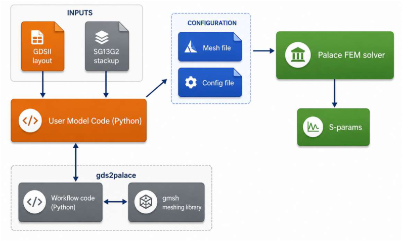


## Required software and Python modules 

The gds2palace Python workflow creates AWS Palace model files (mesh file + config file). To actually simulate these models, you need to have AWS Palace installed. Installing Palace is described below in chapter “Installing AWS Palace”. 

### All-in-one installation script for Linux

An installation script for Linux is available, which

- creates the Python venv for gds2palace and its user interface setupEM
- installs gds2palace, setupEM and all dependencies
- installs the AWS Palace solver as an Apptainer container image, and checks that it runs
- installs the scripts to run Palace models from gds2palace (run_palace, combine_snp)

See <https://github.com/VolkerMuehlhaus/gds2palace_ihp_sg13g2/tree/main/scripts/install_linux>

### Manual installation

It is recommended to install gds2palace into a Python virtual environment. In this document, we assume Linux environment and install to a virtual environment `palace` that is located in the user’s home directory at `~/venv/palace` 

This is how to create that virtual environment: 

```
cd ~
python3 -m venv ~/venv/palace
```

### Recommended installation of gds2palace as Python module 

The easiest method to install the gds2palace Python workflow is to use the preconfigured package which automatically installs all dependencies (gdspy, gmsh, scikit-rf). We activate the virtual environment and install to there:  

```
source ~/venv/palace/bin/activate
pip install --upgrade gds2palace
```

That’s all we need to do for installing the gds2palace Python module. If you install gds2palace this way, you only need the gds2palace repository to download the examples and XML stackup files and documentation.  

To run a model script using gds2palace, you then activate the venv first:

```
source ~/venv/palace/bin/activate
```

As an alternative, it would also be possible to work with a local copy of the gds2palace directory, as described below. However, this is more complicated and no longer recommended! 

### Alternative, no longer recommended: local gds2palace directory 

It is possible to use a local directory with gds2palace module code. This directory can be downloaded from the gds2palace github repository and must always be copied to the directory where the *.py simulation model is located. The simulation model must then have a code line to include that local gds2palace directory in the Python path.  

In this case, Python module dependencies must be installed manually:  

```
source ~/venv/palace/bin/activate
pip install gdspy
pip install gmsh
pip install scikit-rf
```

This virtual environment with installed dependencies can be used to run gds2palace and the scripts that postprocess the Palace simulation results. To activate this Python environment on the command line: 

```
source ~/venv/palace/bin/activate
```

### External tools (not Python modules)

Two more tools are needed for parts of the workflow, but are not installed via pip:

- [ParaView](https://www.paraview.org/) — to view field-dump output (Palace/Elmer EM) and Elmer thermal result files.
- An MPI implementation — only needed for multi-process Elmer runs (`settings['ELMER_MPI_THREADS']`, see chapter "Installing Elmer FEM"). Use OpenMPI or MPICH on Linux/macOS; on Windows, install [Microsoft MPI](https://learn.microsoft.com/en-us/message-passing-interface/microsoft-mpi).

## Installing AWS Palace 

To actually simulate the model created by gds2palace, you need to have AWS Palace installed. Different methods of installing Palace are described at <https://awslabs.github.io/palace/stable/install/>  but we have compiled the most relevant methods for gds2palace users below.  

### Installing the Palace solver using Apptainer 

For development of gds2palace, Palace was installed using the Singularity/Apptainer installation method. This was rather simple and straightforward, even with no knowledge about container usage. A step-by-step guide can be found here: [building-palace-apptainer.md](https://github.com/VolkerMuehlhaus/gds2palace_ihp_sg13g2/blob/main/doc/building-palace-apptainer.md)

A pre-built container image for Palace 0.18.1 is also available, if you'd rather not build anything yourself. It runs on all Intel processors since 2013 and all AMD processors since 2017. To download it into your current directory:  

```
$ apptainer pull palace_0181.sif oras://ghcr.io/volkermuehlhaus/palace_0181:latest
```

### Installing the Palace solver using spack package manager 

Palace can also be created from source with a few simple commands. All tools required by the build process will be downloaded and installed automatically by spack, so you can sit and watch while your system builds the software.  
A step-by-step guide for compiling Palace using the **spack package manager for Linux** : [building-palace-spack.md](https://github.com/VolkerMuehlhaus/gds2palace_ihp_sg13g2/blob/main/doc/building-palace-spack.md)

### Running Palace (after installation) 

You can use any of the installation methods described on the AWS Palace web site. The gds2palace workflow does not change, it only creates the input files for Palace and does not care how you installed Palace, or on what platform you run the actual Palace simulation from these model files.  

To start Palace from setupEM, a wrapper script **run_palace** is used, and this is where you point to your actual installation (even remote copy & remote simulation is possible). This script is available in the scripts folder in gds2palace repository, and needs to be adjusted for your path settings and number of processor cores.  

## Quick tour 

This chapter will give a very brief overview of the workflow usage, without going into the details.  

To get started, we need a directory that contains:  
- GDSII layout file to be simulated  
- XML stackup file  
- Only if gds2palace is **not** installed as Python module: local copy of gds2palace directory  

In addition, we need the simulation model code in Python, which brings the workflow to life. Below are the most important code sections that need to be configured by the user.  

### Simulation model: Input files 

In this section, the user specifies the GDSII data source and the technology stackup file.  

```python
# ===================== input files and path settings =======================

gds_filename = "line_simple_viaport.gds"   # geometries
XML_filename = "SG13G2_nosub.xml"          # stackup

# preprocess GDSII for safe handling of cutouts/holes?
preprocess_gds = False
```


### Simulation model: Simulation control 

In this section, the user needs to specify frequency range and mesh settings.  There are additional optional settings that can be applied, as discussed later in this document.  

```python
settings['unit']   = 1e-6  # geometry is in microns
settings['margin'] = 50    # distance in microns from GDSII geometry boundary to simulation boundary

settings['fstart']  = 0e9
settings['fstop']   = 100e9
settings['fstep']   = 2.5e9

settings['refined_cellsize'] = 2  # mesh cell size in conductor region
settings['cells_per_wavelength'] = 10   # how many mesh cells per wavelength, must be 10 or more

settings['meshsize_max'] = 70  # microns, override cells_per_wavelength
settings['adaptive_mesh_iterations'] = 0
```

Users who are familiar with the IHP openEMS workflow will notice many similarities, although some implementation details are different.  

One important difference is that FEM simulates one frequency after another, so frequency settings have an effect on total simulation time. However, Palace is configured to use an adaptive frequency sweep, which will EM simulate only the minimum required number of frequencies across the band, and then create all other frequency points using interpolation. This adaptive sweep is enabled by default in our workflow.  

Another important difference is the use of “refined_cellsize” to create the mesh: the gmsh meshing engine will always create a mesh based on all geometry detail, no matter how small it is, and then apply an additional mesh refinement based on “refined_cellsize” along the metal edges.  

### Simulation model: Ports 

Additional important user input are the port definitions.  

Similar to the IHP openEMS workflow, **ports are created based on polygons from the GDSII file** , located on special layers that are not part of the IHP layer table. Each port needs to use a different source layer in the GDSII file.  

The port mapping defines the port number and port impedance, and then maps the port geometry from the special GDSII input layer (usually 201 and above) to actual IHP technology layers. For the vertical ports shown here, we have from_layername and to_layername. For in-plane ports, we would have target_layername instead. Finally, the port direction is required to specify vertical ports or in-plane ports and their direction/polarity.  


```python
simulation_ports = simulation_setup.all_simulation_ports()
# instead of in-plane port specified with target_layername,
# we here use via port specified with from_layername and to_layername
simulation_ports.add_port(simulation_setup.simulation_port(
    portnumber=1, voltage=1, port_Z0=50, source_layernum=201,
    from_layername='Metal1', to_layername='TopMetal2', direction='z'))
simulation_ports.add_port(simulation_setup.simulation_port(
    portnumber=2, voltage=1, port_Z0=50, source_layernum=202,
    from_layername='Metal1', to_layername='TopMetal2', direction='z'))
```


For this Palace workflow, the voltage parameter is not supported yet by the Palace solver. Palace only supports opposite polarity by reversing the port direction. **But here in our workflow, we use this voltage parameter to specify if a port is active: ports with voltage=0 will not be excited.**  

It must be noted that Palace behaves differently from other FEM solvers: to get the full S- matrix, we need to run all port excitations, one after another. This only happens if all port voltages are not zero. Only then, the full S-parameter output file can be created.  

**ATTENTION** : If any port excitation is zero, that “zero voltage” port will not be excited and that row in the S-parameter file will be padded with zeros. For example, if we simulate an 8-port circuit and only excite port 1, the S-parameter output will have valid results for S11, S21, … S81 but all other values will be zero. This can be useful to quickly simulate one specific path in the model.  

To get the full S-parameter file, all ports must be defined with non-zero voltage, so that all port excitations are simulated, one after another.  

**PORT SHAPE IN GDSII** : The workflow creates lumped ports in Palace, which need to be 2D sheets. This means that for vertical ports (via ports), you should draw a zero-width box in GDSII, resulting in a vertical 2D sheet with no width. If you define a vertical port from a box with finite xy area, the Palace port will be created as a vertical 2D sheet along the left edge (xmin) of that box if it is taller than wide, else along its bottom edge (ymin), not along its center line.  

**Composite ports** (multiple EM ports grouped into one port in the final output file) are not yet supported by this workflow. All ports with non-zero voltage are simulated one after another, resulting in n-port S-parameters.  

### Running the model code to create Palace input files 

The simulation model file (Python code) can be run on the command line. After reading and processing the input files, a 3D viewer comes up and shows the resulting 3D model. This viewer is the graphical interface of the gmsh meshing library, and provides many options for inspection of the model. At this point, the model is not meshed yet, so that we can see the raw geometries. 


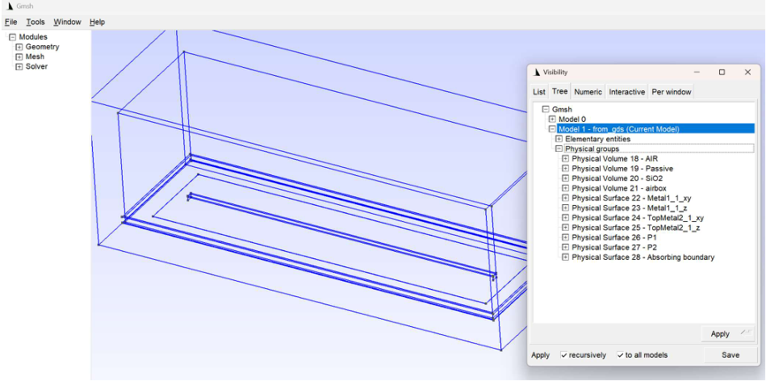


To see the structure of the 3D model, you can go to Tools > Visibility.  

In the screenshot, you can see that dielectric boxes (SiO2, Passive, AIR etc) have been added around the GDSII polygons, with an offset value in xy direction from the “margins” parameter in the model file. Around that, we have another layer of air on all six sides, using the same margins value.  

Metals have been created as surfaces. All polygons on each layer are merged, if possible, and then each of the resulting polygons is created as a separate surface. To be more precise, all faces of each resulting polygon body (top, bottom and side walls) form one surface group, named after the layer and a number, e.g. TopMetal2_1. 

You can also see two ports P1 and P2 created as surfaces. The outer simulation boundary is this example is a surface “Absorbing boundary” that is defined as absorbing boundary in the Palace config file.  

When we are done with inspecting the model (which is optional, no user action is required!), the gmsh viewer window can be closed to proceed with meshing. After closing the gmsh geometry preview, the simulation model script will mesh these geometries, which can take a while and will show lots of status information on the command line.  

When meshing is completed, the gmsh 3D viewer will be displayed again, showing the overall mesh.  


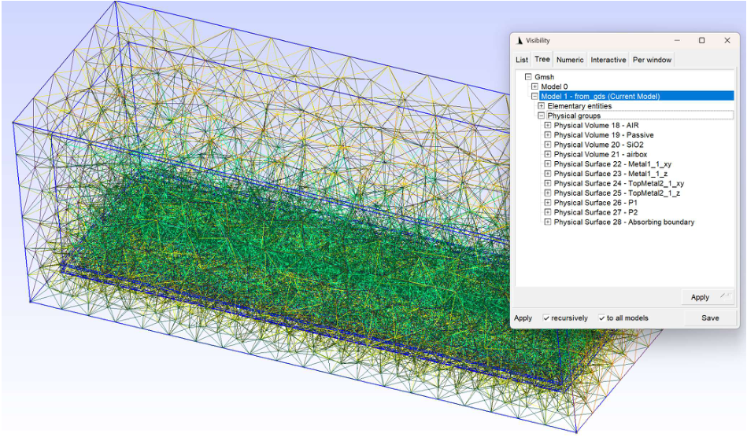


This is too complex to see anything, but we can now go to Tools > Visibility and select one or more groups to be displayed:  


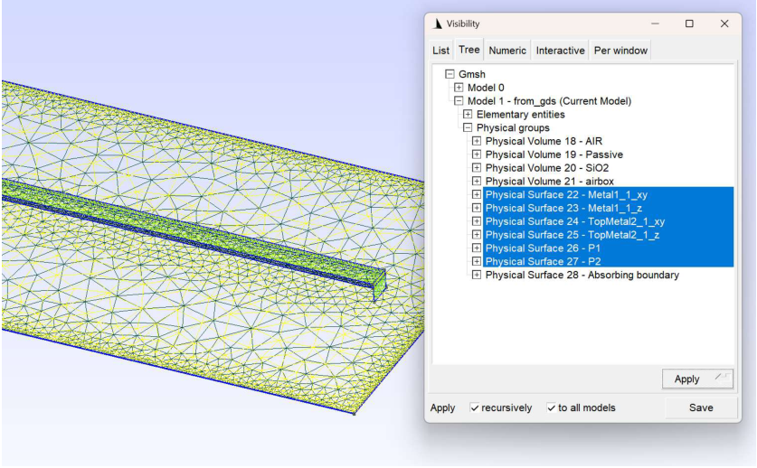


This shows the mesh at the conductor surfaces of Metal1, TopMetal1 and the vertical ports. We can also display the meshed oxide, which has a lot of detail because the metal layers reside inside this volume. The metals have been “cut out” from the dielectric layer, and we see the mesh refinement around the conductor edges.  


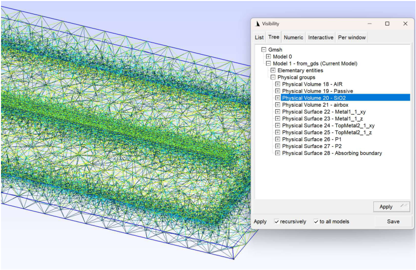

When you are done with inspection of the model (which is optional, no user action is required!), the gmsh viewer window can be closed to finish model generation. The workflow code has now created the required file to start Palace: the simulation control file config.json and the mesh file.  


```json
{
    "Problem": {
        "Type": "Driven",
        "Verbose": 3,
        "Output": "output/palace_line_viaport"
    },
    "Model": {
        "Mesh": "palace_line_viaport.msh",
        "L0": 1e-06,
        "Refinement": {}
    },
    "Solver": {
        "Driven": {
            "MinFreq": 0.1,
            "MaxFreq": 100.0,
            "FreqStep": 2.5,
            "SaveStep": 0,
            "AdaptiveTol": 0.01
        },
        "Linear": {
            "Type": "Default",
            "KSPType": "GMRES",
            "Tol": 1e-06,
            "MaxIts": 400,
            ...
```


### Running Palace FEM simulation from our input files 

To simplify running the solver, in addition to mesh file and config file, a script file was also created named *run_sim*.  


```bash
#!/bin/bash
run_palace config.json
combine_snp
```


This starts a script *run_palace* where you can define in detail how to run Palace. It is recommended that you place this run_palace script in your PATH, configured for the actual machine where you want to run Palace.  

For workflow development and test, Palace was installed into an apptainer container, as documented in the Palace documentation in chapter “**Build using Singularity/Apptainer**”.  

The script *run_palace* was then configured to start Palace inside the palace_014.sif container, which is located in the user’s home directory, and passes one command line argument (the config.json file). The additional parameter _-np 16_ tells palace to run using 16 threads. This will partition the simulation domain into 8 pieces, each running in a separate process, and the combine results into one output directory.  


```bash
#!/bin/bash
apptainer exec ~/palace_014.sif palace -np 16 $1
```


Running Palace is not very spectacular, the simulation progress is shown in the terminal window.  


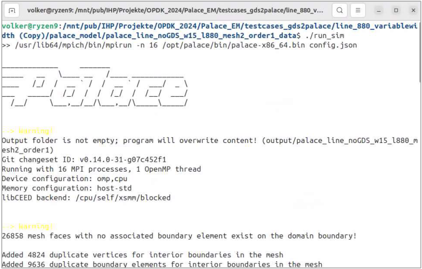


When *run_palace* is finished, Palace output files are created in the *output* directory below the simulation model directory. S-parameters are in *.csv file format, which we need to convert now.  


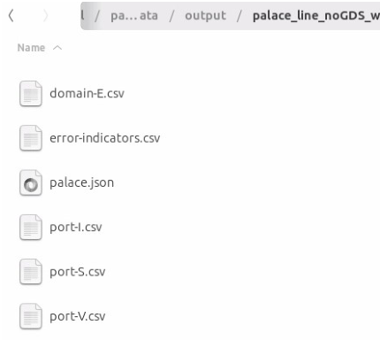


To do that conversion, the run_sim script where we started simulation with “run_palace” executes another command *combine_snp*.  

*combine_snp*  is a script that searches for Palace s-parameter files (port-S.csv) and converts them to Touchstone file format. If the model was simulated for selected port excitations only, missing rows in the S-parameter file will be padded with zeros. 

It should be noted that Palace frequency domain simulation cannot go down to 0 Hz, and the workflow script will replace any 0 Hz start frequency by a low value like 1 GHz. 

If simulation results include such low frequency data, combine_snp will create an additional S-Parameter file with suffix “_dc”, with a DC value extrapolated from the EM simulated data.[^combine-snp] Always check that DC extrapolated dataset carefully before use! 


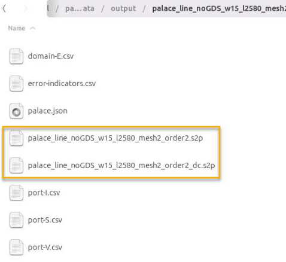


This ends our quick tour of using the gds2palace workflow. There are many additional settings available, which will be described in detail in the next chapters. 

[^combine-snp]: combine_snp is a Python script created for this workflow. DC extrapolation in this script is powered by Python library scikit-rf. 

## Simulation model file in detail 

### Input files 

Typical simulation models require two input files: GDSII geometries and XML stackup. 


```python
# ===================== input files and path settings =======================

gds_filename = "BM_Ardavan_Rahimian_with_ports.gds"   # geometries
XML_filename = "SG13G2_nosub.xml"          # stackup
```


Two settings are available to control processing of the GDSII geometries: 


```python
# preprocess GDSII for safe handling of cutouts/holes?
preprocess_gds = False

# merge via polygons with distance less than .. microns, set to 0 to disable via merging.
merge_polygon_size = 0
```


**preprocess_gds** is no longer needed: layouts with cutouts (holes) or other self-intersecting polygon boundaries are now handled automatically. If an older model script still sets it to True, the GDSII reader ignores it and prints a note. Earlier versions needed it, otherwise meshing of layouts with holes failed with errors like “Exception: Curve loop is not closed”. 

**merge_polygon_size** applies to layers which are declared as _Type=”via”_ in the XML stackup file. 

When enabled with a non-zero value, the code will merge polygons on these layers with the given distance. This is how it works: in the GDSII reader, polygons on this layer will be oversized by half the given value, then all overlapping polygons on that layer will be merged, then undersized by half the given value. 

For via arrays that are oriented along the xy-axis, this will give the resulting bounding box if the maximum via spacing is no larger than the given value. 

Merging turns the gaps between the vias into solid via material, so the merged polygon contains more via metal than the real via array. By default, it still gets the full via conductivity from the XML stackup, which overestimates the conductivity of the via array: in the IHP stackup files, via conductivity is calculated from the resistance per via in the process specification, so it describes a single via, not a via array. With settings['fill_factor_correction'] = True (see [settings](#settings)), the conductivity of each merged via polygon is multiplied by its fill factor (original via area / merged polygon area).  

This correction only knows about merging done here, by merge_polygon_size. If the via arrays were already merged before, e.g. with gds_prepare_for_EM, they arrive as solid polygons with fill factor 1.0, and their conductivity is not corrected.  

### settings ###

settings for meshing and simulation control are implemented as a Python dictionary, which is passed to the simulation_setup.create_palace function. Some settings are required, other are optional with a meaningful default value.  

These settings are always required:  

**settings['unit']:** Unit of values in mesh, typically 1E-6  
**settings['margin']:** Oversize of dielectrics from bounding box of drawing in xy plane  
**settings['fstart']:** Start frequency in Hz  
**settings['fstop']:** Stop frequency in Hz  
**settings['fstep']:** Frequency step in Hz for output, not all of them need to be EM simulated due to adaptive frequency sweep  
**settings['refined_cellsize']:** Target mesh size at polygon edges  

All other settings are optional, grouped here by what they control.  

#### Frequencies

Discrete frequencies can be used in addition to fstart/fstop and fstep, or instead of fstart/fstop and fstep:  

**settings['fpoint']:** Discrete frequency/frequencies, values enclosed in [ ]. Example: settings['fpoint']=[10e9, 15e9]  
**settings['fdump']:** Same as fpoint, but Palace is configured to write a field dump for Paraview at this frequency/these frequencies. Example: settings['fdump']=[10e9]  
**settings['adaptive_sweep']:** Enable adaptive frequency sweep, default is True  

#### Mesh size and accuracy

**settings['cells_per_wavelength']:** Calculated at highest frequency,value must be 10 or more, default is 10  
**settings['meshsize_max']:** Maximum mesh size limit, in addition to cells, default is 70  
**settings['refined_cellsize_override']:** Optional per-layer override of refined_cellsize,example: settings['refined_cellsize_override']=[['Metal3',10],['Metal2',2]]  
**settings['substrate_refinement']:** Extra mesh refinement into substrate, usually not required, default is False  
**settings['order']:** Order of basis function for FEM solver (order 2 is more accurate,order 1 is only for quick & dirty results). Default is 2  

#### Adaptive mesh refinement

**settings['adaptive_mesh_iterations']:** Iterations for adaptive mesh refinement, often not required when using fine initial mesh, default is 0  
**settings['adaptive_mesh_conformal']:** Use conformal AMR refinement instead of Palace's default nonconformal (hanging-node) refinement, default is False  
**settings['amr_tol']:** Target relative error for adaptive mesh refinement: refinement stops once the error estimate is below this value. Only used with adaptive_mesh_iterations > 0, default is 0.01  
**settings['amr_max_dof']:** Maximum number of unknowns for adaptive mesh refinement: refinement stops once the model reaches this size. Only used with adaptive_mesh_iterations > 0, default is 2e6  
**settings['save_adaptive_mesh']:** Save mesh file from adaptive iteration for possible re-use, default is False  

#### Linear solver (Palace)

**settings['complex_coarse_solve']:** Let Palace's sparse direct coarse solver factorize the full complex system, instead of only its real part (Palace's own default). **Default is True, for every model**, whether metals are meshed as surface impedance or filled. The real-part-only preconditioner ignores absorbing boundaries, port resistances and losses. Some models then need far more iterations or don't converge at all, and a frequency that doesn't converge gets **wrong S-parameters**, not just slightly inaccurate ones. Which models are affected can't be predicted from the settings: it happened at high frequency (a D-band grounded CPW line failed at 170 GHz) and at a single low frequency (an inductor failed at 2.4 GHz and gave 1.1 nH instead of 2.5 nH, while the same model converged at 0.1 and 10 GHz). With True, both converged in 1-31 iterations and ran 3.5-6x faster. Models that already converge without it get identical results, in about the same or less time. The cost is peak RAM, which depends on the model: 1.0-1.6x at order 2 and 1.5-1.9x at order 1 in our test cases. Set it to False only if a model doesn't fit into memory, and then check the Palace output for `did NOT converge`  
**settings['solver_maxits']:** Iteration limit of Palace's linear solver (GMRES) per frequency. If it is reached, Palace only logs "solver did NOT converge" and carries on, and the S-parameters at that frequency are unreliable. Default is 400  
**settings['solver_tol']:** Relative residual tolerance of Palace's linear solver. Default is 1e-6  

#### Simulation boundary

**settings['boundary']:** List with 6 values for boundary at xmin,xmax,ymin,ymax,zmin,zmax. Values can be ABC/PML, PEC or PMC. Default: ['ABC','ABC','ABC','ABC','ABC','ABC']  
**settings['air_around']:** Other spacing of air around dielectrics, default is same as margin. Can be a single value or a list of 6 values [air_xmin, air_xmax, air_ymin, air_ymax, air_zmin, air_zmax]. A value of 0 is allowed on any side, placing the simulation boundary flush with the dielectric/metal stack on that side (e.g. a backside ground plane serving directly as the PEC/ABC boundary, with no wasted air layer below it).  

#### Conductor modelling

**settings['conductor_model']:** The conductor model. Errors, run times and what they mean for typical designs: see "Choosing the conductor model" in chapter "Conductor loss modelling". Default is 'surface'

- `'surface'`: a surface impedance on all conductor faces, the conductors are hollow. The fastest model, and accurate for inductance, coupling, resonances, match and balance. Its loss is less accurate: the peak Q of coils on TopMetal1/TopMetal2 with 2-8 µm traces is 18-30 % too high, and thin layers with current on one face get up to twice their loss.
- `'solve_inside'`: the conductors are meshed as volumes with their bulk conductivity. This gives the right loss at low frequency, where the skin depth is not small compared to the conductor cross section. At high frequency, the loss is a few percent too high at a 2 µm mesh. Use it for Q and loss while designing. Needs more RAM and simulation time than the surface model.
- `'solve_inside_skin'`: like `'solve_inside'`, plus thin layers along all faces of each conductor (top, bottom and side walls). The mesh then has thin cells next to the conductor surface, where the skin effect puts the current, while the cell size along the surface stays at `refined_cellsize`. Use it for final numbers of Q and loss.

There is nothing to set for the skin layers. Their depths are about 0.4 and 1 skin depth at the highest simulation frequency (the largest of `fstop`, `fpoint`, `fdump`), from each layer's conductivity. A depth is only used if a core of at least 1/3 of the layer thickness remains; the model script prints the depths used per layer. Some layers get no skin layers:

- Vias, sheet layers and PEC layers.
- Layers thinner than 4 skin depths at the highest frequency. In SG13G2, these are Metal1-Metal5 below about 1 THz, TopMetal1 below about 35 GHz and TopMetal2 below about 15 GHz. They gain little, while their very thin skin layers cost much solver effort. For the 0.42 µm Metal1 ground plane of `palace_line_viaport.py`, skin layers changed the line resistance by about 1 % and made the simulation 2.6 times slower. In the D-band balun of the mesh convergence studies, skin layers in Metal3-Metal5 left the result unchanged and made it 1.7 times slower.
- Layers with a conductivity above 1e8 S/m. No real metal conducts better than silver (6.3e7 S/m), so such a material stands in for a perfect conductor, e.g. `LOWLOSS` (1e10 S/m) for SUBGND in older stackups, and its skin layers would be a few nanometres thin.

So in a low GHz simulation, `'solve_inside_skin'` builds the same model as `'solve_inside'`. Skin layers were tested on TopMetal2 inductors and lines up to 150 GHz with `refined_cellsize` 2, see chapter "Conductor loss modelling". Elmer thermal models always use solid conductor volumes, whatever this setting is.

Scripts from gds2palace before 0.9.0 use **settings['filled_metals']** instead. It still works: `True` is the same as `'solve_inside'`, `False` the same as `'surface'`, and the model script prints a note. If both settings are given with different meanings, the script stops with an error.

**settings['fill_factor_correction']:** Only has an effect with merge_polygon_size > 0. Via array merging fills the gaps between vias with via material, so each merged via polygon is scaled down to its real via conductivity: its conductivity is multiplied by its fill factor (original via area / merged polygon area). Merged vias on the same layer are grouped into separate materials, starting a new group when the fill factor is more than 20% below the group's highest value, and each group uses its mean fill factor. Vias with the reserved PEC material are grouped but not scaled. Applies to Palace and Elmer EM (electrical conductivity) and to Elmer thermal (heat conductivity, including temperature table values). Default is False  

#### Script control and output files

**settings['no_gui']:** Run script without showing gmsh user interface, useful for automated processing, default is False  
**settings['no_preview']:** don't show unmeshed geometry, immediately show meshed model, default is False  
**settings['preview_only']:** Only show the unmeshed geometry in gmsh, then stop without generating a mesh, default is False  
**settings['save_gmsh_unrolled']:** Also save gmsh geometry file without meshing, for later inspection, default is False  
**settings['config_suffix']:** Text appended to the names of the generated config.json and port_information.json files, e.g. '_fine' gives config_fine.json, default is '' (no suffix)  

#### Model data set by the script

The model script also passes the stackup and layout data in the settings dictionary. These are not options: the script sets them after reading the XML stackup and the GDSII file.  

**settings['materials_list'], settings['dielectrics_list'], settings['metals_list']:** Stackup data, as returned by stackup_reader.read_substrate()  
**settings['allpolygons']:** Layout polygons, as returned by gds_reader.read_gds()  
**settings['simulation_ports']:** Port definitions, created with simulation_setup.all_simulation_ports()  
**settings['sim_path']:** Output directory for the generated model files  
**settings['model_basename']:** Base name of the generated model files, e.g. the mesh file model_basename.msh  

### Port configuration ###

Similar to the IHP openEMS workflow, **ports are created based on polygons from the GDSII file** , located on special layers that are not part of the IHP layer table. Each port needs to use a different source layer in the GDSII file.  

The port mapping defines the port number and port impedance, and then maps the port geometry from the special GDSII input layer (usually 201 and above) to actual IHP technology layers. For the vertical ports shown here, we have from_layername and to_layername. For in-plane ports, we would have target_layername instead. Finally, the port direction is required to specify vertical ports or in-plane ports and their direction/polarity.  


```python
simulation_ports = simulation_setup.all_simulation_ports()
# instead of in-plane port specified with target_layername,
# we here use via port specified with from_layername and to_layername
simulation_ports.add_port(simulation_setup.simulation_port(
    portnumber=1, voltage=1, port_Z0=50, source_layernum=201,
    from_layername='Metal1', to_layername='TopMetal2', direction='z'))
simulation_ports.add_port(simulation_setup.simulation_port(
    portnumber=2, voltage=1, port_Z0=50, source_layernum=202,
    from_layername='Metal1', to_layername='TopMetal2', direction='z'))
```


For this Palace workflow, the voltage parameter is not supported yet by the Palace solver. Palace only supports opposite polarity by reversing the port direction. **But here in our workflow, we use this voltage parameter to specify if a port is active: ports with voltage=0 will not be excited.**  

It must be noted that Palace behaves differently from other FEM solvers: to get the full S- matrix, we need to run all port excitations, one after another. This only happens if all port voltages are not zero. Only then, the full S-parameter output file can be created.  

**ATTENTION** : If any port excitation is zero, that “zero voltage” port will not be excited and that row in the S-parameter file will be padded with zeros. For example, if we simulate an 8-port circuit and only excite port 1, the S-parameter output will have valid results for S11, S21, … S81 but all other values will be zero. This can be useful to quickly simulate one specific path in the model.  

To get the full S-parameter file, all ports must be defined with non-zero voltage, so that all port excitations are simulated, one after another.  

**PORT SHAPE IN GDSII** : The workflow creates lumped ports in Palace, which need to be 2D sheets. This means that for vertical ports (via ports), you should draw a zero-width box in GDSII, resulting in a vertical 2D sheet with no width. If you define a vertical port from a box with finite xy area, the Palace port will be created as a vertical 2D sheet along the left edge (xmin) of that box if it is taller than wide, else along its bottom edge (ymin), not along its center line.  

**Composite ports** (multiple EM ports grouped into one port in the final output file) are not yet supported by this workflow. All ports with non-zero voltage are simulated one after another, resulting in n-port S-parameters.  

**Port parasitics in results, lumped port vs. wave port:** This workflow creates lumped ports, which introduce some physical length into the simulation model, leading to extra path length (? inductance) in results. Other 3D volume meshing EM tools behave the same for lumped ports. If port size is not small compared to the device under test, one possible solution is to estimate these parasitics and remove them in postprocessing (or result use) by cascading negative inductance or negative length at each port.  

### Filenames and flow control ###

If you want to have additional control over the names of files and directories that are created by the workflow, have a look at this section at the beginning of the simulation model file: 


```python
# get path for this simulation file
script_path = utilities.get_script_path(__file__)

# use script filename as model basename
model_basename = utilities.get_basename(__file__)

# set and create directory for simulation output
sim_path = utilities.create_sim_path (script_path,model_basename)
print('Simulation data directory: ', sim_path)

# change path to models script path
modelDir = os.path.dirname(os.path.abspath(__file__))
os.chdir(modelDir)
```


For example, if you want the customize the model name, to reflect settings used for meshing, you can define these values as variables and append that to the model_basename variable. 


```python
mesh  = 5  # define here, so that we can add this information to output filenames
order = 3  # define here, so that we can add this information to output filenames

XML_filename = "SG13G2_nosub.xml"          # stackup

# preprocess GDSII for safe handling of cutouts/holes?
preprocess_gds = False

# merge via polygons with distance less than .. microns, set to 0 to disable via merging.
merge_polygon_size = 0

# get path for this simulation file
script_path = utilities.get_script_path(__file__)

# use script filename as model basename, with parameters for suffix
model_basename = utilities.get_basename(__file__) + '_mesh' + str(mesh) + '_order' + str(order)

# set and create directory for simulation output
sim_path = utilities.create_sim_path (script_path,model_basename)
print('Simulation data directory: ', sim_path)

# change path to models script path
modelDir = os.path.dirname(os.path.abspath(__file__))
os.chdir(modelDir)

# ======================== simulation settings ================================

settings = {}

settings['unit']   = 1e-6  # geometry is in microns
settings['margin'] = 50    # distance in microns from GDSII geometry boundary to simulation boundary

settings['fstart']  = 0e9
settings['fstop']   = 100e9
settings['fstep']   = 2.5e9

settings['refined_cellsize'] = mesh  # mesh cell size in conductor region
settings['cells_per_wavelength'] = 10   # how many mesh cells per wavelength, must be 10 or more

settings['meshsize_max'] = 70  # microns, override cells_per_wavelength
settings['adaptive_mesh_iterations'] = 0
settings['order'] = order
```


If you want the script to create the Palace files without showing the mesh in gmsh 3D viewer, this is also possible. 

You can use the optional **settings['no_gui']** and either set this to _True_ (always run without graphical user interface) or you can check for an optional command line parameter passed to the simulation model script. 


```python
settings['no_gui'] = ('nogui' in sys.argv)  # check if nogui specified on command line
```


In this case, running the model as 

```
python mymodel.py
```

would run with 3D mesh viewer, or running the model as 

```
python mymodel.py nogui
```

would run without the 3D viewer. Maybe this gives some idea what customization is possible. 

## Examples 

This chapter gives examples on configuration settings, especially mesh control, and their results. 

### Single microstrip line 

The first testcase for meshing is a microstrip line with TopMetal2 over Metal1 ground. Width is 15 µm to achieve 50 Ohm line impedance, length is 880µm.  
This model is simulated with mesh configurations that vary 2 mesh parameters:  
- **'refined_cellsize'** defines the mesh resolution along the conductor edges 
- **'order** ' defines the order of basis functions, i.e. the degrees of freedom for field variation within one cell 

By default, we want to simulate with an order=2, which is a good trade-off between accuracy and speed. However, in this simple example, we will check how these two values can be configured for accurate results, and what this does to simulation time. 

**The basic idea is this:** if we have a higher order of basis functions, the fields can be modelled more accurately within each mesh cell, so we need less mesh cells ? larger value of refined_cellsize. 

If we use first order basis functions, we need higher mesh density to accurately model the field distribution.  
Mesh on conductors at **'refined_cellsize'** = 5: 


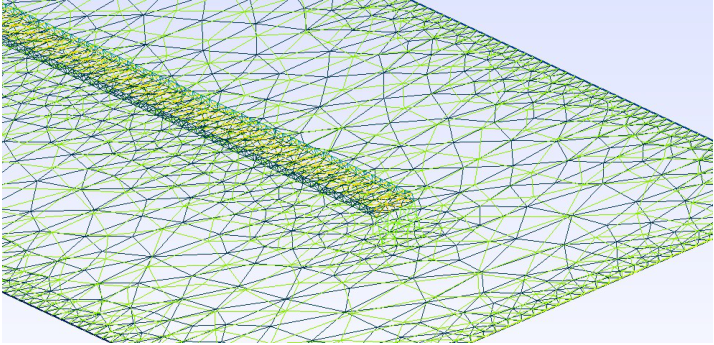


Mesh on conductors at **'refined_cellsize'** = 2:  


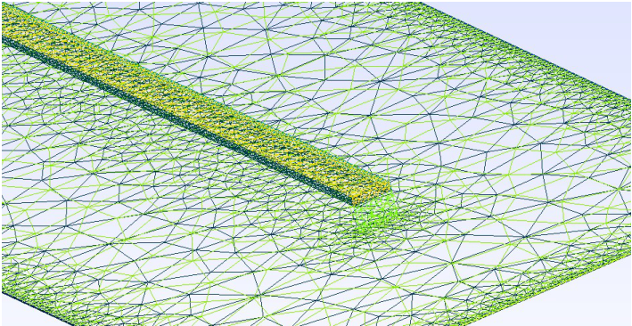


These two mesh densities are now simulated with different order of basis function.  


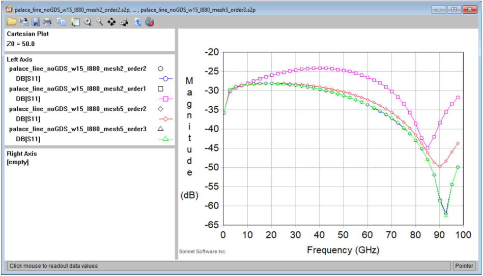


The clear outlier in this return loss plot is the pink curve, simulated with mesh order = 1 at 2µm refined cellsize. This result is different from the other curves obtained with higher mesh order. Our default simulation would be the blue curve, obtained with refined_cellsize = 2µm and order = 2.  
Going to a larger value of refined_cellsize = 5µm (less mesh density at the edges) at order = 2 gives slightly different results, shown by the red curve.  

If we combine the larger refined_cellsize = 5µm with higher order = 3, to give each cell more degrees of freedom, we get similar results as our baseline (default) simulation: the green and blue curve are visually identical for S11. For S21 transmission, we get a similar result: these two are almost identical.  


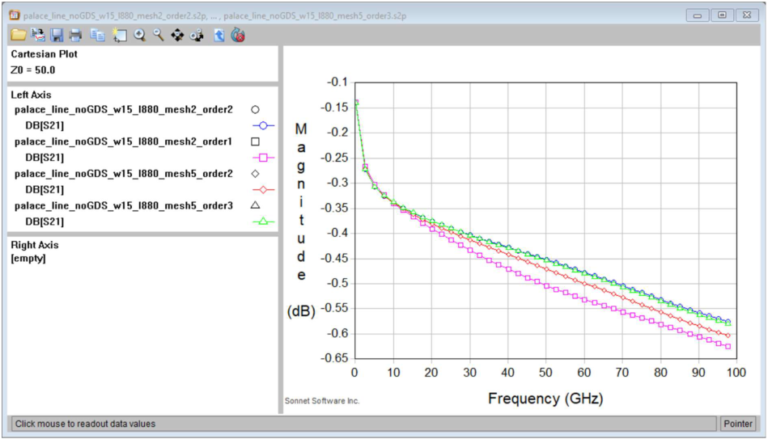


For phase of S21 we also have similar results: the order = 1 result is a clear outlier, but all other results are very close.  


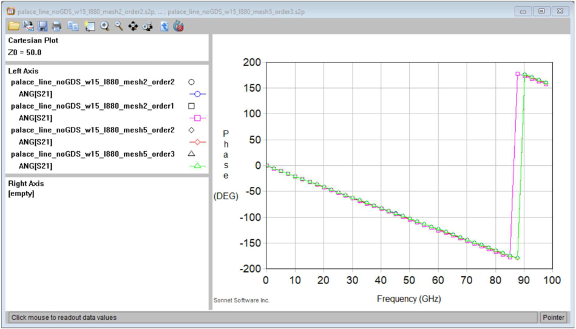


Conclusion: refined_cellsize=2 at order=2 is a good starting point, and for this example we don’t need to go any further. Decreasing the mesh resolution to refined_cellsize=5 at order=2 is possible if we can accept some small change in results.  Let’s look at simulation times for these 4 different meshing approaches:  

**Simulation time total, Degrees of freedom (from log)**  
refined_cellsize=2, order=2: 733s, DOF 1640126  
refined_cellsize=2, order=1: 64s, DOF 321999  
refined_cellsize=5, order=2: 282s, DOF 699658  
refined_cellsize=5, order=3: 1967s, DOF 1982661  


All simulations were done using adaptive frequency sweep and required 10 discrete frequencies to be EM simulated. Total time in the table also includes interpolation to the specified sweep range.  It can be seen that refined_cellsize=2, order=2 is the best choice for accurate data, we get results that are visually identical to refined_cellsize=5, order=3 at less simulation time (733 s total vs. 1967 s total).  

In the next chapter, we will go from that baseline setting, and investigate the use of adaptive mesh refinement.  

### Balun 140-170 GHz 

This testcase is a balun from the phase shifter project by Rupok Das, published for the OPDK July 2025 tapeout:  

- <https://github.com/IHP-GmbH/TO_July2025/tree/main/FMD_QNC_D_Band_Phase_Shifter> 


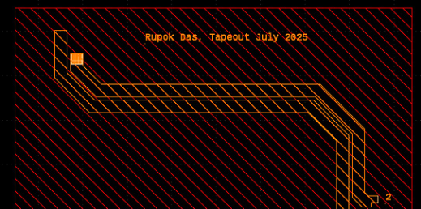


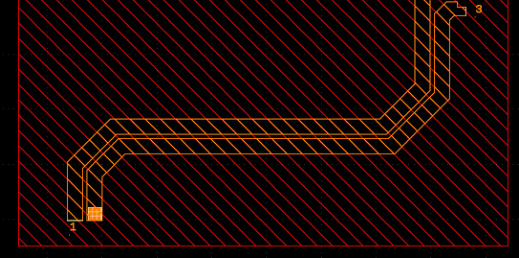


Line width is 7µm with TopMetal2 over Metal3 ground, gap width is 2µm. 


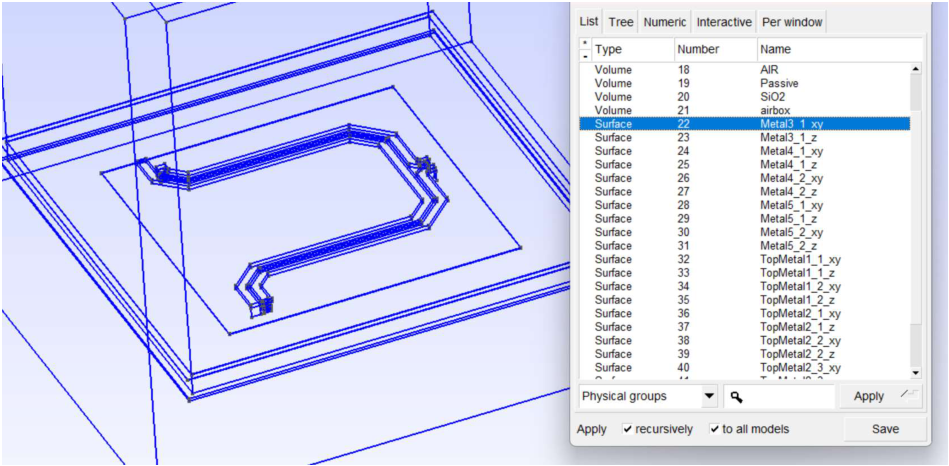


The critical dimension in this design is the 2µm wide gap between the coupler traces, the solver needs to model the field distribution in that gap with sufficient accuracy. 


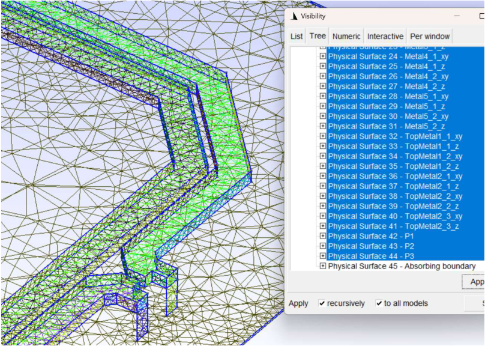


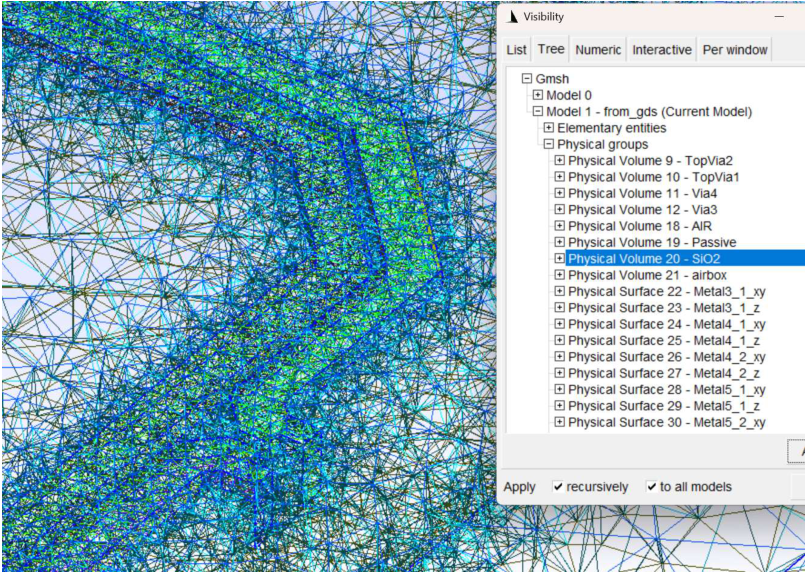


We will first look at results from refined_cellsize=5 and refined_cellsize=2, both with order=2, over the frequency band 100 to 200 GHz, with all 3 port excitations simulated for full S- parameter data. 


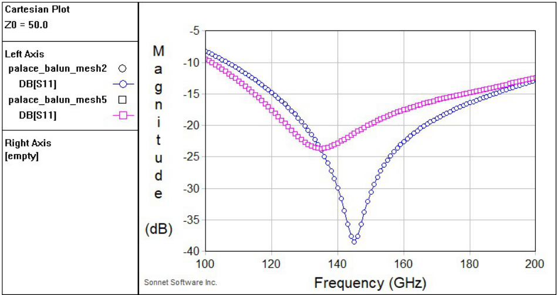


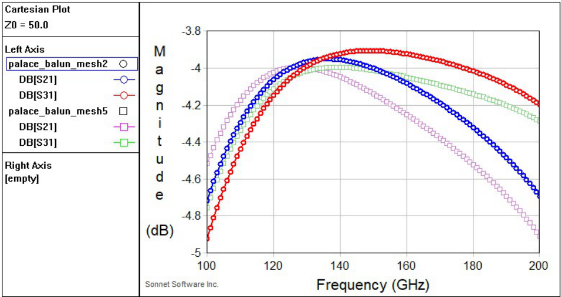


There is quite a difference in S11 and S21,S31 results, and we can assume that the finer mesh gives more accurate results … but how far are we off from convergence? We could now simulate with an ever smaller refined_meshsize = 1, or we can use adaptive mesh refinement now. This will run the simulation starting with an initial mesh size, and then refine the mesh in the most relevant regions.  

By default, adaptive mesh refinement in Palace uses data from all simulation frequencies and all port excitations, which means a significant increase in overall simulation time because a full simulation is used during mesh refinement. The excerpt below shows settings from the Palace configuration file for an adaptive sweep with maximum of 2 adaptive mesh refinements, with up to 2 million degrees of freedom.  


```json
"Model": {
    "Mesh": "palace_balun_mesh5_AMR.msh",
    "L0": 1e-06,
    "Refinement": {
        "UniformLevels": 0,
        "Tol": 0.01,
        "MaxIts": 2,
        "MaxSize": 2000000.0,
        "Nonconformal": true,
        "UpdateFraction": 0.7,
        "SaveAdaptMesh": false
    }
},
"Solver": {
    "Driven": {
        "MinFreq": 100.0,
        "MaxFreq": 200.0,
        "FreqStep": 1.0,
        "SaveStep": 0,
        "AdaptiveTol": 0.01
    },
```


Note for experts: We could decide to create an adaptive mesh refinement at one target frequency, or a few selected target frequencies, and then store that refined mesh for the final full frequency sweep. This is the approach chosen by many commercial FEM solvers, where the user needs to decide what frequencies are used for AMR.  

However, that is not implemented in this gds2gmsh workflow. The present implementation of adaptive mesh refinement in gds2gmsh workflow does each refinement step at all frequencies and for all port excitations, to provide a safe and reliable mesh refinement. In this case, the refined mesh exists in memory only and is not stored to disk.  

Below is the result from an adaptive mesh refinement with 2 refinement steps, based on an initial mesh with refined_cellsize=5. This result is very close to the results obtained with a (fixed) mesh created from refined_cellsize=2, so both models come to similar results from different (initial) mesh.  


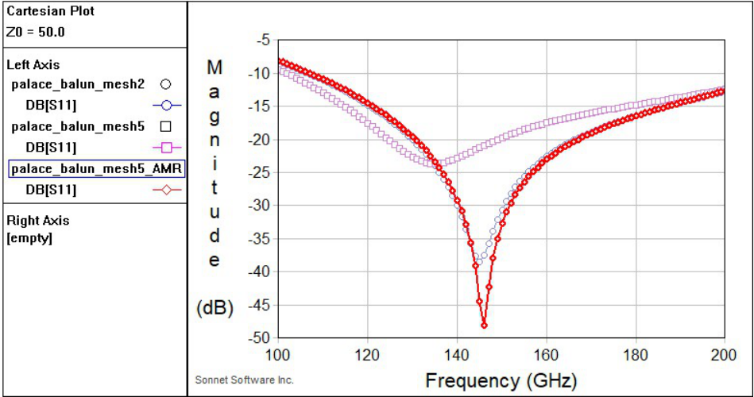


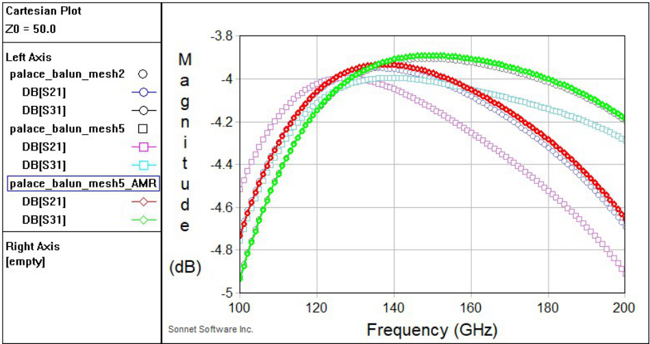


Here is the overview of simulation times and mesh size for full sweep over all 3 port excitations: 

**Simulation time total, Degrees of freedom (from log)**  
refined_cellsize=2: 580s (13 freq), DOF 836878  
refined_cellsize=5: 218s (13 freq), DOF 353056  
refined_cellsize=5 + AMR 2x: 1132s (13 freq), DOF 353056, 402138,710236   

We could now spend more time to double check result with an adaptive mesh refinement starting from an initial mesh that is even finer, and to save time, that could be done at one or few frequencies only. Below is the result for 3 selected frequencies with 2 mesh refinements starting from 2µm:  


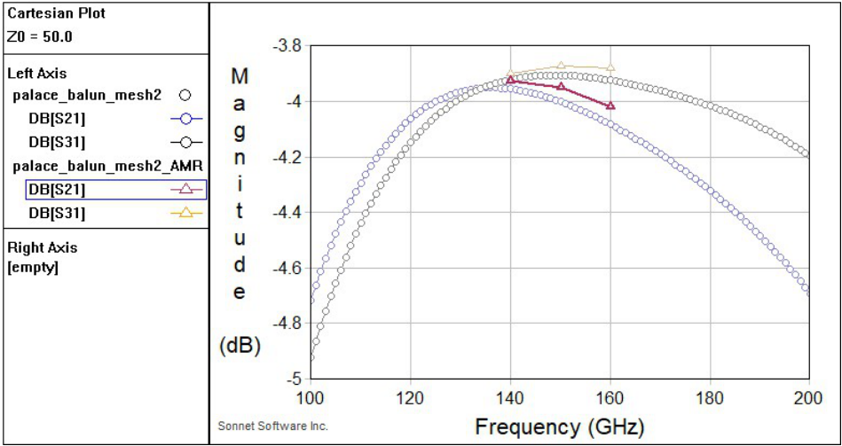


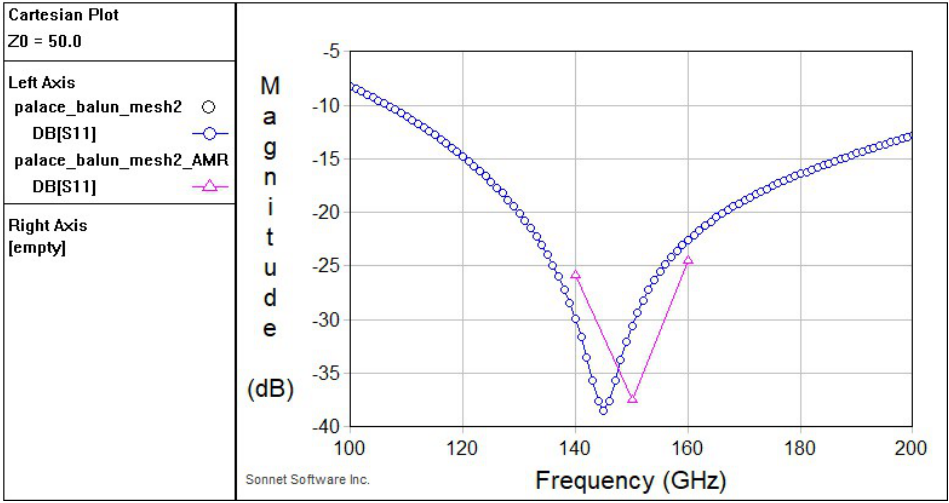


This gives an idea where a converged result would be located in frequency, at approximately 150 GHz resonance instead of 145 GHz calculated with coarser mesh. Here is the overview of simulation times and mesh size for 3 frequencies (not full sweep!) over all 3 port excitations: 

**Simulation time total, Degrees of freedom (from log)**  
refined_cellsize=2 + AMR 2x: 1346s (3 freq), DOF 804166, 961866, 1742956  


## Conductor loss modelling 

Many RF FEM solvers, including this gds2palace workflow, model metals as hollow bodies with surface resistance on the side walls. The advantage of this approach is that we don’t need to mesh into skin effect, which might require sub-micron mesh size inside the conductors.  


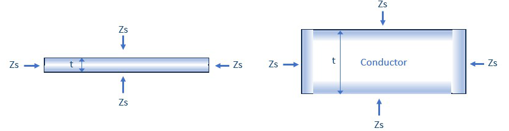


The surface impedance can be calculated easily when physical metal dimensions are much larger than skin depth. However, at low frequency and in the transition between skin effect regime and low frequency, we also need to consider conductor dimensions.  

### Limits of conductor loss calculation 

The gds2palace workflow creates surface elements for planar metals, and defines them as a conductor sheet with conductivity and thickness in the Palace config.json file. Thickness in this case is the value defined for that metal in the XML stackup file, e.g. 3µm thickness for TopMetal2.  

The code in Palace does not know anything about the aspect ratio of the conductor, and uses a surface impedance calculation that is accurate for wide sheets, where we have a conductor that is much wider than the conductor height. Summing up the surface impedance mapped to top and bottom side of a thin sheet, the resulting impedance would be accurate down to DC where it is limited by physical conductor cross section.  

However, in our RFIC use case, we might have conductor aspect ratio that reaches almost square shape, and we need to account for side wall currents, not only for closely spaced coupled lines.  

Mapping the surface impedance (as calculated internally by Palace from conductor thickness) onto all surfaces, i.e. side walls as well as top and bottom, will lead to an overestimate of available conductor cross section at low frequency:  

The Palace calculation [^palace-zs] of Zs is exact when applied to top and bottom side only. If we apply this value to all sides, the extreme case at DC will over-estimate the conductor cross section by factor (width+thickness)/width.  


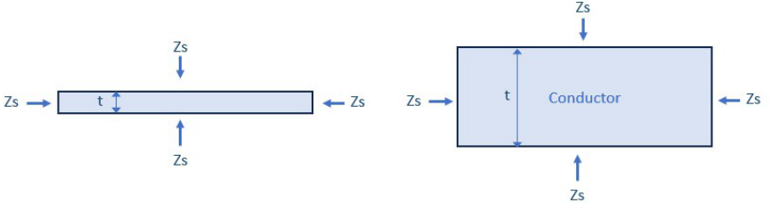


[^palace-zs]: <https://github.com/awslabs/palace/blob/main/palace/models/surfaceconductivityoperator.cpp> 

The volume models of `settings['conductor_model']` (`'solve_inside'`, `'solve_inside_skin'`) do not have this error, see "Choosing the conductor model" below.

### Accuracy at high frequency

At high frequency, the current flows in a thin layer at the surface of a conductor. This is the skin effect. In TopMetal2, the skin depth is about 0.9 µm at 10 GHz and 0.3 µm at 100 GHz, much less than the 3 µm metal thickness. The three conductor models of `settings['conductor_model']` handle the skin effect in different ways, and each has its own error. This section explains these errors, so that you can choose the right model for your design.

#### Surface impedance (`'surface'`, the default)

The surface model does not mesh the inside of a conductor. Instead, each face gets a surface impedance that describes the skin effect. This impedance is exact for a wide, flat sheet. Real conductors are not wide sheets, and this causes two errors.

**Too little loss in thick conductors.** At the edges and corners of a trace, the current crowds into the corners. A surface impedance per face cannot describe this. So the loss of TopMetal1 and TopMetal2 traces is too low, not only at low frequency (see "Limits of conductor loss calculation"), but also at mm-wave frequencies. For TopMetal2 lines, the resistance is still about 10-20 % too low at 50-150 GHz. For coils with 2-8 µm traces on the top metals, the peak Q is about 20-30 % too high, and below the peak even more. Coils with wider traces were not tested. Their error is probably smaller, because the side walls and edges carry a smaller part of the current.

**Too much loss in thin layers with current on one face.** A ground plane under a line carries its current only on the face toward the line. The same is true for the plates of a MIM capacitor. The surface model assumes that both faces of a conductor share the current. The face that carries all the current then gets twice the real sheet resistance. This matters for layers thinner than about two skin depths: in SG13G2, Metal1-Metal5 and the MIM plates up to 150 GHz. The loss of such a layer can double. For the line example `palace_line_viaport.py` below, the line resistance is 20-40 % too high, and the 880 µm line shows up to 0.08 dB too much insertion loss. The subsection "Palace's External option" explains the details.

The two errors have opposite signs. On a given structure, they can add up or cancel. So a surface model result does not tell you whether the loss is too high or too low.

#### Conductors meshed as volumes (`'solve_inside'`)

With `'solve_inside'`, gds2palace meshes the conductors as volumes with their bulk conductivity. The solver then computes the current inside the metal, including the current crowding at edges and corners. At low frequency, this model is exact.

At high frequency, the mesh must resolve the skin effect. What matters is the cell size normal to the conductor surface. With a 2 µm mesh, the 3 µm thick TopMetal2 gets about two cells through its thickness. The second order elements follow the current decay into the metal quite well, but they leave some current too deep in the metal. The loss is then a few percent too high, up to about 10 % at 100 GHz. A finer mesh reduces this error. But it also refines the mesh along the whole conductor surface, which makes the model much larger.

#### Volumes with skin layers (`'solve_inside_skin'`)

`'solve_inside_skin'` adds thin layers along all faces of the conductors. The mesh cells in these layers are thin normal to the surface, where the current changes fast. Along the surface, they keep the normal cell size. This is the same idea as a skin depth based mesh operation in HFSS.

The depths of the skin layers follow from the skin depth at the highest simulation frequency. You don't need to set them. Thin layers like Metal1-Metal5 get no skin layers: they would gain little, but their very thin skin layers would cost much solver time.

For a single-turn TopMetal2 inductor up to 100 GHz, skin layers with a 2 µm mesh came within about 1 % of a fully converged model, in a ninth of its run time. Without skin layers, the 2 µm mesh gave a Q about 8 % too low. The surface model gave a Q about 22 % too high.

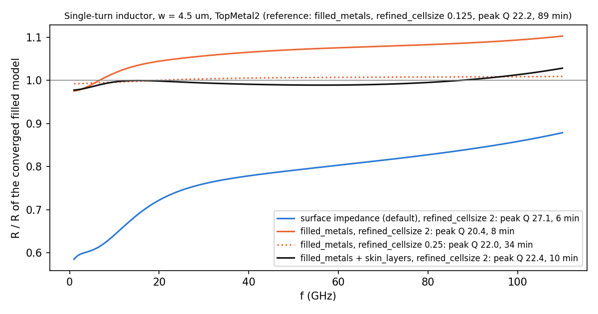

The line example `palace_line_viaport.py` is a 15 µm wide TopMetal2 line over a Metal1 ground plane. Its line resistance, from two line lengths, is compared here with a 2D calculation. With skin layers, the model is within a few percent of the 2D result up to 100 GHz. The surface model is 20-40 % too high, because of the thin Metal1 ground plane.

In S21, the 880 µm example line has an insertion loss of 0.1-0.5 dB between 1 and 100 GHz. Compared with the most accurate run, the surface model adds up to 0.08 dB to that, and `'solve_inside'` up to 0.03 dB. With skin layers, the difference is below 0.01 dB.

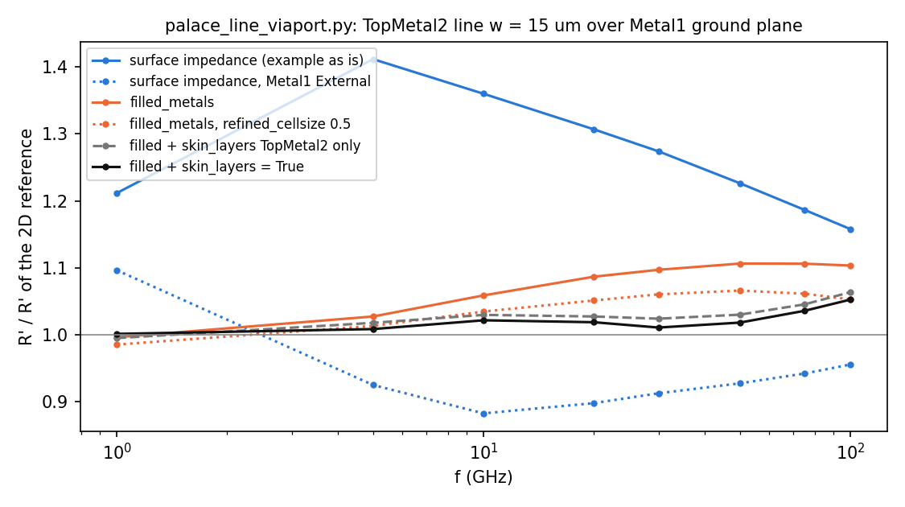

#### Choosing the conductor model

For most designs, the choice is simple:

| purpose | `settings['conductor_model']` |
|---|---|
| resonance frequencies, inductance, coupling, match and balance | `'surface'`, the fastest |
| Q and insertion loss during design | `'solve_inside'`, a few percent pessimistic at a 2 µm mesh |
| Q and insertion loss, final numbers | `'solve_inside_skin'` |

The table below sums up the three models. The errors are for a 2 µm mesh, compared with `'solve_inside_skin'` at 1 µm. They come from step 4 of the mesh convergence studies in `more_examples/mesh_convergence`, with five SG13G2 structures. The run times are for the coils and baluns, from the conductor model study in `more_examples/conductor_models`, which ran all models on one machine, one run at a time. On straight lines, the volume models cost less: 1.0-1.1x and 1.4-2.0x.

| | `'surface'` (default) | `'solve_inside'` | `'solve_inside_skin'` |
|---|---|---|---|
| Model | surface impedance on all conductor faces | conductors meshed as volumes | volumes with thin layers along the faces for the skin effect |
| In HFSS | impedance boundary (Solve Inside off) | Solve Inside | Solve Inside with a skin depth based mesh operation |
| Before gds2palace 0.9.0 | `filled_metals = False` | `filled_metals = True` | not available |
| Peak Q of coils on TopMetal1/2 | 18-30 % too high | 4-8 % too low | 2-3 % too low |
| Insertion loss (baluns) | 0.02-0.14 dB too low | 0.03-0.15 dB too high | up to 0.05 dB too high |
| Unknowns at the same mesh | 1x | about 1.2x | 1.75-2.5x |
| Run time at the same mesh | 1x | 1.25-1.7x | 1.5-3.5x |

The Q errors are for the peak Q of coils with 2-8 µm traces. Below the peak, the surface model is even more optimistic: 24-37 % at half the peak frequency. Coils with wider traces were not tested. Their error is probably smaller, because the side walls and edges carry a smaller part of the current.

What the errors mean for typical designs, with the same mesh and reference. For the line, the line resistance R' is compared with the 2D calculation, and the attenuation in dB/mm with the most accurate run (skin layers also in the Metal1 ground plane).

| Design | Figure of merit | `surface` | `solve_inside` | `solve_inside_skin` |
|---|---|---|---|---|
| LC VCO tank, coil on TopMetal1/TopMetal2 with 2-8 µm traces | coil Q at its peak; phase noise ~ 1/Q² where the coil sets the tank Q | Q +18…+30 %: phase noise 1.4-2.3 dB too optimistic | Q -4…-8 %: phase noise 0.35-0.7 dB pessimistic | Q -2…-3 % |
| LNA input match, baluns, matching networks | insertion loss, adds 1:1 to the noise figure of an LNA | 0.02-0.14 dB too optimistic | 0.03-0.15 dB pessimistic | up to 0.05 dB pessimistic |
| MIM capacitor in a tank or matching network | series resistance, capacitor Q | series R about 2x (`palace_rfcmim.py`, 10 MHz: 1.88 instead of 0.87 Ω), capacitor Q about half | right | right |
| TopMetal2 line over a Metal1 ground plane (`palace_line_viaport.py`) | attenuation (dB/mm), line resistance R' | up to 0.09 dB/mm too lossy (+9…+39 %); R' +21…+41 % | up to 0.03 dB/mm too lossy (+8 %); R' up to +11 % | within 0.01 dB/mm (+1 %); R' -0.5…+6.4 % |
| any structure | inductance, coupling, SRF, match, amplitude and phase balance | all three models within about 1 % of each other | | |

Some notes on these numbers:

- **Loss errors in dB hide the relative error.** 0.05 dB on a balun with 1.2 dB insertion loss is 4 % of its loss. At a PA output, 0.1 dB is 2.3 % of the output power.
- **The reference is a converged simulation, not a measurement.** Compared with a measurement, the stackup matters as much as the conductor model. In the L6n2 inductor study (`more_examples/measured_vs_simulated/more_accurate_models_L6n2_v3`), a volume model with the planar stackup had a Q 8 % below the measured one. With the conformal passivation over TopMetal2, it came within 3-5 % in Q and within 2 % in SRF.
- **Sweeping far beyond your band is fine.** The skin layers are sized for the highest frequency. On a 30 GHz transformer, skin layers sized for 200 GHz changed Q by only 1 %.
- **Skin layers don't replace a fine enough mesh.** The cell size must not exceed the smallest gap or trace width, for every conductor model. With traces 2 µm apart, `'solve_inside_skin'` at a 4-5 µm mesh was worse than `'solve_inside'` at 2 µm.

#### Palace's External option

This subsection explains why the surface model doubles the loss of thin layers with current on one face.

Palace's `Conductivity` boundary uses the surface impedance Zs = (γ/σ)·coth(γh/2) for a conductor of thickness h. At DC, this is 2/(σh), twice the sheet resistance of the layer. This is meant for a conductor with two faces in the mesh. A thin sheet inside the model is an example: Palace splits it into two faces, each face gets this Zs, and the two faces in parallel give the right sheet resistance 1/(σh).

The option `"External": true` doubles h. Then Zs tends to 1/(σh), the full sheet resistance on one face. This is meant for a conductor with only one face in the mesh, such as a metal wall that forms the outer boundary of the model.

gds2palace models each conductor as a hollow body with all its faces in the mesh, and does not set `External`. This is exact when both faces carry the same current, for example a Metal1 line at low frequency. It makes no difference for conductors much thicker than the skin depth: with or without `External`, Zs is then nearly the same. For a ground plane with current on one face, it doubles the loss.

Setting `External` by hand on a ground plane would fix that case. But it would halve the loss of conductors that carry current on both faces, and gds2palace puts all faces of a conductor in one group. So no setting of the surface model is right for all conductors. Meshing the thin layers as volumes is the better fix: a thin layer is only one or two cells thick, so this costs little, and the current in it is then right. The volume models `'solve_inside'` and `'solve_inside_skin'` do this.

## Dielectric loss modelling 

The 15 µm wide TopMetal2 line over a Metal1 ground plane (`palace_line_viaport.py`) was measured with lengths of 880 µm and 2580 µm. The line was de-embedded from the measurement with GSG pads, so part of the ripple in the measured data can come from this de-embedding. The Palace models leave out the silicon substrate, which is shielded by the Metal1 ground plane (with and without substrate, the difference was negligible), and use the surface impedance model, which overestimates the loss of the Metal1 ground plane (see "Accuracy at high frequency" in chapter "Conductor loss modelling"). An openEMS simulation of the 880 µm line with a 0.5 µm mesh gave about the same insertion loss as Palace.  

Up to about 40 GHz, simulated and measured insertion loss agree; above, the measured loss increases faster with frequency than the simulated one. This could indicate higher **dielectric loss** than modelled. In the supplied XML stackup files, SiO2 is modelled as a lossless dielectric. To verify if dielectric loss could be the reason for poor agreement in that frequency range, we repeat the simulation of the 2580 µm line with non-zero loss tangent for the SiO2 layer.  

Loss tangent value used in this simulation is **0.01** , which is a rough estimate based on a paper published by IHP authors for SG25H technologies back in 2007:  
_Korndörfer F, F Sischka Optimization of the Substrate Parameters for EM-simulators MOSAK/ESSDERC/ESSCIRC Workshop (Munich) 14 Sep., 2007_  
- <https://www.mos-ak.org/munich_2007/posters/P05_MOS-AK_Korndoerfer.pdf> 


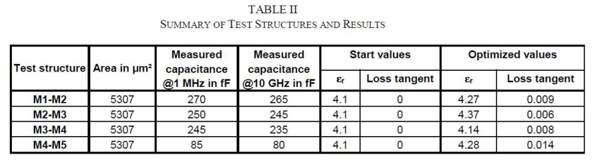


Indeed, that simulation with SiO2 loss tangent of 0.01 (pink curve) gives increased high frequency loss and quite nice agreement with the measured data above 50 GHz, much better than the model with lossless SiO2.  


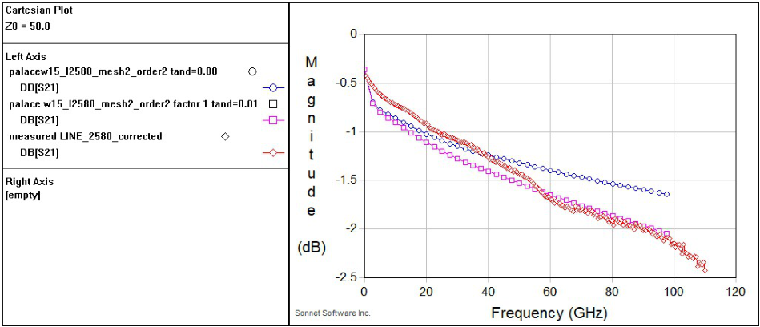


For the 880µm line length, the ripple on measurement data has a larger (relative) impact, but we see the same trend: simulation results with tand=0.01 are much closer to measurement than the simulation without SiO2 losses.  


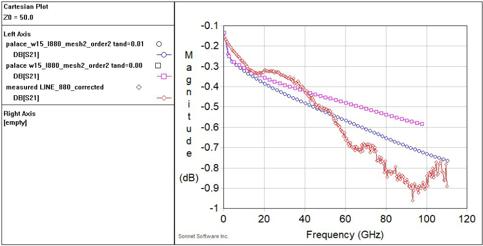


### Conclusion regarding dielectric losses 

The existing data is not complete enough to create an “official” technology stackup with SiO2 losses, but it seems that some amount of dielectric loss is real. If you decide to include dielectric loss in your simulation, this can be easily specified in the XML stackup file using parameter _DielectricLossTangent_ for the SiO2 material definition.  

## Advanced topics 

### Adaptive mesh refinement at selected frequencies only 

By default, adaptive mesh refinement in Palace uses data from all simulation frequencies and all port excitations, which means a significant increase in overall simulation time because a full simulation is used during mesh refinement. To do a two-step approach where the adaptive mesh refinement used only a limited set of frequencies, you could run the gds2palace workflow with those frequencies only, and change the config.json file to **store the resulting mesh data to disk** , by setting SaveAdaptMesh to true.  


```json
"Model": {
    "Mesh": "palace_balun_mesh2_AMR.msh",
    "L0": 1e-06,
    "Refinement": {
        "UniformLevels": 0,
        "Tol": 0.01,
        "MaxIts": 2,
        "MaxSize": 2000000.0,
        "Nonconformal": true,
        "UpdateFraction": 0.7,
        "SaveAdaptMesh": false
    }
},
```


Adaptive frequency sweep would be **disabled** by removing the "AdaptiveTol" line in the frequency block. 

After running Palace with this config file, you will find a refined mesh file in the output folder. Note that the final mesh refinement result is **not** located in the “iteration_nn” folder, the results of adaptive sweep can be found one level above (!) in the parent folder.  You would then create another config.json file with the full frequency range and adaptive frequency sweep enabled, with the Mesh setting pointing to that adaptive mesh file created by the AMR before.  

### Using wave ports instead of lumped ports not supported 

This gds2palace workflow creates lumped ports, which introduce some physical size and thus some parasitic series impedance. The Palace solver also supports using wave ports, but that is not implemented in the gds2gmsh workflow. 

## Using S-Parameter output, model extraction 

S-Parameters are an accurate wideband description of the simulation results, but can be difficult to use in time domain circuits simulators. In this chapter, we will look at some possible solutions. 

### Lumped circuit model extraction 

For a limited range of devices, we can use straightforward calculation of the equivalent lumped circuit model. Such a calculation is available here, based on simple narrowband calculation: 

<https://github.com/VolkerMuehlhaus/lumpedmodel>  

Currently, these devices are supported:  
- Untapped inductors (2-port)  
- MIM capacitor (2-port)  
- Transmission line model (RLGC, 2-port data)  

These tools are provided as Python scripts. The user needs to specify a target frequency, the fit result is then plotted along with the input data to show the quality of the model fit. For sure, there are other extraction tools available elsewhere that might cover more use cases.  

### Mathematical “black box” vector fit 

Another approach is to do vector fitting of arbitrary n-port data. One possible implementation is available here, using the vector fit in scikit-rf library: 
<https://github.com/VolkerMuehlhaus/lumpedmodel/tree/main/vector_fit> 


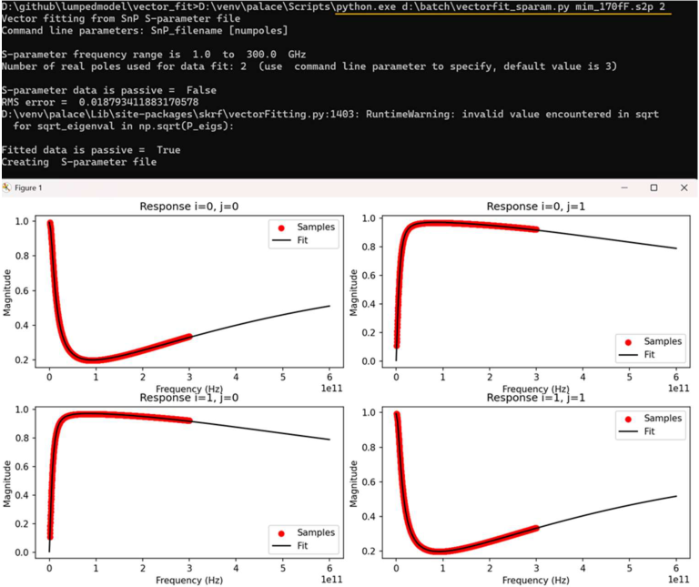


## Using gds2palace with Elmer FEM for EM simulation

[Elmer FEM](https://www.elmerfem.org/) is an open-source multiphysics FEM solver. In addition to the AWS Palace output described so far in this guide, gds2palace can create input files for Elmer's electromagnetic (`VectorHelmholtz`) solver, producing S-parameters from the same layout, stackup and port model already used for Palace.

### Installing Elmer FEM

Elmer FEM is not distributed with gds2palace and must be installed separately, see <https://www.elmerfem.org/>. gds2palace needs to find two Elmer command-line tools: `ElmerGrid` (mesh conversion) and `ElmerSolver` (the solver itself).

- **Windows:** set the environment variable `ELMER_HOME` to your Elmer install directory. gds2palace looks for `%ELMER_HOME%\bin\ElmerGrid.exe`.
- **Linux/macOS:** make sure `ElmerGrid` and `ElmerSolver` are available on your `PATH`.

If you use `settings['ELMER_MPI_THREADS']` to run Elmer across multiple processes, you also need an MPI implementation installed (see "External tools (not Python modules)" above) — on Windows this is Microsoft MPI, providing the `mpiexec`/`mpirun` launcher the generated `run_elmer` script uses.

### From a Palace model to an Elmer model

An Elmer EM model uses the same **GDSII layout**, **XML stackup file**, **settings dictionary** and **port definitions** already described in chapter "Simulation model file in detail". The only change needed at the end of the model script is which output function is called:

```python
# Palace output
config_name, data_dir = simulation_setup.create_palace (excite_ports, settings)
utilities.create_run_script(sim_path)
```

becomes

```python
# Elmer FEM output
config_name, data_dir = simulation_setup.create_elmer (excite_ports, settings)
utilities.create_elmer_run_script(sim_path, settings)
```

Everything else in the model script — `gds_filename`, `XML_filename`, `settings['unit']`, `settings['margin']`, `settings['refined_cellsize']`, and port definitions via `simulation_setup.all_simulation_ports()` / `simulation_setup.simulation_port(...)` — stays exactly the same as for a Palace model.

**Important difference in how ports are excited:** Palace runs one solver pass per active port excitation (controlled by each port's `voltage` and the `excite_ports` list) to build up the full S-matrix, and ports with `voltage=0` are skipped to save simulation time. Elmer's EM solver instead uses a *constraint modes* ("scanning") analysis that solves for **all** ports defined in the model in a single run. This means:

- Every port you define in `simulation_ports` appears in the resulting Elmer S-matrix, regardless of its `voltage` setting.
- There is no equivalent to the Palace "excite only port 1" trick to save time — with Elmer, you get the full n-port S-matrix or nothing.
- Depending on port count and mesh size, a full n-port Elmer run can be faster or slower than n separate Palace excitation runs; this depends on the specific model.

### Frequency sweep

`settings['fstart']`, `settings['fstop']`, `settings['fstep']`, `settings['fpoint']` and `settings['fdump']` are read the same way as for Palace and written to a plain frequency list (`frequencies.dat`) for Elmer. Note that Palace's adaptive frequency sweep interpolation (`settings['adaptive_sweep']`) has no Elmer equivalent — Elmer solves at every frequency you list, so simulation time scales directly with the number of frequency points.

### Mesh order and solver method

```python
settings['order'] = 2          # 1 = linear, 2 = quadratic (recommended), default 2
settings['iterative'] = False  # True = iterative linear solver, False = direct solver (default)
```

- `settings['order']` selects the basis function order, same setting as used for Palace. Elmer supports order 1 (linear) and order 2 (quadratic); other values fall back to the order-1 solver recipe.
- `settings['iterative']` selects between Elmer's direct solver (MUMPS, default, robust for small/medium models) and an iterative solver, which can be more memory-efficient for large models.
- `settings['ELMER_MPI_THREADS']` (optional) enables MPI-parallel solving: gds2palace partitions the mesh with `ElmerGrid` for the given number of MPI processes, and the generated `run_elmer` script (see below) uses `mpirun` to start `ElmerSolver`.

```python
settings['ELMER_MPI_THREADS'] = 8   # partition mesh and solve using 8 MPI processes
```

### Boundary conditions and current limitations

`settings['boundary']` (the six-sided outer simulation boundary, values ABC/PML/PEC/PMC) works the same way as for Palace, including PMC.

A few other Palace features are not yet available in the Elmer EM flow:

- **Sheet resistor layers** (`Type="sheet"` metal paired with a `Resistor` material, as used for on-chip resistors) are not yet supported for Elmer EM output.
- **Composite ports** (grouping several EM ports into one output port) are not supported, same limitation as for Palace.

### Running the Elmer EM simulation and getting S-parameters

`utilities.create_elmer_run_script(sim_path, settings)` writes a `run_elmer` script into the model output directory, next to the generated Elmer input files (`physics.sif`, `case.sif`, `frequencies.dat`, `mesh/`, `ELMERSOLVER_STARTINFO`):

```bash
#!/bin/bash
ElmerSolver
combine_snp
```

or, if `settings['ELMER_MPI_THREADS']` is set to more than 1:

```bash
#!/bin/bash
mpirun -np 8 ElmerSolver case.sif
combine_snp
```

Run it from the model output directory:

```
cd <model>_data
./run_elmer
```

`ElmerSolver` finds `case.sif` automatically via `ELMERSOLVER_STARTINFO`. The same `combine_snp` postprocessing script already used for Palace results also recognizes Elmer's `scalar_results` output and converts it to Touchstone (`.sNp`) format, so downstream use of Elmer S-parameters is identical to Palace results.


## Using gds2palace with Elmer FEM for thermal simulation

In addition to EM simulation, gds2palace can generate input for Elmer's steady-state Heat Equation solver, producing a 3D temperature field from user-defined heat sources and constant-temperature boundaries. This shares the same GDSII + XML stackup pipeline as the EM flows, but does not use frequencies or ports.

Elmer FEM must be installed as described above (`ElmerGrid` and `ElmerSolver` on `PATH`, or `ELMER_HOME` set on Windows).

A complete, extensively documented worked example (model script, stackup XML, and GDSII layout) is available at [`more_examples/thermal_simulation_using_Elmer/Elmer_Thermal_Workflow.md`](../../more_examples/thermal_simulation_using_Elmer/Elmer_Thermal_Workflow.md) — this chapter summarizes the key points.

### Stackup XML: thermal material properties

For a thermal run, every `<Material>` needs a thermal conductivity. Only steady-state conductivity is evaluated so far; electrical parameters (used for S-parameter simulation) are not needed for a thermal-only model, though the same stackup file can be reused for both EM and thermal simulation.

```xml
<Material Name="TopMetal2" Type="Conductor" Conductivity="30300000.0"
          Density="2700" ThermalConductivity="237" Color="ff8000"/>
```

- `Density` (kg/m³) is written through to Elmer but not used by the steady-state solver.
- `ThermalConductivity` is a single value in W/(m·K), for materials whose conductivity doesn't change meaningfully with temperature.
- `ThermalConductivityTable` points to a `<Table>` instead, for temperature-dependent conductivity (e.g. silicon substrate):

```xml
<Material Name="HighResSubstrate" Type="Semiconductor" Conductivity="0.025"
          ThermalConductivityTable="SiliconThermalCond" Density="2329"/>
...
<Tables>
  <Table Name="SiliconThermalCond">
    <Point Temperature="280" Value="163.00"/>
    <Point Temperature="290" Value="155.20"/>
  </Table>
</Tables>
```

gds2palace writes this straight through as an Elmer temperature-dependent material table — no manual `.sif` editing needed. See chapter "Extended XML stackup format" in the Appendix and [`XML_stackup_format.md`](../XML_stackup_format/XML_stackup_format.md) for the full attribute reference.

### Heat sources and constant-temperature boundaries

Instead of ports, a thermal model declares where heat enters and leaves through `thermal_objects`, using ordinary marker polygons drawn on dedicated GDSII layers:

```python
thermal_objects = simulation_setup.all_thermal_objects()
thermal_objects.add_heatsource(simulation_setup.heatsource(
    power=0.65, source_layernum=201, target_layername='TFR'))
thermal_objects.add_consttemp(simulation_setup.constanttemp(
    temp=298, source_layernum=202, target_layername='BACKSIDEGND'))
```

- `source_layernum` is a GDSII layer number you draw purely as an xy footprint marker; it does not set a z-position.
- `target_layername` is the name of an existing `<Layer>` from the stackup XML — its z-range becomes the 3D volume the source/boundary is applied to.
- `heatsource(power, ...)` dissipates `power` Watts as a volumetric heat source over that volume. In the example above, 0.65 W is applied to the `TFR` resistor layer via marker layer 201.
- `constanttemp(temp, ...)` fixes that volume's temperature (Kelvin), acting as a heat sink/reference boundary. In the example above, layer 202 pins the `BACKSIDEGND` layer to 298 K (25 °C), a typical backside heatsink boundary.

The target layer for a heat source must be a volume (`Zmax` larger than `Zmin`). The target layer for a constant-temperature boundary is usually a zero-thickness sheet layer (`Zmax = Zmin`) — if it has finite thickness instead, two boundaries are created, one at each face.

### Model script settings

```python
settings['unit']              = 1e-6   # geometry is in microns
settings['margin']            = 100    # air margin around the layout, in microns
settings['refined_cellsize']  = 5      # extra-fine mesh near heat sources
settings['meshsize_max']      = 100    # coarsest mesh size, in microns
settings['elmer_thermal']     = True   # selects the thermal flow instead of EM/Palace
settings['thermal_objects']   = thermal_objects
```

`settings['no_gui'] = True` skips the interactive gmsh mesh preview, useful for unattended/batch runs. Then create the model:

```python
config_name, data_dir = simulation_setup.create_elmer_thermal (settings)
```

Note there is no `excite_ports` argument here — a thermal run has no ports.

### Running ElmerSolver and viewing results

Output goes to an `elmer_model/` folder next to the script, containing the gmsh mesh, the Elmer-native `mesh/` folder (from `ElmerGrid`), `case.sif` (materials, body/volume definitions, the heat source as a volumetric Body Force, and the constant-temperature Boundary Condition), and `ELMERSOLVER_STARTINFO`. It's worth a quick look at `case.sif` before solving, especially the first time you use a new stackup — it's plain text and easy to sanity-check.

```
cd elmer_model
ElmerSolver
```

Results appear in the same directory:

- `thermal_results.vtu` — full 3D temperature field, open in ParaView.
- `thermal_results.dat` — quick min/max temperature summary (plain text).

If `settings['ELMER_MPI_THREADS']` is set to more than 1, gds2palace also partitions the mesh for you; run `ElmerSolver_mpi` with your MPI launcher of choice instead of the single-threaded `ElmerSolver`.

### Using setupThermal instead of writing Python code

[setupThermal](https://github.com/VolkerMuehlhaus/setupEM) is a desktop GUI (part of the `setupEM` project) that drives this same flow without writing a Python model script by hand: pick the layout/stackup files, add heat sources and constant-temperature boundaries in a table (GDSII source layer, target stackup layer name, and power in W or temperature in K), then generate and run the model, or launch `ElmerSolver` directly from the app with output streamed to an on-screen log. The **Model** tab shows the generated Python code, so you can inspect or export it if you'd rather take over from there manually.


## Appendix 

### Understanding volumes and surfaces created from GDSII 

The workflow creates different types of geometry: volumes and surfaces. This depends on the mapping in the XML stackup file. 

**Geometries from GDSII layers** are defined in the “Layers” section of the XML file : 
- Type=”conductor” is used for all regular metal layers, in the mesh they are represented by **“Surface”** objects on all boundaries (top, bottom, side walls). In other words, these metals are represented by hollow shells and not by solid volumes.  
- Type=”sheet” is used for metal layers that have no physical height in the model, they are represented as one flat **“Surface** ” only.  
- Type=”via” is used for via layers, these are represented in the mesh by **“Volume”** objects.  

**Important: Conductor layers must never be stacked directly, they must be separated by a via layer!** 

Extract from an XML stackup file, showing layer mappings with conductor, via and sheet types: 


```xml
  </Dielectrics>
  <Layers>
    <Substrate Offset="183.75"/>
    <Layer Name="Activ" Type="conductor" Zmin="0.0000" Zmax="0.4000" Material="Activ" Layer="1"/>
    <Layer Name="Metal1" Type="conductor" Zmin="1.0400" Zmax="1.4600" Material="Metal1" Layer="8"/>
    <Layer Name="Metal2" Type="conductor" Zmin="2.0000" Zmax="2.4900" Material="Metal2" Layer="10"/>
    <Layer Name="Metal3" Type="conductor" Zmin="3.0300" Zmax="3.5200" Material="Metal3" Layer="30"/>
    <Layer Name="Metal4" Type="conductor" Zmin="4.0600" Zmax="4.5500" Material="Metal4" Layer="50"/>
    <Layer Name="Metal5" Type="conductor" Zmin="5.0900" Zmax="5.5800" Material="Metal5" Layer="67"/>
    <Layer Name="TopMetal1" Type="conductor" Zmin="6.4303" Zmax="8.4303" Material="TopMetal1" Layer="126"/>
    <Layer Name="TopMetal2" Type="conductor" Zmin="11.2303" Zmax="14.2303" Material="TopMetal2" Layer="134"/>
    <Layer Name="TopVia2" Type="via" Zmin="8.4303" Zmax="11.2303" Material="TopVia2" Layer="133"/>
    <Layer Name="TopVia1" Type="via" Zmin="5.5800" Zmax="6.4303" Material="TopVia1" Layer="125"/>
    <Layer Name="Via4" Type="via" Zmin="4.5500" Zmax="5.0900" Material="Via4" Layer="66"/>
    <Layer Name="Via3" Type="via" Zmin="3.5200" Zmax="4.0600" Material="Via3" Layer="49"/>
    <Layer Name="Via2" Type="via" Zmin="2.4900" Zmax="3.0300" Material="Via2" Layer="29"/>
    <Layer Name="Via1" Type="via" Zmin="1.4600" Zmax="2.0000" Material="Via1" Layer="19"/>
    <Layer Name="Cont" Type="via" Zmin="0.4000" Zmax="1.0400" Material="Cont" Layer="6"/>
    <Layer Name="SUBGND" Type="conductor" Zmin="-3.75" Zmax="0" Material="LOWLOSS" Layer="210"/>
    <Layer Name="BACKSIDEGND" Type="sheet" Zmin="-180" Zmax="-180" Material="LOWLOSS" Layer="211"/>
    <Layer Name="MIM" Type="conductor" Zmin="5.6043" Zmax="5.7540" Material="MIM" Layer="36"/>
    <Layer Name="Vmim" Type="via" Zmin="5.7540" Zmax="6.4303" Material="Vmim" Layer="129"/>
    <Layer Name="LBE" Type="dielectric" Zmin="-183.75" Zmax="0" Material="Air" Layer="157"/>
  </Layers>
</ELayers>
</Stackup>
```


Resulting mesh with surface and volume objects: 


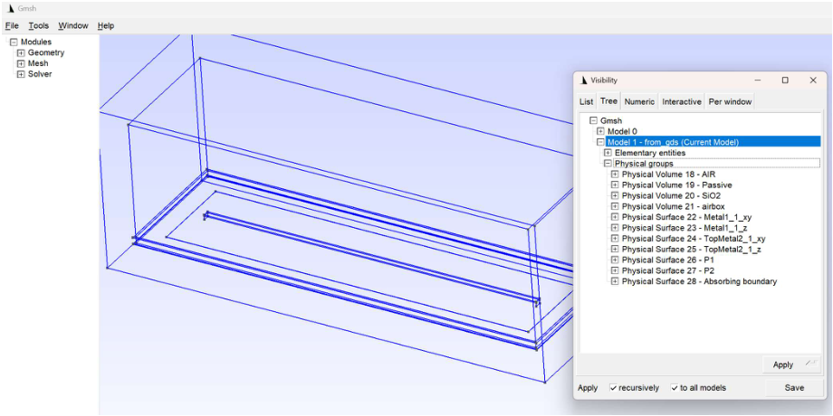


**Dielectrics:** There are additional materials in the stackup that are not drawn in the GDSII file, such as substrate or oxide or passivation. These are created as **“Volume”** objects in the mesh.  
Dielectrics are defined in the <Dielectrics> section of the XML file, and usually cover the entire drawing area (bounding box of GDSII drawing) plus an additional “margin” that is defined in the simulation model code.  


```xml
</Materials>
<ELayers LengthUnit="um">
  <Dielectrics>
    <Dielectric Name="AIR" Material="AIR" Thickness="200.0000"/>
    <Dielectric Name="Passive" Material="Passive" Thickness="0.4000"/>
    <Dielectric Name="SiO2" Material="SiO2" Thickness="15.7303"/>
    <Dielectric Name="EPI" Material="EPI" Thickness="3.7500"/>
    <Dielectric Name="Substrate" Material="Substrate" Thickness="180.0000"/>
  </Dielectrics>
  <Layers>
    <Substrate Offset="183.75"/>
    <Layer Name="Activ" Type="conductor" Zmin="0.0000" Zmax="0.4000" Material="Activ" Layer="1"/>
    ...
```


As an option, the size of these dielectric layers can be defined by an optional parameter **Boundary** which sets the size of the dielectric from the bounding box of that layer in the GDSII file.  


```xml
</Materials>
<ELayers LengthUnit="um">
  <Dielectrics>
    <Dielectric Name="iAIR" Material="AIR" Thickness="50.0000" Boundary="1039"/>
    <Dielectric Name="iSubstrate" Material="Substrate" Thickness="80.0000" Boundary="1039"/>
    <Dielectric Name="iSiO2" Material="SiO2" Thickness="12.27" Boundary="1039"/>
    <Dielectric Name="iPassive" Material="Passive" Thickness="0.4000" Boundary="1039"/>
    <Dielectric Name="Underfill" Material="Underfill" Thickness="46.2" Boundary="1039"/>
    <Dielectric Name="Passive" Material="Passive" Thickness="0.4000" Boundary="39"/>
    <Dielectric Name="SiO2" Material="SiO2" Thickness="15.7303" Boundary="39"/>
    <Dielectric Name="EPI" Material="EPI" Thickness="3.7500" Boundary="39"/>
    <Dielectric Name="Substrate" Material="Substrate" Thickness="180.0000" Boundary="39"/>
    <Dielectric Name="AIR" Material="AIR" Thickness="50.0000" Boundary="39"/>
  </Dielectrics>
  <Layers>
    <Substrate Offset="233.75"/>
    <Layer Name="Activ" Type="conductor" Zmin="0.0000" Zmax="0.4000" Material="Activ" Layer="1"/>
    ...
```


### Mapping of Volumes and Surfaces to Palace materials 

Palace offers a wide range of options to assign material properties to volumes and surfaces. Our workflow creates that mapping in the Palace control file (config.json), as described below:  

**Via layers** (Type=”via”) are created as volumes, and the conductivity defined in the XML stackup is assigned to these volumes. In the Palace configuration file excerpts below, "Attributes" is the number of the physical volume or surface in the mesh.  


```json
"Domains": {
    "Materials": [
        {
            "Attributes": [
                9
            ],
            "Permittivity": 1.0,
            "Conductivity": [
                314300.0,
                314300.0,
                3143000.0
            ]
        },
```


To account for the z-directed nature of via arrays, which allows current flow predominantly in z direction, the conductivity from XML is only assigned to z-direction, and the value in xydirection is reduced by a factor of 10. This avoids issues with “unreal” currents flowing on the side walls of merged via polygons after via array merging.  

With settings['fill_factor_correction'] = True, the conductivity of merged via polygons is additionally multiplied by their fill factor, in all directions. Via polygons on the same layer with different fill factors then get separate materials, in physical groups named after the layer and the fill factor, e.g. TopVia2_x0.49. The same applies to Elmer output: Elmer EM scales the (scalar) electrical conductivity, Elmer thermal the heat conductivity, and the Elmer bodies are named after these physical groups.  

**Metal layers** (Type=”conductor”) are created as hollow elements surrounded by surfaces, with surface impedance to define metal loss (default `conductor_model = 'surface'`). The conductivity and thickness are obtained from the XML file. With `'solve_inside'` or `'solve_inside_skin'`, they are volumes with the conductivity of the XML file instead, like the vias.  


```json
"Boundaries": {
    "Conductivity": [
        {
            "Attributes": [
                27
            ],
            "Conductivity": 21640000.0,
            "Thickness": 0.41999999999999993
        },
```


All faces, top, bottom and side walls, get the same conductivity and thickness. This is exact for top and bottom of wide conductors, down to low frequency where the skin depth is larger than the physical conductor height. On the side walls, it over-estimates the conductor cross section at low frequency, see "Limits of conductor loss calculation".  

**Metall sheet layers** (Type=”sheet”) are created as a single, flat surface. Their position in the stackup should be defined with Zmin=Zmax for better readability, but actually the Zmax value is ignored here.  
 

```xml
<Layer Name="MIM" Type="conductor" Zmin="5.6043" Zmax="5.7540" Material="MIM" Layer="36"/>
<Layer Name="Vmim" Type="via" Zmin="5.7540" Zmax="6.4303" Material="Vmim" Layer="129"/>
<Layer Name="LBE" Type="dielectric" Zmin="-183.75" Zmax="0" Material="Brick" Layer="157"/>
<Layer Name="ResistorA" Type="sheet" Zmin="22.0" Zmax="22.0" Material="ResA" Layer="220"/>
<Layer Name="ResistorB" Type="sheet" Zmin="15.0" Zmax="15.0" Material="ResB" Layer="221"/>
```


These sheets are typically used with a Type=”Resistor” material definition in the XML file, with fixed sheet resistance in Ohm/square. 


```xml
<Material Name="Vmim" Type="Conductor" Permittivity="1" DielectricLossTangent="0" Conductivity="2191000.0" Color="ffe6bf"/>
<Material Name="MIM" Type="Conductor" Permittivity="1" DielectricLossTangent="0" Conductivity="500000.0" Color="e6ffbf"/>
<Material Name="LBE" Type="Dielectric" Permittivity="1.0" DielectricLossTangent="0.0" Conductivity="0" Color="d0d0d0"/>
<Material Name="ResA" Type="Resistor" Rs="3.5e-1" Color="d0d0d0"/>
<Material Name="ResB" Type="Resistor" Rs="1.1" Color="d0d0d0"/>
```


In the Palace config file, this results in an Impedance boundary with Rs value mapped to the surface.  


```json
"Impedance": [
    {
        "Attributes": [
            37,
            38
        ],
        "Rs": 0.35
    },
    {
        "Attributes": [
            39
        ],
        "Rs": 1.1
    }
],
```


### Extended XML stackup format

The XML stackup format has grown beyond the basic dielectric stack and conductor/via layer mapping described above. The current major additions, all optional and backward-compatible with older stackup files, are:

- **Derived layers** — a layer's geometry can be computed from other layers via boolean operations (`AND`/`OR`/`XOR`/`NOT`) and resizing, instead of only being read directly from GDSII. Used, for example, to derive on-chip resistor geometry from existing process layers.
- **Reference-relative positioning** — a `<Layer>` or `<Dielectric>` can be positioned as an offset from the top or bottom edge of another named layer/dielectric, instead of requiring an absolute Zmin/Zmax.
- **Thermal material properties** — `Density`, `ThermalConductivity` and `ThermalConductivityTable` on `<Material>`, plus a `<Tables>` block for temperature-dependent conductivity, used by the Elmer thermal flow described in chapter "Using gds2palace with Elmer FEM for thermal simulation".

Using derived layers, reference-relative positioning, or thermal conductivity tables requires `schemaVersion="3.0"` in the `<Stackup>` root element. The stackup reader prints a warning if a file declares a newer `schemaVersion` than the installed gds2palace version supports, so an outdated installation is easier to notice.

The full attribute reference, with examples, is in [`XML_stackup_format.md`](../XML_stackup_format/XML_stackup_format.md), and derived-layer details specifically are in [`derived_layers.md`](../XML_stackup_format/derived_layers.md).

### Software versions used in this document 

Palace version used for this document: v0.14  
Palace installation method used: container for Apptainer environment, running on Ubuntu 24.04.02 LTS  
Simulation host: AMD Ryzen 9-7950X (16 cores) with 128 GB RAM  
Code base used for this test: gds2palace Python scripts as of October 13, 2025 (unless noted otherwise)  

## List of examples 

Here is an overview of model examples. 

### palace_line_viaport.py 

Microstrip line on TopMetal2 over Metal1 ground plane, with via ports on both ends. Geometry is read from GDSII. The stackup does not include bulk silicon because that is shield by the ground plane anyway. 

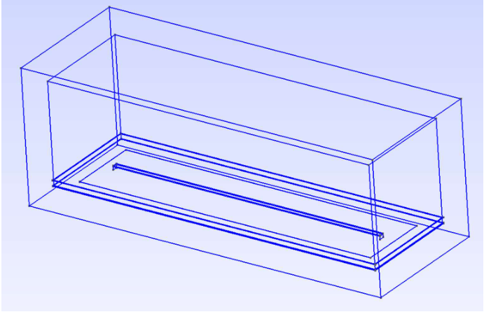

https://github.com/VolkerMuehlhaus/gds2palace_ihp_sg13g2/blob/main/workflow/palace_line_viaport.py  


### palace_line_noGDS.py 

Similar to palace_line_viaport.py but geometry is created by code instead of reading it from GDSII. 
https://github.com/VolkerMuehlhaus/gds2palace_ihp_sg13g2/blob/main/workflow/palace_line_noGDS.py


### palace_ind_frame.py 

This is a 2-port inductor embedded into a metal frame. Geometry from GDSII. 

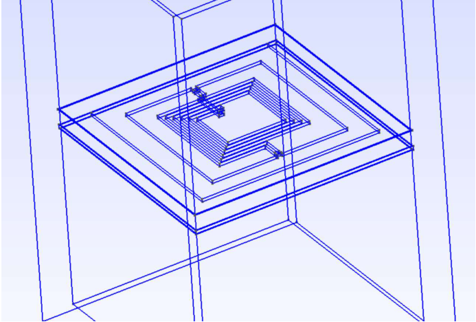

https://github.com/VolkerMuehlhaus/gds2palace_ihp_sg13g2/blob/main/workflow/palace_ind_frame.py


### palace_L2n0.py 

2-port octagon inductor with via ports down to an artificial metal plane that sits on the surface of bulk silicon. 


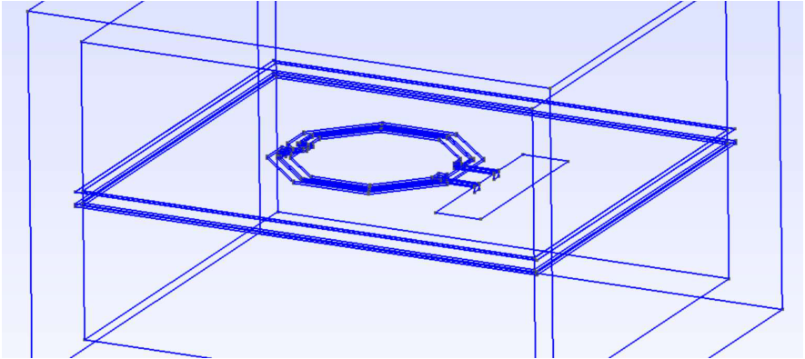


https://github.com/VolkerMuehlhaus/gds2palace_ihp_sg13g2/blob/main/workflow/palace_L2n0.py  

Field dump at a single frequency is enabled in this model. The Paraview screenshot below shows current density using this file:


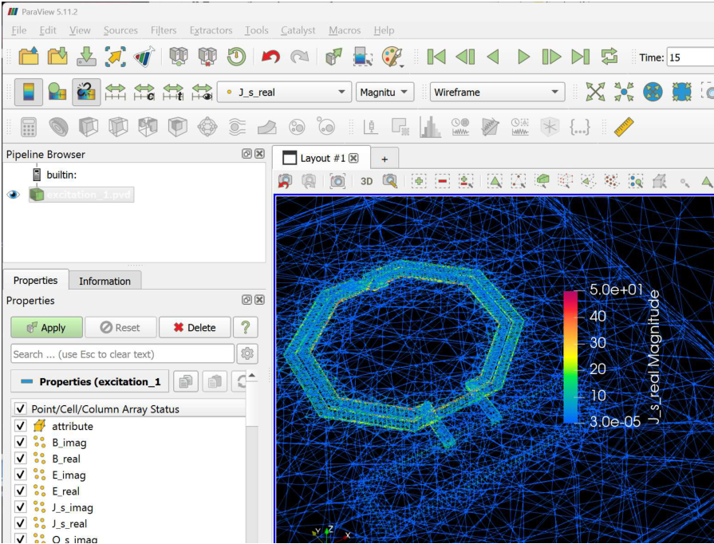


### palace_butlermatrix.py 

This is quite a big model, the Butler Matrix by Ardavan Rahimian in IHP Open PDK Tapeout - July 2025, available at <https://github.com/IHP-GmbH/TO_July2025/tree/main/W_Band_Butler_Matrix_IC> 


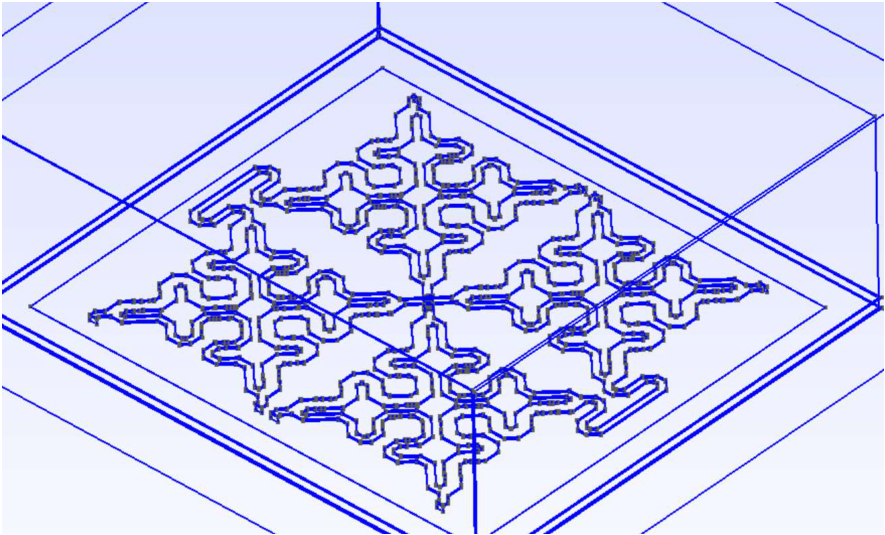

https://github.com/VolkerMuehlhaus/gds2palace_ihp_sg13g2/blob/main/workflow/palace_butlermatrix.py  

Geometry is from GDSII, the model uses a total of 8 via ports between Metal3 and TopMetal2. However, to speed up simulation, only one port excitation is active in this model, and we only get S11,S21,S31,S41,S51,S61,S71 and S81 from this simulation run. 


```python
simulation_ports = simulation_setup.all_simulation_ports()
# instead of in-plane port specified with target_layername,
# we here use via port specified with from_layername and to_layername
simulation_ports.add_port(simulation_setup.simulation_port(
    portnumber=1, voltage=1, port_Z0=50, source_layernum=201,
    from_layername='Metal3', to_layername='TopMetal2', direction='z'))
simulation_ports.add_port(simulation_setup.simulation_port(
    portnumber=2, voltage=0, port_Z0=50, source_layernum=202,
    from_layername='Metal3', to_layername='TopMetal2', direction='z'))
simulation_ports.add_port(simulation_setup.simulation_port(
    portnumber=3, voltage=0, port_Z0=50, source_layernum=203,
    from_layername='Metal3', to_layername='TopMetal2', direction='z'))
simulation_ports.add_port(simulation_setup.simulation_port(
    portnumber=4, voltage=0, port_Z0=50, source_layernum=204,
    from_layername='Metal3', to_layername='TopMetal2', direction='z'))
simulation_ports.add_port(simulation_setup.simulation_port(
    portnumber=5, voltage=0, port_Z0=50, source_layernum=205,
    from_layername='Metal3', to_layername='TopMetal2', direction='z'))
simulation_ports.add_port(simulation_setup.simulation_port(
    portnumber=6, voltage=0, port_Z0=50, source_layernum=206,
    from_layername='Metal3', to_layername='TopMetal2', direction='z'))
simulation_ports.add_port(simulation_setup.simulation_port(
    portnumber=7, voltage=0, port_Z0=50, source_layernum=207,
    from_layername='Metal3', to_layername='TopMetal2', direction='z'))
simulation_ports.add_port(simulation_setup.simulation_port(
    portnumber=8, voltage=0, port_Z0=50, source_layernum=208,
    from_layername='Metal3', to_layername='TopMetal2', direction='z'))
```


All other port excitations are set to voltage=0 in the model. To get full 8-port S-parameters, we would need to change all port voltages to 1 and re-run the model, so that all excitations are simulated, one after another. 

### palace_butlermatrix_dump93.py 

Same as before, but a field dump setting is added in this model at 93 GHz. 


```python
settings['fstart']  = 90e9
settings['fstop']   = 95e9
settings['fstep']   = 0.1e9

# settings["fpoint"] = [93e9]  # list of discrete frequencies to be simulated

settings["fdump"] = [93e9]  # save field dump at these frequency points
```

https://github.com/VolkerMuehlhaus/gds2palace_ihp_sg13g2/blob/main/workflow/palace_butlermatrix_dump93.py  


### palace_core.py 

This is the 4-port “core” model of the 60 GHz medium power amplifier from IHP Analog Academy online course. There are two via ports at the input and output, and two in-plane ports on Metal2 between the common emitter polygon and base/collector coming down from the via stacks. 


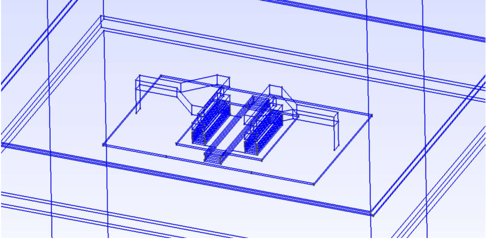

https://github.com/VolkerMuehlhaus/gds2palace_ihp_sg13g2/blob/main/workflow/palace_core.py  

### palace_rfcmim.py 

This is 2-port model of an rf_cmim component with some feedline length. Via ports are used at the input and output down to the Metal1 ground plane.  Via arrays are merged by this setting: merge_polygon_size = 2   


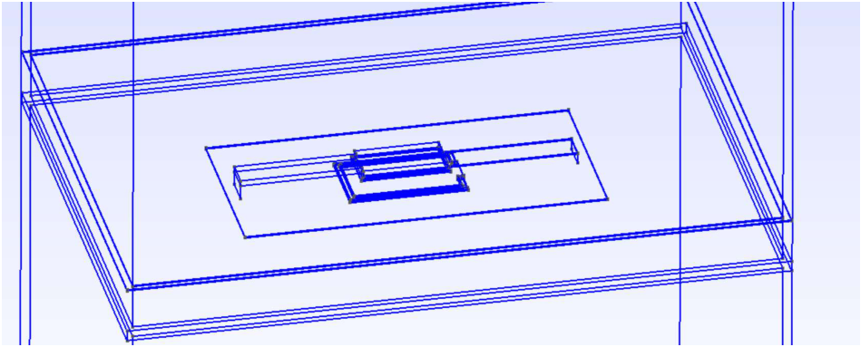

https://github.com/VolkerMuehlhaus/gds2palace_ihp_sg13g2/blob/main/workflow/palace_rfcmim.py

### palace_pcb_lowpass.py 

This shows a use case of gds2palace outside the RFIC domain: the layout of a PCB lowpass on RO4003 substrate was imported to klayout and saved in GDSII format. 


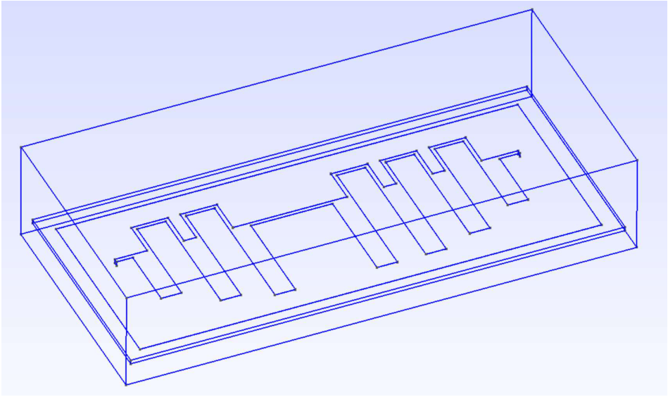

An XML stackup file was created for this substrate, with layout layers matching the layer numbers used in klayout. 

```xml
<Stackup schemaVersion="2.0">
  <Materials>
    <Material Name="Copper" Type="Conductor" Permittivity="1" DielectricLossTangent="0" Conductivity="3.3e7" Color="00ff00"/>
    <Material Name="RO4003" Type="Dielectric" Permittivity="3.38" DielectricLossTangent="0.0022" Conductivity="0" Color="01e0ff"/>
    <Material Name="AIR" Type="Dielectric" Permittivity="1.0" DielectricLossTangent="0.0" Conductivity="0" Color="d0d0d0"/>
  </Materials>
  <ELayers LengthUnit="um">
    <Dielectrics>
      <Dielectric Name="RO4003" Material="RO4003" Thickness="510"/>
    </Dielectrics>
    <Layers>
      <Substrate Offset="0"/>
      <Layer Name="Bottom" Type="Conductor" Zmin="-17" Zmax="0" Material="Copper" Layer="1"/>
      <Layer Name="Top" Type="Conductor" Zmin="510" Zmax="527" Material="Copper" Layer="10"/>
    </Layers>
  </ELayers>
</Stackup>
```

Here, setting “margins” only controls the (small) oversize of the dielectrics from the drawing layers. The optional “air_around” setting was used in the simulation model to define the air margins independently, without adding these air layers in the XML stackup.  

```python
settings['unit']   = 1e-6  # geometry is in MILLIMETER for PCB example
settings['margin'] = 2000    # distance in microns from GDSII geometry boundary to simulation boundary
settings['air_around'] = [1000,1000,1000,1000,2000, 10000] # airbox size to simulation boundary
```

https://github.com/VolkerMuehlhaus/gds2palace_ihp_sg13g2/blob/main/workflow/palace_pcb_lowpass.py  

