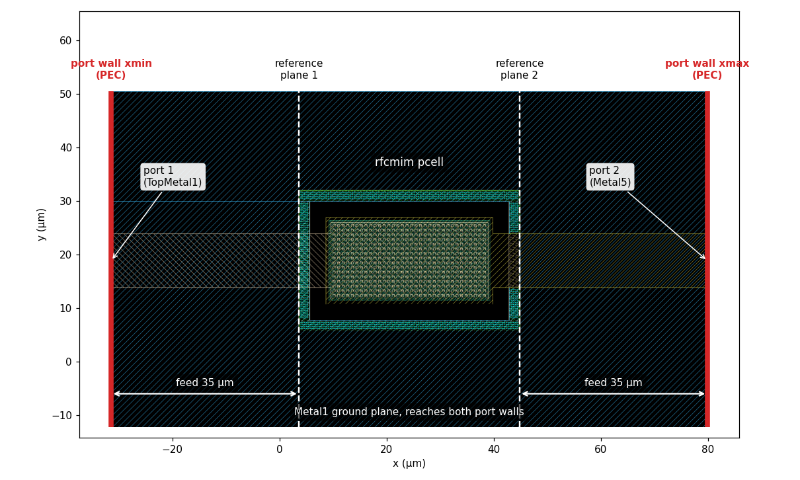
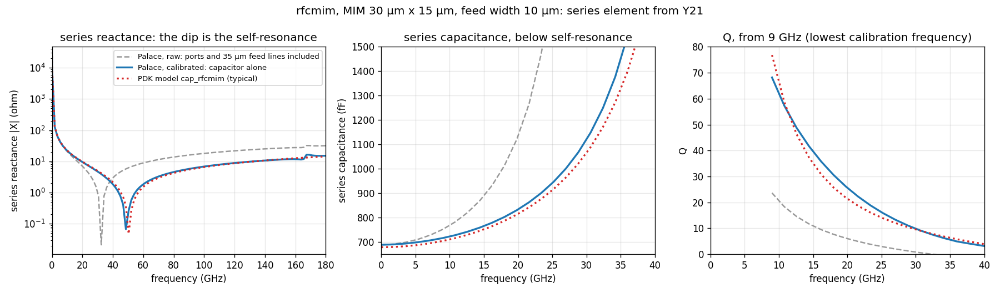
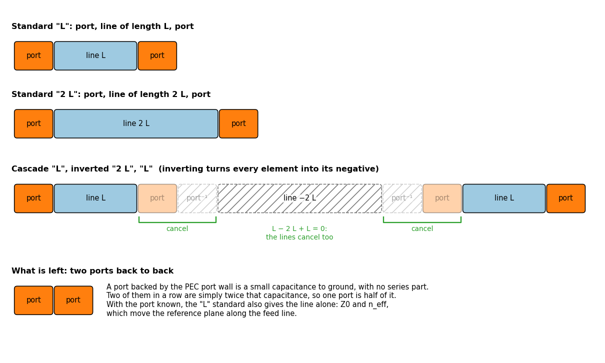
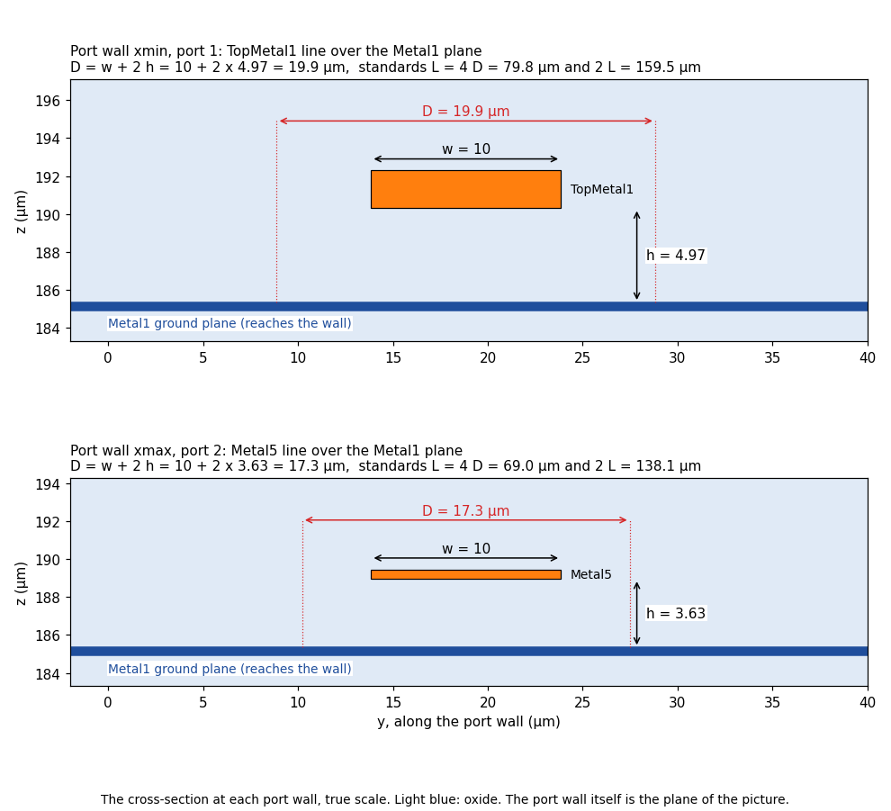

# Calibrated box wall ports: an RF MIM capacitor without its feed lines

This example simulates an IHP SG13G2 `rfcmim` capacitor and gets the capacitor **alone**: no feed lines, no port
parasitics. The reference planes sit at the pins of the pcell, at the same place as in the PDK model. That makes
the result directly comparable with the PDK model `cap_rfcmim`.

The trick is called **calibrated box wall ports**. The ports sit on a metal wall at the edge of the simulation box.
Each port feeds the capacitor through a short line. gds2palace then simulates two extra calibration lines, works out
what the port and the line add, and removes both from the result.

No KLayout plug-in is needed. You draw the layout in any layout editor, and gds2palace does the rest.



## Why the ports can't simply sit at the capacitor

A port in Palace is a small sheet that drives a current. In gds2palace, that sheet sits between the metal you want
to drive and a ground. Right at the capacitor's pins, such a port would be a sheet from the Metal1 ground up to the
pin on TopMetal1 or Metal5, a few µm tall.

That sheet has its own inductance and capacitance, and for this capacitor they are not small. The capacitor's own
series inductance is only about 15 pH. A port sheet adds several pH, and gds2palace can only estimate how much from
the port's size. So a model with ports at the pins measures the ports almost as much as the capacitor.

Box wall ports solve this. The ports move away from the capacitor, to the end of a feed line, and a calibration
measures what they add instead of estimating it.

## The method and who invented it

The calibration used here is **double delay**, invented by James C. Rautio for planar electromagnetic solvers [1]. In
2005, James C. Rautio and Vladimir I. Okhmatovski showed that double delay and the short-open calibration (SOC) are
special cases of one extended SOC method, and documented both, with their assumptions and failure modes [2].
gds2palace implements the method as described there. All credit for the method goes to the authors.

The idea is simple: gds2palace simulates two extra calibration lines, one twice as long as the other. Comparing the
two shows what the port adds, and what a piece of the line adds. Both are then removed from the result. How that
works is in [Behind the scenes](#behind-the-scenes) at the end.

## What you need

- **gds2palace 0.10.0 or newer**, on the machine that writes the model. Port walls came with 0.10.0, and later
  versions fixed details, so use the latest version. The model script was tested with 0.10.5.
- **Palace** on Linux. The results in this folder are from Palace 0.19.0.
- **An up-to-date `combine_snp`** on the Linux machine, from gds2palace 0.10.0 or newer: copy it once from
  [`scripts/`](../../scripts). An older one leaves the feed lines in the result, without an error, see
  [If the result still contains the feed lines](#if-the-result-still-contains-the-feed-lines).

## What is in this folder

| File | What it is |
|---|---|
| [`rfcmim_boxwall.gds`](rfcmim_boxwall.gds) | The layout: capacitor, two feed lines, Metal1 ground, two port lines |
| [`rfcmim_boxwall.py`](rfcmim_boxwall.py) | The gds2palace model script |
| [`compare_with_pdk.py`](compare_with_pdk.py) | Plots the result next to the PDK model `cap_rfcmim` |
| [`results/`](results) | Palace results: raw `.s2p` (with ports and feed lines), calibrated `_deembedded.s2p` (capacitor alone), `_deembedding.json`, the plot |
| [`layout_and_ports.png`](layout_and_ports.png), [`double_delay.png`](double_delay.png), [`D_at_port_walls.png`](D_at_port_walls.png) | Pictures for this README |

## Step by step

### Step 1: place the device

Place the `rfcmim` pcell from the IHP SG13G2 PDK. Here: `l` = 30 µm (along the feed), `w` = 15 µm, `wfeed` = 10 µm.
The pcell's pins are its outer edges in x: PLUS on TopMetal1 at the left, MINUS on Metal5 at the right. Those two
edges will be the reference planes.

### Step 2: draw a feed line at each pin

From each pin, draw a straight line outward, with the pin's metal and width:

- left: TopMetal1, 10 µm wide, 35 µm long
- right: Metal5, 10 µm wide, 35 µm long

Keep the line straight, with the same width all the way: the calibration lines are copies of it.

The length is not critical. The feed only has to keep the device a little away from the wall, and the calibration
removes it again, whatever its length. 35 µm is plenty here. If a feed is too short, gds2palace tells you with a
warning when it writes the model.

### Step 3: draw a ground that reaches the wall

Draw a Metal1 ground plane under both feed lines, up to the same edge as the lines. In this layout, the Metal1 plane
fills the whole area around the pcell.

Why: the port's ground is the wall. The line's return current must flow in metal close to the line, and that metal
must touch the wall. Over bare silicon, the return path is not defined, and gds2palace stops with an error.

### Step 4: make the layout end at the line ends

The port wall is placed at the edge of the layout: the outermost metal or port shape in x. So on the two port sides,
the feed lines and the ground plane must end at exactly the same x, and nothing may stick out further.

In this layout, the left edge is at x = -31.38 µm and the right edge at x = 79.82 µm. If the ground plane went on
beyond the line ends, the wall would be placed at the ground's edge, away from the ports, and gds2palace would stop:

```
ERROR: port wall xmin has no port: draw the port polygons on the layout edge at xmin, over the ends of the lines
```

### Step 5: draw the ports

Draw one port shape per line, on the layout edge, across the end of the line:

- port 1 on layer 201, at x = -31.38 µm, across the TopMetal1 line
- port 2 on layer 202, at x = 79.82 µm, across the Metal5 line

This layout uses a zero-width line (a polygon with zero width in x). gds2palace then cuts a small gap between the
wall and the line, and places the port in that gap. A rectangle also works, for example 1 µm deep and a
bit wider than the line: its depth then sets the gap. The width of the port shape doesn't matter: the port takes the
width of the line.

### Step 6: set up the model script

Three settings make the box wall ports. The rest of [`rfcmim_boxwall.py`](rfcmim_boxwall.py) is a normal gds2palace
script.

```python
# xmin and xmax are port walls: PEC walls right at the layout edge
settings['boundary'] = ['PORTWALL', 'PORTWALL', 'ABC', 'ABC', 'ABC', 'ABC']

# move the reference planes 35 um into the layout, to the pins of the pcell
settings['reference_plane_shift'] = {'xmin': 35, 'xmax': 35}

# one in-plane port per line, on the line's metal; both ports must be excited (voltage=1)
simulation_ports.add_port(simulation_setup.simulation_port(portnumber=1, voltage=1, port_Z0=50,
    source_layernum=201, target_layername='TopMetal1', direction='x'))
simulation_ports.add_port(simulation_setup.simulation_port(portnumber=2, voltage=1, port_Z0=50,
    source_layernum=202, target_layername='Metal5', direction='-x'))
```

A few things gds2palace does by itself on a port wall: it sets the margin and the air to 0 on that side, and it sets
each port's direction to point into the layout. Every port on a port wall must be excited, because the calibration
needs the full S-matrix.

The script also uses `conductor_model = 'solve_inside'`, so that the mesh resolves the current inside the metals.
That matters for the capacitor's series resistance and Q. The mesh in the metals is fine: `refined_cellsize = 0.5`
(µm).

### Step 7: write the model

```
python rfcmim_boxwall.py
```

The log tells you what gds2palace found at each wall:

```
Port wall xmin: ports 1, ground Metal1, D = 19.94, standards 79.762 and 159.524 (4 D), valid to 180 GHz; port 1 gap 0.623 (set by the tool)
Port wall xmax: ports 2, ground Metal1, D = 17.26, standards 69.04 and 138.08 (4 D), valid to 180 GHz; port 2 gap 0.539 (set by the tool)
Note: port wall xmin: reference plane shifted 35 into the layout: exact only if the feed is the standards' line
```

Check that each wall has the port you expect and the ground metal you drew. The standards are the two calibration
lines, with their lengths. "valid to" is the frequency up to which the calibration is fully valid. The two walls
have different cross-sections (TopMetal1 and Metal5), so each gets its own pair of standards. D is a size that
gds2palace works out by itself: see [Behind the scenes](#behind-the-scenes)
if you are curious.

Everything goes into `palace_model/rfcmim_boxwall_data/`: the model, the four standards and a `run_sim` script.

### Step 8: run Palace

On Linux with Palace installed, in `palace_model/rfcmim_boxwall_data/`:

```
./run_sim
```

`run_sim` first solves the four standards, at three frequencies each (fstop/20, fstop/5 and fstop: 9, 36 and
180 GHz). Then it solves the model, and `combine_snp` writes the results into
`output/rfcmim_boxwall/`:

- `rfcmim_boxwall.s2p`: the raw result, as Palace computed it at the ports on the walls (see below)
- `rfcmim_boxwall_deembedded.s2p`: the calibrated result, reference planes at the pcell pins. This is the
  capacitor alone, the file to use
- `rfcmim_boxwall_deembedding.json`: what the calibration found

**What "raw" means.** The raw result is what Palace sees at its ports, out on the port walls. Nothing is removed
from it. It describes the whole drawn structure: port, 35 µm feed line, capacitor, 35 µm feed line, port. So it
is not the capacitor alone, and it is expected to differ from the PDK model. Each feed line adds about 10 pH of
series inductance, some loss and a little capacitance to ground, and each port adds a few fF. The raw file is kept
so that you can see what the calibration removed.

When you run again with the same mesh and settings, `run_sim` reuses the standards.

If the `_deembedded.s2p` file doesn't start with `!port 1: calibrated at port wall ...`, or there is no
`_deembedding.json`, an old `combine_extend_snp.py` ran: see
[If the result still contains the feed lines](#if-the-result-still-contains-the-feed-lines). Update
`combine_snp` and run `combine_snp` again in the `_data` folder. Palace doesn't need to run again.

### Step 9 (optional): check the calibration

The calibrated result is complete after step 8. `combine_snp` already checks the calibration and prints
"WARNING, calibration doubtful" when something is clearly wrong. This step is a closer look, worth doing the first
time you use port walls on a new kind of line.

Open `rfcmim_boxwall_deembedding.json` (the one from this run is in [`results/`](results)). For this layout:

| | port wall xmin (TopMetal1) | port wall xmax (Metal5) |
|---|---|---|
| port capacitance | 2.8 fF | 1.7 fF |
| port series inductance | 0.04 to 0.06 pH | 0.01 to 0.02 pH |
| line Z0 at 9 / 36 / 180 GHz | 44.2 / 42.0 / 41.1 Ω | 43.2 / 37.4 / 36.3 Ω |
| line n_eff at 9 / 36 / 180 GHz | 2.15 / 2.06 / 2.02 | 2.33 / 2.12 / 2.07 |

The port is almost a pure shunt capacitance, as the method assumes: its series part is below 0.1 pH. The lines'
impedance and effective index are plausible for a 10 µm line a few µm above a ground plane on SG13G2. The list
`calibration_doubtful` is empty. If a line's Z0 or n_eff looks wrong for the line you drew, don't trust the
calibration either.

## Results

`compare_with_pdk.py` plots the series element between the two ports, from Y21, for three cases:

- **Palace, raw** (grey, dashed): capacitor plus both 35 µm feed lines plus both ports, reference planes at the
  port walls. This curve is expected to deviate from the PDK model, because the feed lines are not removed. It is
  shown to make visible what the calibration does.
- **Palace, calibrated** (blue): the capacitor alone, reference planes at the pcell pins. This is the curve to
  compare with the PDK model.
- **PDK model** `cap_rfcmim`, typical corner (red, dotted): reference planes at the pcell pins.



**Self-resonance.** The raw structure resonates at 32 GHz. The capacitor alone, after calibration, resonates at
49.0 GHz, close to the PDK model's 50.6 GHz. The difference between raw and calibrated is the two feed lines: about
10 pH each, together more than the capacitor's own series inductance. That is no error in the raw result: it is a
different structure. It shows why the feed lines must be removed before comparing with a device model.

**Capacitance.** At low frequency, the calibrated capacitance is 689 fF and the PDK model's 679 fF, 1.5 % apart.
Towards the self-resonance, both rise the same way, the calibrated one a little earlier. A finer mesh brings the
capacitance closer to the PDK model: with a 2 µm mesh it was 4 % higher, with 1 µm 2.6 %, with 0.5 µm 1.5 %.

**Q.** From 9 GHz up, the calibrated Q is within about 20 % of the PDK model's. The raw Q is much lower, because
the raw result includes the loss of 70 µm of feed line.

The small step near 165 GHz in both Palace curves is in the raw result too, so it doesn't come from the calibration.

### A limit: R and Q below the lowest calibration frequency

The standards are solved at 9, 36 and 180 GHz only. In between, gds2palace interpolates the line's loss, assuming
that it grows with √f, like skin effect loss. Below 9 GHz, it extrapolates with the same √f, towards zero at DC.

A thin feed line doesn't behave like that at low frequency. Its resistance stays at its DC value until the skin
depth gets smaller than the metal thickness. So below 9 GHz, the calibration removes too little feed line
resistance, and the calibrated R is too high and the Q too low. That is why the plot shows Q only from 9 GHz up. The
capacitance is not affected, and neither is the result without a reference plane shift: the port itself has almost
no loss.

## Behind the scenes

You don't need this chapter to use port walls. gds2palace does all of it by itself.

### How the calibration works

1. A port on a box wall drives a line. What the port adds is called the port discontinuity.
2. Simulate two straight lines with the same cross-section: one of length L, one of length 2 L. Both have a port at
   each end.
3. Each line is "port + line + port". In cascade (ABCD) matrices, inverting the 2 L line turns every element into
   its negative. Cascading the L line, the inverted 2 L line and the L line again cancels all the line, and leaves
   two port discontinuities in a row.
4. If the port is a pure shunt element (a small capacitance to ground, no series part), this leftover gives the
   single port directly. That is true when the port is backed by a perfectly conducting wall [2, Fig. 1]. This is
   why a port wall in gds2palace is a PEC wall.
5. With the port known, the L line without its ports is known too: its characteristic impedance and its effective
   index. gds2palace uses it to move the reference plane along the feed line, into the layout.



A check comes for free: if the leftover in step 4 is not a pure shunt element, something is wrong [2, Section II].
gds2palace then warns "calibration doubtful".

### How gds2palace sizes the calibration: the "D" in the log

At each port wall, gds2palace looks at the cross-section of the line and measures its size, called D:

**D = line width + 2 × height above the ground metal**



For the TopMetal1 feed, 4.97 µm above Metal1, D = 10 + 2 × 4.97 = 19.9 µm. For the Metal5 feed, D = 17.3 µm.

D is the scale of the port's fringing field: the field settles over about one D along the line. Three things follow
from it:

- **The calibration lines** are L = 4 D and 2 L long, so the field of the two ports settles in between.
- **The gap** between the wall and the line, where the port sits, is D/32 when you draw the port as a zero-width
  line.
- **The feed length**: the device should be at least D away from the wall. Here that is about 20 µm, and the feeds
  are 35 µm. A shorter feed gives the warning "the device is inside the port's fringe field".

The user's guide has the details, also for other kinds of lines, such as lines with ground strips beside them.

## If the result still contains the feed lines

Then an old `combine_snp` processed the results. This section explains why it must be recent.

A model with port walls has more than one result. Palace solves the device and the four calibration standards,
each into its own folder under `output/`. `combine_snp` then has to know which results are standards, and remove
the ports and the feed lines from the device with them. Only `combine_extend_snp.py` 1.3 or newer (gds2palace
0.10.0 or newer) knows that.

Since gds2palace 0.10.0, two things changed:

1. Every model's `_data` folder holds its own copy of `combine_extend_snp.py`, written by the gds2palace that made
   the model. So the result processing always matches the model.
2. The wrapper script `combine_snp` runs that copy. An older `combine_snp` runs the copy in `~/scripts` instead, which
   may be old.

So update `combine_snp` once from [`scripts/`](../../scripts) (see [`scripts/README.md`](../../scripts/README.md)),
and also `~/scripts/combine_extend_snp.py` if you keep one there.

An older `combine_extend_snp.py` doesn't stop with an error. It treats the four standards as devices and writes
`.s2p` files for them. For the device, it writes a `_deembedded.s2p` file in which only a small estimated port
inductance is removed (0.25 pH per port here): the ports are not calibrated, and the 35 µm feed lines are still in
the result. For this capacitor, that file resonates at 32 GHz, like the raw result, instead of 49 GHz.

How to tell that the right version ran:

- the first line of the `combine_snp` output is `combine_extend_snp.py 1.3` or newer, followed by its path
- `run_sim` prints a warning when your `combine_snp` would still run the copy in `~/scripts`
- the `_deembedded.s2p` file starts with `!port 1: calibrated at port wall xmin, reference plane 35 um into the layout`
- a `_deembedding.json` file is written next to it

## About the PDK model curve

`compare_with_pdk.py` doesn't need a circuit simulator. It contains the subcircuit `cap_rfcmim` from
`ihp-sg13g2/libs.tech/ngspice/models/capacitors_mod.lib` of the
[IHP Open PDK](https://github.com/IHP-GmbH/IHP-Open-PDK) (branch `dev`), with its parameter equations unchanged,
and evaluates it as a small circuit at the simulated frequencies. The substrate node `bn` is ground, like the
substrate tie ring of the pcell in the EM model.

## Doing the same in setupEM

setupEM has the same feature: in the Mesh and Boundaries tab, click "Advanced..." next to the box sides and set a
side to "Port wall". The Ports tab then shows D, the standards and the frequency limit for each port wall.

The layout of this example was cut out of a larger layout with the KLayout plug-in
[klayout_em_export](https://github.com/VolkerMuehlhaus/klayout_em_export), which does steps 4 and 5 for you: it
crops the layout at a region box and writes the port shapes. It is optional.

## More information

- User's guide, section "Calibrated de-embedding at port walls": all settings, how D and L are chosen, warnings,
  and moving a port wall outward ([`gds2palace_workflow_userguide.md`](../../doc/userguide_md_format/gds2palace_workflow_userguide.md#calibrated-de-embedding-at-port-walls))
- [`workflow/palace_line_portwall.py`](../../workflow/palace_line_portwall.py): a differential GSSG line with
  ground strips beside the lines instead of a ground plane, 4 ports on 2 port walls

## References

[1] J. C. Rautio, "A de-embedding algorithm for electromagnetics," *International Journal of Microwave and
Millimeter-Wave Computer-Aided Engineering*, vol. 1, no. 3, pp. 282–287, July 1991.

[2] J. C. Rautio and V. I. Okhmatovski, "Unification of double-delay and SOC electromagnetic deembedding,"
*IEEE Transactions on Microwave Theory and Techniques*, vol. 53, no. 9, pp. 2892–2898, September 2005,
doi: [10.1109/TMTT.2005.854250](https://doi.org/10.1109/TMTT.2005.854250).
