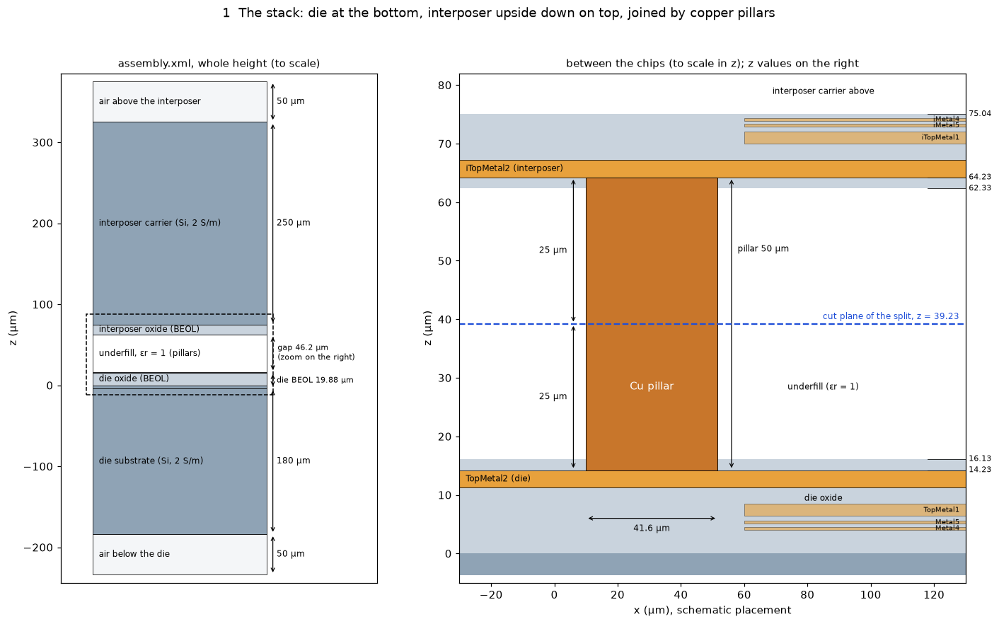
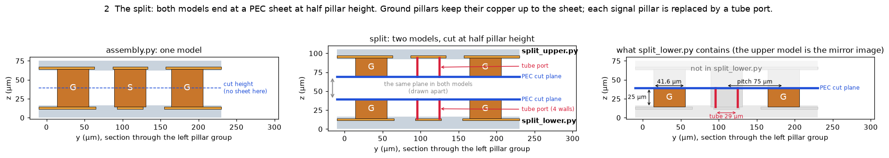
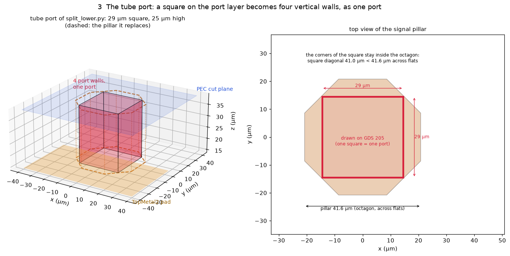
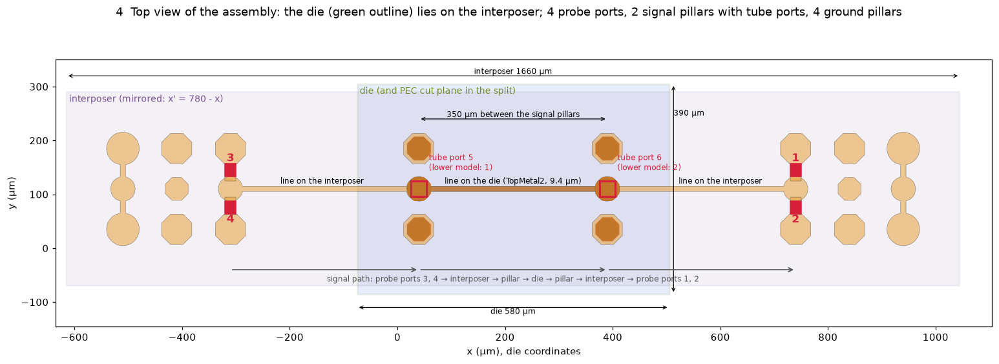
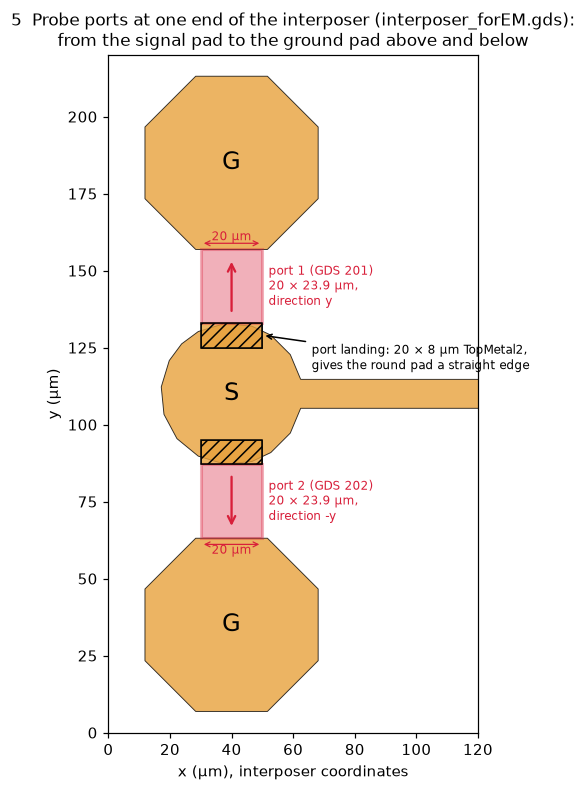
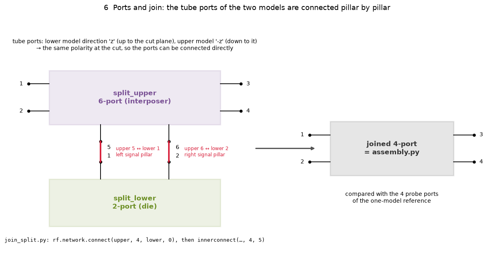
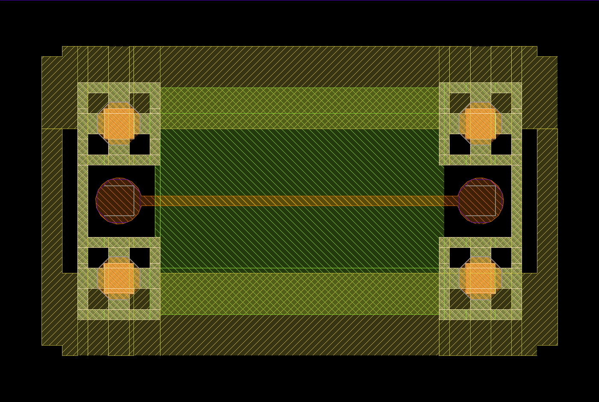
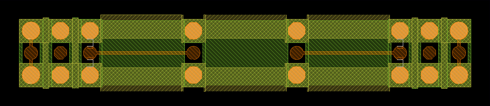
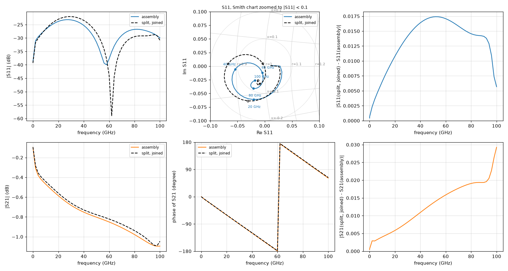

# Two stacked chips, simulated as two models joined at the copper pillars (gds2palace)

A die is mounted upside down on an interposer (flip-chip), connected by 50 µm copper pillars. You can simulate both
chips in one model, but that model is large, and every change on one chip means meshing and solving both. This
example cuts the assembly at half pillar height into two models, solves them separately, and joins the two results
into the S-parameters of the assembly. It compares the joined result with the one-model reference.

The method in short:

- **Cut plane:** both models end at a PEC sheet at half pillar height (`CUT` in the stackups). The sheet gives the
  two models a common ground at the cut.
- **Ground pillars:** each model keeps its half of the ground pillars as copper, up to the cut plane.
- **Signal pillars:** each half signal pillar is replaced by a **tube port**, from the chip's top metal to the cut
  plane. A tube port is a via port drawn as a square instead of a line: gds2palace 0.12.0 and newer build its four
  side walls as one port, so the port current flows around the pillar's perimeter, like the current on the copper
  it replaces.
- **Join:** [`join_split.py`](join_split.py) connects each tube port of the lower model to the tube port of the upper
  model on the same pillar, with scikit-rf.

## The concept in sketches

All sketches are to scale; [`sketches.py`](sketches.py) draws them from the GDS files and `assembly.xml`.

The stack: the die at the bottom, the interposer upside down on top, 50 µm copper pillars between them. The split
cuts the pillars at half height, z = 39.23 µm:



The split, as a cross section through one ground-signal-ground pillar group. Each model ends at the PEC cut plane.
The ground pillars keep their copper up to the plane, and each signal pillar is replaced by a tube port:



The tube port: one square on the port layer, which gds2palace builds as four vertical walls. The square has to fit
on the pillar's end face:



Top view of the assembly, with all ports. The cut plane of the split covers the die outline:



The probe ports on the interposer, the same in `assembly.py` and `split_upper.py`:



How the ports of the two models are joined:



## Files

| File | What it is |
|---|---|
| [`prepare_layouts.py`](prepare_layouts.py) | Downloads the two public layouts and writes the three GDS files below |
| `die_forEM.gds` | The die: a 300 µm TopMetal2 line with a ground-signal-ground (GSG) pillar group at each end |
| `interposer_forEM.gds` | The interposer, with the four probe ports (GDS 201-204) |
| `split_shapes.gds` | For the split models, in die coordinates: cut plane (GDS 220), ground pillars (221), tube port squares (205, 206) |
| [`assembly.xml`](assembly.xml), [`assembly.py`](assembly.py) | Reference: die, pillars and interposer in one model, 4 probe ports |
| [`split_lower.xml`](split_lower.xml), [`split_lower.py`](split_lower.py) | Lower model: die and lower pillar halves; 2 tube ports |
| [`split_upper.xml`](split_upper.xml), [`split_upper.py`](split_upper.py) | Upper model: interposer and upper pillar halves; 4 probe ports and 2 tube ports |
| [`join_split.py`](join_split.py) | Joins the split results into a 4-port, combines the probe ports into one GSG port per end, and compares the 2-port with the reference |
| [`sketches.py`](sketches.py) | Draws the sketches in `png/` |
| `results/` | The S-parameters of the three models, the joined 4-port, the GSG 2-ports of the joined models and of the assembly, and the comparison plot |

The die layout with the split shapes on top, as `split_lower.py` sees it (cut plane not shown; ground pillars and the
two tube port squares in white outline):



The interposer; the die sits on the pillar pads in the middle. The probe ports are at the third pad column from each
end:



## Running it

The three GDS files are included; `python prepare_layouts.py` makes them again from the public layouts (it needs
`gds_prepare_for_EM`, `pip install gds_prepare_for_EM`).

```bash
python split_lower.py          # about 10 s
python split_upper.py          # about 3 min
python assembly.py             # the reference, optional: about 7 min, and large to solve (see Result)
```

Then run Palace in each model folder `palace_model/<model>_data/` with `./run_sim`, and join:

```bash
python join_split.py
```

`join_split.py` takes the results of your own runs, or else the ones in `results/`, so it also works without Palace.

## Result

The models have two probe ports at each end of the line, one in each gap between the signal pad and a ground pad
(ports 1 and 2 at one end, 3 and 4 at the other). `join_split.py` combines each pair into one 50 Ω
ground-signal-ground (GSG) port: both ports of a pair point from the signal pad to a ground pad, so it renormalizes
them to 100 Ω each and takes their common mode. The two 100 Ω ports are then in parallel, as under a GSG probe. The
result is a 2-port, for the joined split models (`results/split_joined_gsg.s2p`) and the assembly
(`results/assembly_gsg.s2p`). One Palace port with the two gaps as its elements would give the same 2-port.
Connecting the two ports of a pair with an ideal parallel connection instead gives the same result within
0.0001 here, because the layout is symmetric about the line.

The joined split models agree with the one-model reference within 0.03 in every S-parameter up to 100 GHz:

| Frequency range | Largest \|S(split, joined) - S(assembly)\| of S11, S21, S12, S22 |
|---|---|
| up to 10 GHz | 0.007 |
| up to 30 GHz | 0.014 |
| up to 60 GHz | 0.017 |
| up to 100 GHz | 0.029 |

Most of the difference is in the phase of S21. At 100 GHz, S21 is -1.05 dB with phase 63.2° from the split models,
against -1.09 dB and 61.3° from the assembly: 1.9° in phase on a transmission near 1 gives the 0.03. The reflection
S11 stays below -22 dB in both; its dip near 60 GHz moves by about 4 GHz.



Model size, Palace 0.19 on 16 MPI processes, FEM order 2:

| Model | Unknowns | Peak RAM | Run time |
|---|---|---|---|
| `split_lower` (die) | 0.70 million | 10 GB | 1.5 min |
| `split_upper` (interposer) | 1.98 million | 28 GB | 14 min |
| `assembly` | 2.46 million | 34 GB | 14 min |

The interposer is much larger than the die, so here the split saves little in one go: the upper model is almost as
large as the assembly. The gain comes when one chip changes. A change on the die needs only `split_lower` again, a
tenth of the assembly's memory and a few minutes, and the join takes a second. (The `split_upper` time was measured
while other jobs ran on the same machine.)

## How to set up the split for your own chips

1. **Choose the cut height** in the pillars, here at half height. Write two stackups, each with its chip, its part of
   the gap between the chips, and the cut plane as a PEC sheet:

   ```xml
   <Layer Name="CUT" Type="sheet" Zmin="39.2303" Zmax="39.2303" Material="PEC" Layer="220" />
   ```

   Both models need the same cut plane shape at the same height. Here it covers the whole die outline.
2. **Ground pillars:** draw them on a layer of their own (here 221) and give that layer the pillar's half height in
   each stackup, so that they end on the cut plane.
3. **Signal pillars:** leave out the copper. Draw a square on a port layer, as large as fits on the pillar's end face
   (here 29 µm on a 41.6 µm octagon), and define a via port from the chip's top metal to `CUT`. Use the same square in
   both models, with `direction='z'` in the lower model and `'-z'` in the upper one, so that both ports have the same
   polarity at the cut.
4. **Join** with scikit-rf as in [`join_split.py`](join_split.py): `rf.network.connect()` for the first pillar,
   `rf.network.innerconnect()` for the others.

`join_split.py` uses the Touchstone files without the port inductance correction of `combine_snp` (not the
`_deembedded` ones), for the split models and the assembly alike. At the tube ports the two files are the same anyway:
`combine_snp` doesn't correct tube ports, because a tube port stands for a real conductor, not for a feed.

## Why this port setup

The port setup of this example was chosen in an earlier study on a hand-simplified version of the same two layouts,
with an 80 µm interposer carrier instead of 250 µm and the interposer metals 0.04 µm closer to the carrier, and the
same mesh (5 µm, order 2) and frequencies. Each variant was split, solved and joined like here, and compared with
the one-model reference of that version. The study compared the 4-port with the four gap ports, not the GSG 2-port.
Largest difference of all 16 S-parameters:

| Variant | up to 10 GHz | up to 30 GHz | up to 100 GHz |
|---|---|---|---|
| **Tube port over the whole half pillar, cut plane over the whole die (the setup of this example)** | **0.003** | **0.003** | **0.012** |
| Tube port 12 µm long, copper for the rest of the half pillar | 0.007 | 0.015 | 0.028 |
| Tube port 5 µm long, copper for the rest | 0.011 | 0.032 | 0.066 |
| Flat sheet port (gds2palace before 0.12.0) over the whole half pillar | 0.007 | 0.012 | 0.032 |
| Flat sheet port 12 µm long, copper for the rest | 0.004 | 0.013 | 0.035 |
| Tube port 12 µm long, cut plane only as a patch over each GSG pillar group | 0.006 | 0.015 | 0.057 |
| Coaxial ring port in the cut plane (Palace `"+R"` direction), round pillars | 0.068 | 0.068 | 0.068 |

What this shows:

- **Let the port replace the whole half pillar.** Shorter ports with a copper stub were worse, and the shorter the
  port, the worse. A likely reason, not checked separately: with a short port, the copper end face and the cut plane
  form a capacitor across the port.
- **Use a tube, not a flat sheet.** A flat port sheet carries the pillar current on a strip through the pillar's
  center. The joined transmission phase came out about 5° off at 100 GHz, against about 1° with the tube.
- **Cover the whole die with the cut plane.** A patch over each pillar group was worse, for reasons not found.
- **Coaxial ring ports** were the worst and need hand edits of `config.json`, which gds2palace doesn't write.

These study numbers were not repeated for the layouts of this example; the result of this example is in the section
above.

## Limits

- **Coupling across the cut is lost.** The PEC cut plane separates the fields of the two models. Coupling between
  the chips that doesn't go through the pillars, e.g. between a line on the die and a line on the interposer above
  it, is not in the joined result. Check with a one-model reference where this matters.
- **The cut plane is close to the die.** Here it is 25 µm above the die's top metal and over the whole die. An
  inductor or a line on the die under that plane sees a ground plane that the assembly doesn't have. On this die the
  line runs over a solid Metal4/Metal5 ground, and the joined result agrees with the reference; under an inductor,
  expect the cut plane to change the result.
- **One layout, one mesh.** The method was checked on this structure only: two signal pillars, 75 µm pillar pitch, a
  5 µm mesh.
- **Assumed values:** pillar height (50 µm) and conductivity (3.3·10⁷ S/m), underfill permittivity 1 (air),
  conductivity of the interposer's silicon carrier (2 S/m). The public interposer data gives none of them. They are
  the same in all three models, so they don't affect the comparison, but they do affect the S-parameters.

## Source of the layouts and stackup values

The two layouts are the example layouts `T591_BEOL_D1_300u.gds` and `T591_BEOL_I1_2x300u.gds` of
[IHP OpenIntM4TM2](https://github.com/IHP-GmbH/OpenIntM4TM2) (release `v2026.11.4`, folder
`libs.ref/intm4tm2_examples/gds`), Copyright IHP PDK Authors, licensed under the
[Apache License 2.0](https://www.apache.org/licenses/LICENSE-2.0). [`prepare_layouts.py`](prepare_layouts.py)
downloads them and lists every change made for this example. The interposer stackup values come from
`libs.tech/intm4tm2_stack.json` and `libs.tech/palace/workflow/INTM4TM2.xml` of the same repository; the die stackup
is IHP SG13G2 as in [`XML_stackup/legacy/SG13G2_200um.xml`](../../XML_stackup/legacy/SG13G2_200um.xml).
