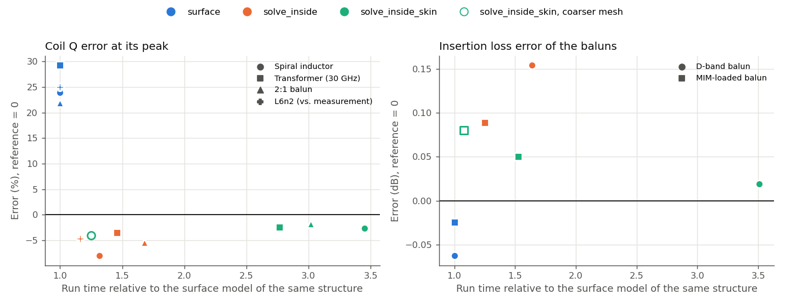
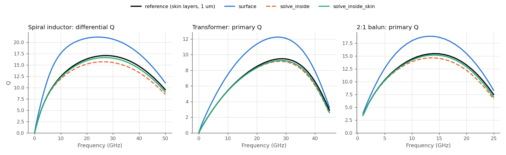
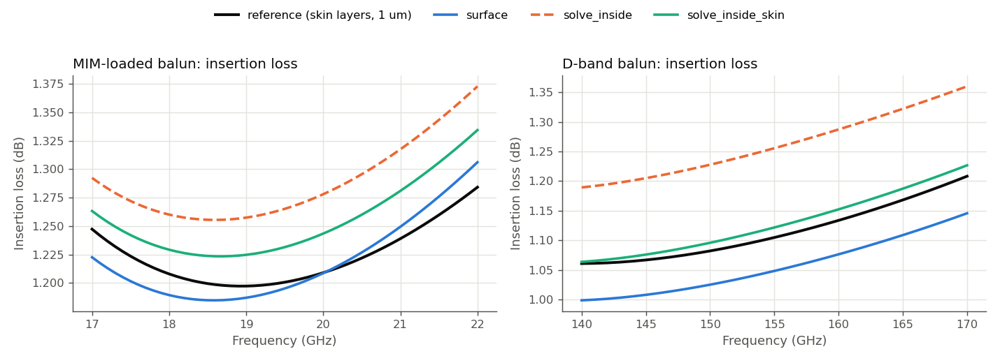
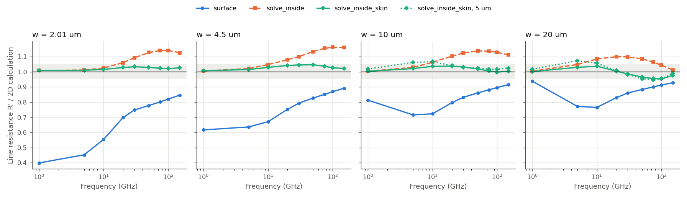
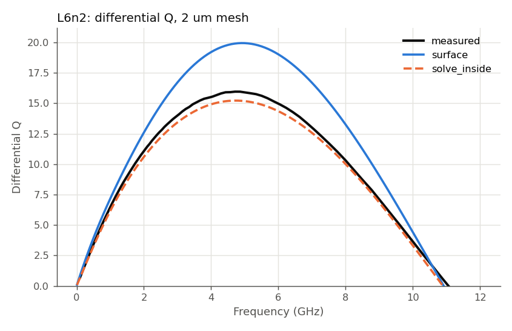
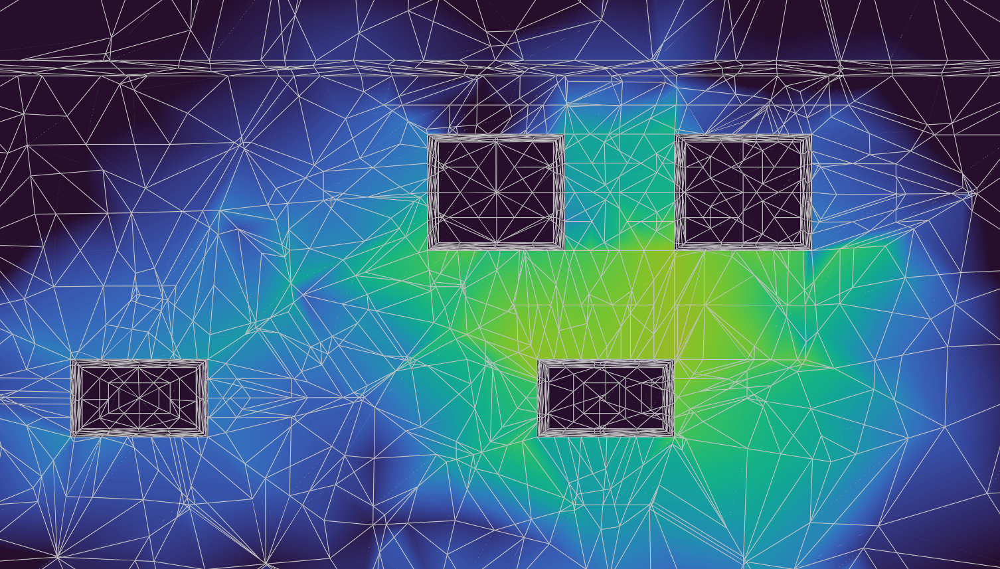

# Conductor models: accuracy and cost

gds2palace v0.9.0 now offers three conductor models:

```python
settings['conductor_model'] = 'surface'            # default: surface impedance on all conductor faces
settings['conductor_model'] = 'solve_inside'       # conductors meshed as volumes
settings['conductor_model'] = 'solve_inside_skin'  # volumes with thin layers along the faces for the skin effect
```

The new `solve_inside_skin` option is an extended filled metal model: additional mesh layers are created near all surfaces, to resolve the skin effect. The thickness of these skin layers is **independent** of `refined_cellsize`: it follows from the skin depth at the highest simulation frequency. Along the surface, the cells keep `refined_cellsize`.

The new `conductor_model` replaces the previous `filled_metals` setting. Scripts with `filled_metals` still work: `False` is read as `'surface'`, `True` as `'solve_inside'`.

____

The study below reviews these conductor models for different test cases and answers two questions for a designer: how far off is each model in the numbers you use (Q, insertion loss, line loss), and what does it cost (run time, memory)?

## Results at a glance

| purpose | `settings['conductor_model']` |
|---|---|
| inductance, coupling, resonance, match and balance | `'surface'`, the fastest |
| Q and insertion loss while designing | `'solve_inside'`: a few percent pessimistic, up to 1.7x the run time of `'surface'` |
| Q and insertion loss, final numbers | `'solve_inside_skin'`: within about 3 % in Q and 0.05 dB in loss, 1.4-3.5x the run time |



Each point is one run. Left: the peak Q of the coils, against the most accurate earlier result (for L6n2: against the measurement). Right: the largest insertion loss error of the two baluns in their band. The surface model is the fastest, but its coil Q is 18-30 % too high. `'solve_inside'` costs a little more and is a few percent pessimistic. `'solve_inside_skin'` is close to the reference, at about three times the cost of the surface model.

## What this means for results with the surface model

The surface model is not wrong. It is the usual way to model good conductors in a 3D EM solver: HFSS, too, uses an impedance boundary for good conductors unless Solve Inside is switched on. Most results from earlier gds2palace models stay valid:

- **Inductance, coupling, self-resonance, match, amplitude and phase balance** hardly depend on the conductor model. All three models agree within about 1 % in L and k, and the mesh convergence studies reached the same conclusions about mesh size with every conductor model.
- **Insertion loss of baluns and matching networks** is off by 0.02-0.14 dB here. That is often within the design margin, but it matters where every tenth of a dB counts, e.g. at an LNA input or a PA output.
- **Coil Q** is where the surface model is clearly off: 18-30 % too high at the peak, for coils with 2-8 µm traces on the thick top metals. This was a known limitation (see "Limits of conductor loss calculation" in the user's guide); this study puts numbers on it. A surface model Q of such a coil is an optimistic value, not a design value.

So earlier surface model results don't need to be redone for L, k, resonances or matching. Rerun them with `'solve_inside'` or `'solve_inside_skin'` where Q or loss sets a design decision, e.g. the phase noise of a VCO or the noise figure of an LNA.

## 1. How the study was run

Six SG13G2 structures from earlier studies, each with its most accurate earlier result as the reference:

| structure | what we look at | reference |
|---|---|---|
| spiral inductor, 4 turns, 0-50 GHz | peak Q, L, R at 1 GHz | `'solve_inside_skin'` at 1 µm (inductor mesh study) |
| transformer, 30 GHz | Q, L and k at 30 GHz, peak Q | `'solve_inside_skin'` at 1 µm (transformer mesh study) |
| 2:1 balun, 1-50 GHz | peak Q, L, k, peak \|Sdd21\| | `'solve_inside_skin'` at 1 µm (2:1 balun mesh study) |
| D-band balun, 140-170 GHz | insertion loss, match, balance | `'solve_inside_skin'` at 1 µm (D-band balun mesh study) |
| MIM-loaded balun, 17-22 GHz | insertion loss, match | `'solve_inside_skin'` at 1 µm (MIM balun mesh study) |
| L6n2 inductor, measured | L, peak Q, SRF | the measurement |
| straight TopMetal2 lines, 2-20 µm wide | line resistance R', attenuation in dB/mm | 2D calculation of R' (`lines/peec2d.py`), filled metals at 0.25 µm for the attenuation |

The structures and their setups are those of the mesh convergence studies (`../mesh_convergence/`) and of the L6n2 v3 study (`../measured_vs_simulated/more_accurate_models_L6n2_v3/`). Only the conductor model and, for a few runs, the mesh size change. All new runs use a 2 µm mesh (`refined_cellsize`), plus `'solve_inside_skin'` at a coarser mesh where the gaps allow it.

All new runs ran on the same machine (hpz2, AMD Ryzen AI Max+ 395), with 16 MPI processes, one run at a time. So their run times can be compared with each other. The references ran under other conditions: we use them for accuracy only.

The reference itself is not the truth. It is the most accurate simulation we have, and its own error is a few percent. Only L6n2 has a measurement.

## 2. Coils: the surface model gives too much Q



On all three coils, the surface model's Q is far above the reference: +24 % for the spiral inductor, +29 % for the transformer primary, +22 % for the balun primary, at the peak. The reason is the current crowding at the edges and corners of the thick top metal traces. A surface impedance per face cannot describe it (see "Accuracy at high frequency" in the gds2palace user's guide).

The two volume models agree with the reference much better, and both are slightly pessimistic. `'solve_inside'` is 3.5-8 % low in peak Q. Its 2 µm cells are too thick to follow the current decay into the metal at high frequency. `'solve_inside_skin'` is 2-3 % low: the thin layers at the surface resolve the skin effect.

Inductance and coupling hardly depend on the conductor model: all models are within about 1 % of the reference.


## 3. Thin layers: the surface model's second error



The surface model has a second error, of the opposite sign. A thin layer that carries its current on one face only, like a MIM capacitor plate or a ground plane under a line, gets up to twice its real loss.

The MIM-loaded balun has both errors: too little loss in its coils, too much in its MIM plates. Here they cancel, and the surface model is within 0.02 dB of the reference. This cancellation depends on the layout, so it can't be relied on for other structures.


On the D-band balun, without MIM capacitors, the surface model is 0.06 dB optimistic, `'solve_inside'` 0.15 dB pessimistic, and `'solve_inside_skin'` within 0.02 dB. For both baluns, `'solve_inside_skin'` is within 0.05 dB of the reference.

## 4. Straight lines: how the error depends on the trace width



The lines run over an ideal ground, so only the TopMetal2 strip has loss. This isolates the error of the thick conductor. The grey band marks ±5 %, the accuracy of this comparison (a 3D line on a finite ground plate against a 2D calculation on an infinite one).

The surface model is too low at every width. At low frequency, its side walls make the trace look wider than it is, so a narrow trace has far too little resistance: 40 % of the real value for the 2 µm line at 1 GHz. At 50-150 GHz, it is still 8-22 % low, more for narrow traces.

`'solve_inside'` is right at low frequency, and up to 16 % high at 30-100 GHz. `'solve_inside_skin'` stays within the ±5 % band at all widths and frequencies. In S21, its attenuation is within 0.04 dB/mm of the converged filled model.

For the 10 and 20 µm lines, `'solve_inside_skin'` at a 5 µm mesh is within 7 % (the largest deviations at 5-10 GHz), and even faster than the surface model at 2 µm: a coarser mesh is allowed where the trace is wider than the cells.

## 5. Against the measurement: L6n2



L6n2 is a 4-turn inductor with peak Q at 5 GHz, simulated with the setup of the L6n2 v3 study (conformal passivation, via merging with fill factor correction, 400 µm margin). The surface model's peak Q is 25 % above the measurement. `'solve_inside'` is 4.6 % below it, and within 2 % in inductance and SRF.

`'solve_inside_skin'` builds the same model as `'solve_inside'` here. The sweep ends at 14 GHz, where the 3 µm TopMetal2 is just under 4 skin depths thick, so gds2palace adds no skin layers. At low GHz frequencies, `'solve_inside'` is already close to converged.

## 6. Cost

Run time and peak memory relative to the surface model of the same structure, at the same 2 µm mesh:

| structure | surface model | `'solve_inside'` | `'solve_inside_skin'` |
|---|---|---|---|
| spiral inductor | 1.7 min, 6.4 GB | 1.3x, 1.2x | 3.5x, 2.3x |
| transformer | 3.6 min, 5.6 GB | 1.5x, 1.1x | 2.8x, 1.9x |
| 2:1 balun | 7.2 min, 12.3 GB | 1.7x, 1.2x | 3.0x, 2.0x |
| D-band balun | 1.6 min, 5.3 GB | 1.6x, 1.2x | 3.5x, 2.0x |
| MIM-loaded balun | 12.5 min, 12.9 GB | 1.3x, 1.2x | 1.5x, 1.7x |
| L6n2 | 19.7 min, 18.6 GB | 1.2x, 1.2x | (same model) |
| lines, 2-20 µm | 2.3-2.5 min, 5.2-5.4 GB | 1.0-1.1x, 1.0x | 1.4-2.0x, 1.2-1.4x |

The cost follows the number of unknowns. Skin layers add thin cells along all faces of the thick metals, which doubles the unknowns of a coil model. The volume models also need a few more solver iterations per frequency (27-37 instead of 21-25 in the baluns and the transformer). Where only one layer gets skin layers, as TopMetal2 in the 22 GHz MIM balun, they cost much less.



The cross-section through the transformer shows where the extra unknowns come from. Each trace has a ring of thin cells along all its faces, the skin layers. Inside the trace and along its surface, the cells keep the normal size.

A coarser mesh can pay back the cost, but only where the mesh is not limited by small gaps. The spiral inductor (5 µm gaps) with skin layers at 5 µm was 4 % low in Q, at 1.25x the run time of the surface model at 2 µm. The MIM balun with skin layers at 3 µm was within 0.08 dB, at 1.1x. Where traces are 2 µm apart, the mesh must stay at 2 µm for every conductor model (see the mesh convergence studies).

## 7. Conclusions

1. **The surface model remains the fast choice for most of the design work.** Inductance, coupling, resonances, match and balance agree with the volume models within about 1 %. Its weak point is loss: coil Q is 18-30 % too high on every coil here, and thin layers with current on one face can get up to twice their loss. On a complete circuit, the two loss errors can add up or cancel.
2. **`'solve_inside'` is a good working choice for Q and loss.** It is a few percent pessimistic at a 2 µm mesh, and costs up to 1.7x the run time of the surface model.
3. **`'solve_inside_skin'` gives final numbers.** It was within about 3 % in Q and 0.05 dB in loss on every structure, at 1.4-3.5x the run time and up to 2.3x the memory of the surface model.
4. **The stackup matters as much as the conductor model** when comparing with a measurement: see the L6n2 v3 study for the effect of conformal passivation.

These results come from six SG13G2 structures. Other layouts can show other numbers, but the pattern (surface too high in coil Q, `'solve_inside'` slightly low, `'solve_inside_skin'` close) was the same on all of them.

## Files

| file | content |
|---|---|
| `make_variants.py` | writes the model scripts of the coil and balun structures and of L6n2 from their base scripts |
| `inductor/`, `transformer/`, `balun2x1/`, `dband_balun/`, `mim_balun/`, `l6n2/` | model scripts, one per conductor model (`python <script> nogui`) |
| `lines/make_line_models.py`, `lines/peec2d.py`, `lines/reference/` | straight line models, the 2D reference calculation, and the reference runs (filled 0.25 µm, ideal conductors) |
| `build_models.py`, `remote_runs.py` | build all models; upload, run (one at a time, 16 processes) and collect on the simulation machine |
| `study_data.py`, `analyze.py`, `analyze_lines.py`, `analyze_l6n2.py` | accuracy against the references and cost; `results/tables.md` has all numbers |
| `plots.py` | the figures of this README |
| `results/` | Palace results of every run (`port-S.csv`, `palace.json`, `run.log`, `config.json`, `port_information.json`), tables and plots |

The 2:1 balun runs were made on the same machine under the same conditions shortly before this study, with the same models, and are reused here. The reference files of the inductor, transformer and both D-band and 2:1 baluns are port de-embedded (`combine_extend_snp.py`); the new runs are de-embedded the same way before the comparison. The MIM balun reference and runs are compared without de-embedding, as in its mesh study.
