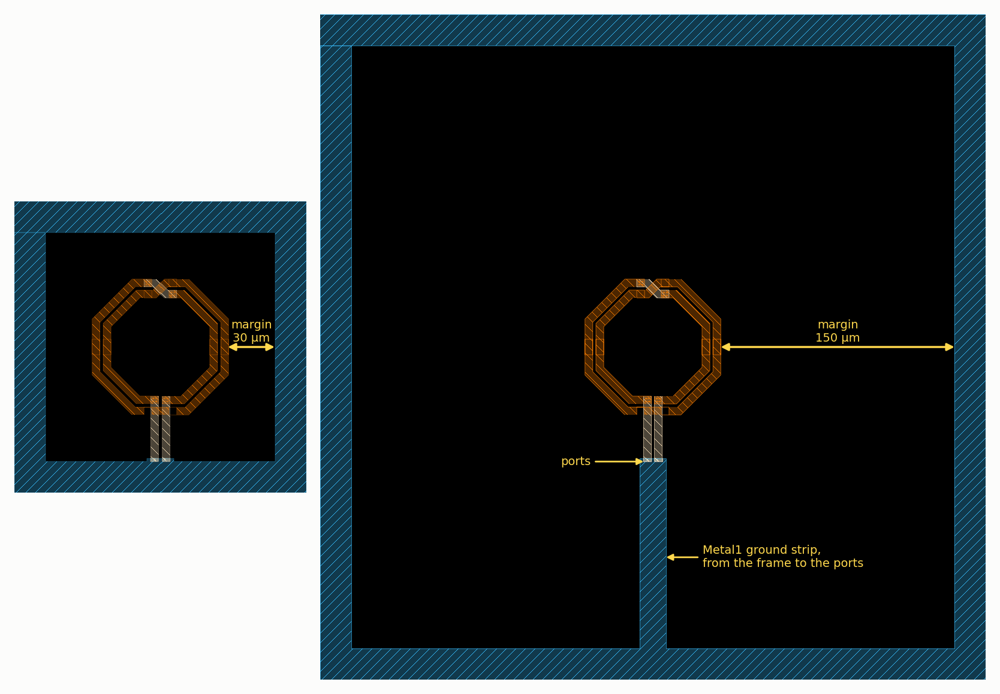
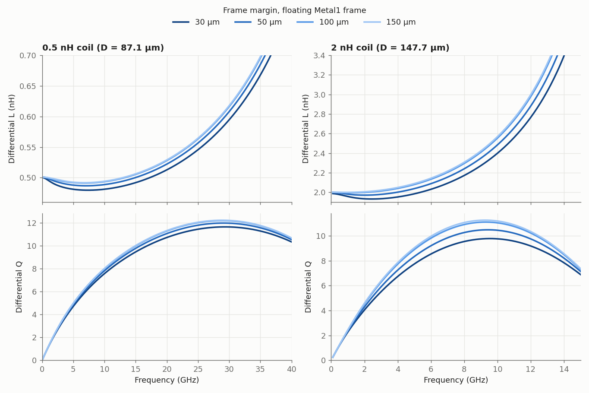
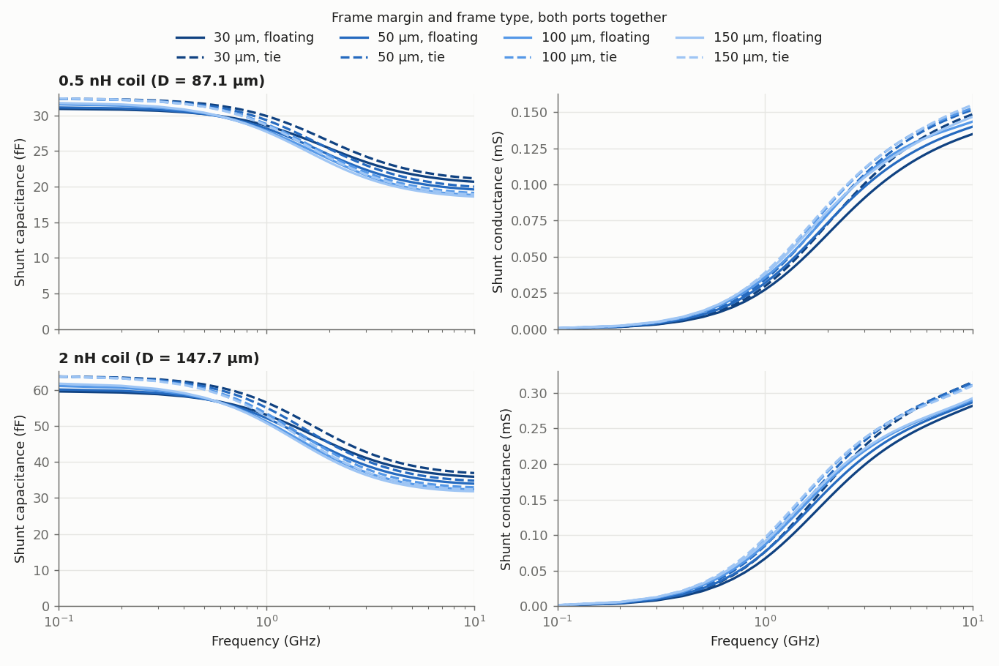
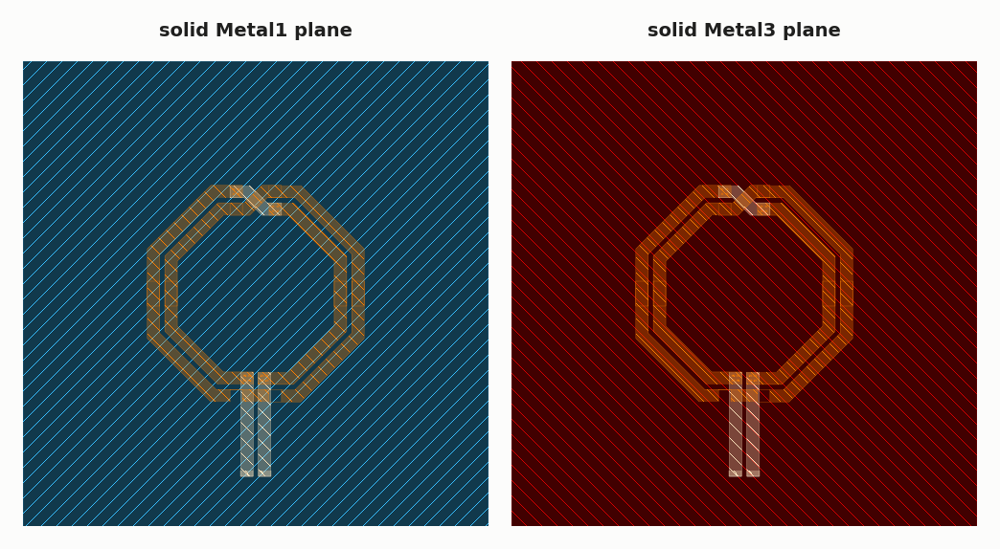
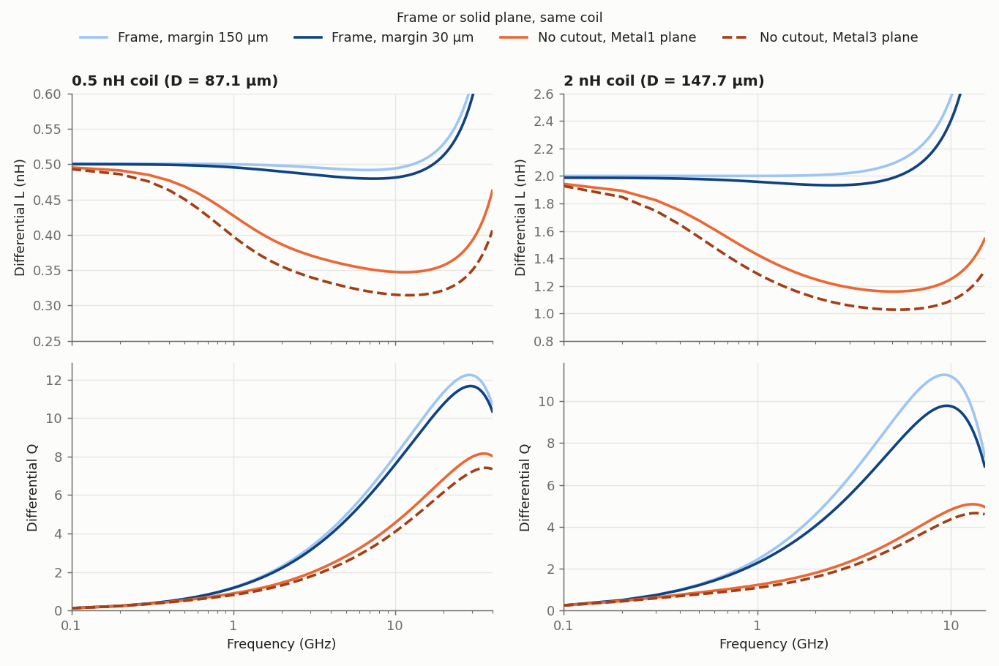
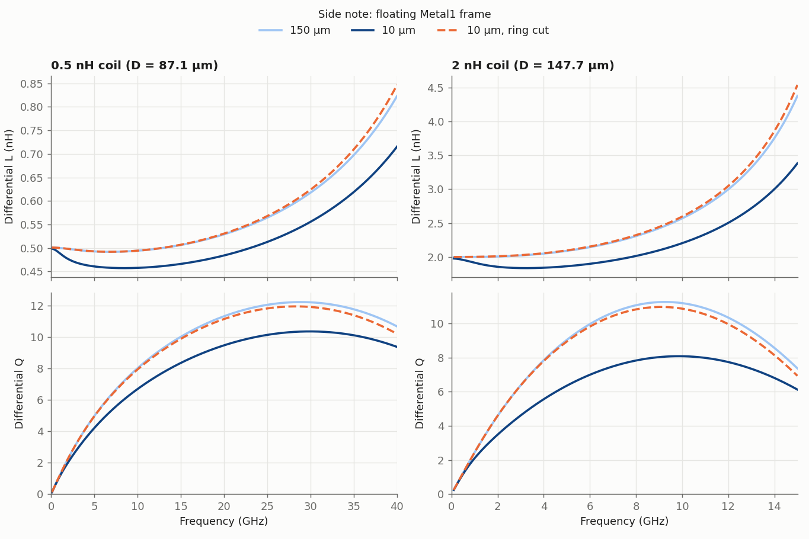

# How far should the ground frame be from an inductor?

A ground frame around an inductor affects it in two ways. It is a closed metal ring, so the coil's magnetic field drives
an eddy current around it. It also collects substrate current, so it changes the shunt path. Both get stronger as the
frame comes closer.

This study sweeps the margin between coil and frame for a 0.5 nH and a 2 nH coil, from 30 µm (the PDK's NOQRC size) to
150 µm. The margin is the distance from the outer edge of the coil to the inner edge of the frame, and it is the same
on all four sides. Section 5 covers the case without any cutout, with a solid ground plane under the coil. The study uses
Palace EM simulation only. There is no comparison with measurement.

**Result:**

- L and Q have nearly settled at 100 µm.
- At 30 µm, peak Q is 5 % lower for the 0.5 nH coil and 13 % lower for the 2 nH coil than at 150 µm.
- L at 5 GHz is 2 % and 5 % lower.
- Shunt capacitance at 2.4 GHz is 10 % and 12 % higher.
- A floating frame and a substrate tie give almost the same L and Q. They differ mainly in the shunt branch.
- Without a cutout, the same coil over a solid Metal1 or Metal3 plane loses much more. Peak Q is 33 to 39 % lower for the
  0.5 nH coil and 55 to 59 % lower for the 2 nH coil. L at 5 GHz is 27 to 34 % and 44 to 51 % lower.

## 1. The two coils

The layouts come from [`inductor_synthesis_no_external_library`](../inductor_synthesis_no_external_library), with w = 5 µm and s = 2 µm. The diameter
was tuned for the target L at 1 GHz with the frame at 150 µm, then kept fixed, so any change in L comes from the frame.

| | 0.5 nH coil | 2 nH coil |
|---|---|---|
| Turns, outer diameter | 2, 87.1 µm | 3, 147.7 µm |
| Differential L at 1 GHz | 0.500 nH | 2.000 nH |
| Differential peak Q | 12.2 at 29 GHz | 11.3 at 9.3 GHz |
| SRF differential, single-ended | 59.6 GHz, 50.7 GHz | 19.7 GHz, 17.8 GHz |

These values are for the floating frame at 150 µm, and all percentages below refer to them.

The frame is the generator's closed square ring, 20 µm wide, in Metal1. The ports stay 30 µm from the coil at every
margin, and the simulation box stays the same. The generator's ground strip connects the ports to the frame. It is in
Metal1, 17 µm wide for the 0.5 nH coil and 40 µm for the 2 nH coil, and reaches 2 µm under the feed at the ports. It is
only a short stub at 30 µm and gets longer as the margin grows (see the figure above), so the frame and this strip are
all that change. Two frame types were simulated:

- **Floating:** Metal1 only. It couples to the silicon through the oxide.
- **Substrate tie:** the same outline also on Cont and Activ, connecting the ring to the silicon. There is no ideal
  ground sheet.

## 2. L and Q: the closed ring acts as a shorted turn

The ring is a shorted turn coupled to the coil. Metal1 is thin, so the ring has a few ohms of resistance, which is
similar to its reactance at around 1 GHz (hand estimate). Well below that, little eddy current flows and L is
unchanged. Above it, the eddy current opposes the coil's field, which lowers L and adds loss.

The curves show this. All margins start at the same L at low frequency, and they separate above about 1 GHz.

Change against the 150 µm margin, floating frame:

| | 0.5 nH, 30 µm | 50 µm | 100 µm | 2 nH, 30 µm | 50 µm | 100 µm |
|---|---|---|---|---|---|---|
| L at 1 GHz | -0.9 % | -0.3 % | 0.0 % | -2.1 % | -0.9 % | -0.2 % |
| L at 5 GHz | -2.3 % | -1.0 % | -0.1 % | -5.0 % | -2.5 % | -0.5 % |
| R at 5 GHz | +3.1 % | +1.4 % | 0.0 % | +10.9 % | +5.7 % | +1.1 % |
| Differential peak Q | -4.7 % | -2.0 % | -0.3 % | -13.1 % | -6.9 % | -1.4 % |
| Differential SRF | +1.5 % | +0.6 % | +0.1 % | +2.4 % | +1.2 % | +0.1 % |

The 2 nH coil is affected more at the same margin. Scaling the margin with the diameter does not fully explain this:
at a margin of 0.34 D, peak Q drops by 4.7 % for the 0.5 nH coil and by 6.9 % for the 2 nH coil.

The generator's own margin of D/2 lies between the simulated points. Interpolating gives about -3 % and -4 % in peak Q.
This margin was not simulated directly.

## 3. Shunt branch: the frame collects substrate current

Substrate current from the coil flows to the frame. A closer frame shortens that path, so the substrate resistance
falls and its capacitance rises. The oxide capacitance under the coil changes by at most 3.4 % over these margins.

Fit of Cox in series with Rsub parallel to Csub, 0.3 to 5 GHz, both ports together (rms error below 0.4 %):

| Frame | Margin | 0.5 nH: Cox, Rsub, Csub | 2 nH: Cox, Rsub, Csub |
|---|---|---|---|
| Floating | 30 µm | 31 fF, 904 Ω, 59 fF | 59 fF, 636 Ω, 86 fF |
| Floating | 150 µm | 32 fF, 1328 Ω, 43 fF | 61 fF, 919 Ω, 62 fF |
| Tie | 30 µm | 32 fF, 897 Ω, 58 fF | 64 fF, 636 Ω, 83 fF |
| Tie | 150 µm | 32 fF, 1278 Ω, 43 fF | 64 fF, 897 Ω, 62 fF |

This branch settles more slowly than L and Q. At 100 µm, Rsub is still 5 to 8 % below its 150 µm value.

The single-ended SRF of the 0.5 nH coil is also still moving: it is 3.4 % higher at 30 µm and 1.6 % higher at 100 µm
than at 150 µm. The cause was not investigated. For the 2 nH coil the same change is only 1.5 % and 0.1 %.

## 4. Floating frame or substrate tie

The eddy current runs in the Metal1 of the ring in both cases. The tie adds Activ in parallel, but at about 7 Ω/sq
against 0.11 Ω/sq for Metal1 it carries very little of it. So the series behaviour barely changes: L and differential
peak Q agree within 0.3 % at every margin, and single-ended peak Q within 0.7 %.

The tie connects the ring directly to the silicon, which removes the oxide between them. Shunt capacitance at 2.4 GHz
is 1.9 to 4.5 % higher than with the floating frame, and shunt conductance 6 to 14 % higher.

## 5. No cutout: a solid plane under the coil

Some designs have no cutout at all, and the coil sits on the ground plane. To see what that costs, the same two coils
were placed over one solid plane, on Metal1 or on Metal3. The coils were not re-tuned, so these numbers show what happens
to an existing coil. A designer would enlarge the coil to get back to the target L.

The plane replaces the frame and has no slits. The ports now go from the plane to the feed, 30 µm from the coil as
before. The middle of the coil's TopMetal2 is 11.3 µm above the Metal1 plane and 9.2 µm above the Metal3 plane.

**The plane acts as a mirror.** The coil's field drives eddy currents in the plane, directly under the turns. These
currents form an image of the coil that opposes it, which lowers L. The plane is thin, so at low frequency its resistance
limits these currents. L is only 1 to 4 % low at 0.1 GHz. It then falls, with half of the fall reached below 1 GHz, and
flattens out by about 5 GHz.

Change against the floating frame at 150 µm. The frame at 30 µm is repeated for comparison:

| | 0.5 nH: frame 30 µm | Metal1 plane | Metal3 plane | 2 nH: frame 30 µm | Metal1 plane | Metal3 plane |
|---|---|---|---|---|---|---|
| L at 1 GHz | -0.9 % | -14.5 % | -20.4 % | -2.1 % | -28.6 % | -35.5 % |
| L at 5 GHz | -2.3 % | -27.4 % | -33.7 % | -5.0 % | -44.5 % | -50.8 % |
| R at 5 GHz | +3.1 % | +27.6 % | +29.4 % | +10.9 % | +52.7 % | +50.6 % |
| Differential peak Q | -4.7 % | -33.4 % | -39.4 % | -13.1 % | -54.9 % | -58.7 % |
| Differential SRF | +1.5 % | +18.7 % | +22.6 % | +2.4 % | +30.2 % | +35.7 % |
| Shunt C at 2.4 GHz | +9.5 % | +60.5 % | +98.4 % | +12.0 % | +83.0 % | +124.5 % |
| Shunt G at 2.4 GHz | -16.6 % | -99.9 % | -99.8 % | -13.2 % | -99.7 % | -99.5 % |

**Q falls because L falls and R rises together.** At 5 GHz, the 0.5 nH coil over Metal1 has 27 % less L and 28 % more R,
which gives 43 % less Q. Q peaks later, at 36 instead of 29 GHz and at 13 instead of 9 GHz, but lower.

**The substrate no longer matters.** The plane shields the silicon, so shunt conductance almost vanishes. This removes
the substrate loss, but the net effect on Q is still strongly negative. What remains in the shunt path is a capacitance
to the plane. It scales with the inverse of the height: C times height is the same for Metal1 and Metal3 within 1 %.

**The Metal3 plane is worse because it is 2 µm closer to the coil.** This strengthens both the image and the capacitance.

**SRF goes up, but Q stays lower over the usable range.** L falls by more than C rises, so resonance moves to a higher
frequency. Q over the plane only passes the frame's Q at about 49 GHz (0.5 nH) and 17 GHz (2 nH), where the frame's Q is
already falling towards its SRF.

**The size of the plane hardly matters.** A plane with the outer size of the 150 µm frame gives the same result as one
with the size of the 30 µm frame: within 1.6 % at 1 GHz, 0.5 % at 5 GHz and 0.2 % in peak Q. The currents that matter
flow directly under the coil.

## Side notes

These runs are outside the main sweep, but they support its explanations. Changes are against the floating frame at
150 µm.

| | 0.5 nH: L at 5 GHz, peak Q | 2 nH: L at 5 GHz, peak Q |
|---|---|---|
| Floating, 10 µm | -6.5 %, -15 % | -11 %, -28 % |
| Floating, 10 µm, ring cut | 0.0 %, -2.3 % | +0.3 %, -2.6 % |
| Ring on `SUBGND`, 30 µm | -2.8 %, -1.5 % | -5.8 %, -1.6 % |

**Cut ring.** A 2 µm cut stops the ring current, and L and nearly all of Q return, even at 10 µm. This confirms the
shorted turn as the cause. The shunt branch stays as it was without the cut. SRF then falls with the added shunt
capacitance, by 1.8 % (single-ended, 0.5 nH) and 3.9 % (2 nH), instead of rising as it does with the closed ring.

**Ring on `SUBGND`.** The first tied models also had the ring on the `SUBGND` sheet, which is PEC. That makes the ring a
lossless shorted turn. L is low already at 1 GHz (-2.9 % and -5.6 % at 30 µm, against -0.9 % and -2.1 % for the
floating frame), and Q is much too good. This variant is a limit for a very low-resistance ring, not a model of a
Metal1 tie ring, so the main sweep doesn't use it.

**Absolute Q.** The low Q at low frequency is real for these layouts. Series resistance at 1 GHz matches a hand sum from
the layout within about 3 %. The generator's 2×2 TopVia2 arrays make up about 40 % of it for the 0.5 nH coil and about
30 % for the 2 nH coil. They don't affect the margin trend.

## How reliable this is

| Check | Result |
|---|---|
| Dielectric beyond the frame, 200 against 400 µm | below 0.2 % in L, Q and shunt branch at 1, 5 and 20 GHz (0.5 nH), and at 1 and 5 GHz (2 nH) |
| Metal mesh, 2 against 1 µm | L within 0.2 % away from the SRF, Q up to 3.5 % at 20 GHz (0.5 nH). Absolute Q near its peak is slightly low; the trend uses one setting throughout |
| Fast sweep against direct solves, same mesh | within 0.07 % in L, R and Q up to 60 GHz (0.5 nH) and 30 GHz (2 nH) |
| hpz2 against ryzen9, same mesh | identical in all printed digits. Each coil's sweep ran on one machine |
| Solid plane, image limit by hand | L without the plane minus the mutual inductance to the coil's mirror image (Neumann integral over the turns) gives L within 2.2 % of the simulation at 5 GHz: 0.358 and 0.328 nH against 0.359 and 0.327 nH, 1.134 and 1.014 nH against 1.159 and 1.027 nH |
| Solid plane, mesh | Palace AMR, 0.5 nH coil over Metal1, up to 3.8 and 4.7 million unknowns. At 5 GHz: L within 0.3 %, R 0.8 %, Q 0.5 %, shunt C 2 % lower. At 20 GHz: L within 0.8 %, but R 4.6 % lower and Q 5.6 % higher. So peak Q over a plane is about 5 % or more too low here. It was not checked at the peak itself. Larger runs, up to 8 million unknowns and the machine's memory limit, showed the same on the 2 nH coil and the Metal3 plane: Q about 1 % at 5 GHz, 5.6 % and still rising at 15 GHz. Those models are not included, because they add nothing to the result |

Limits of the study:

- It covers these two coils, this stackup (`SG13G2_FEM_200um.xml`) and a Metal1 ring. A frame stacked over several metal
  layers has less resistance, so it will behave more like the `SUBGND` limit.
- Cont is drawn as one solid layer over the whole ring, not as real contact arrays.
- The solid planes are on one layer, without slits or fill rules, and not tied to the silicon. The coils were not
  re-tuned, so Q at equal L over a plane was not simulated.
- gds2palace refines the mesh along metal edges, and a solid plane has none under the coil. The mesh there is about
  10 µm, and a smaller cell size for the plane's layer does not change it. That is why AMR was used as the check.
- There is no comparison with measurement.

## Files

| File | Purpose |
|---|---|
| `study.py` | layouts and Palace models. Conductor model `solve_inside`, order 2, 2 µm metal mesh, 5 µm on the frame |
| `remote.py` | runs and collects models (`STUDY_HOST=hpz2` or `ryzen9`) |
| `trend.py`, `compare.py` | tables of all runs, and the direct-solve and side-note comparisons |
| `make_plane_models.py`, `plane_checks.py` | the models without a cutout, and their AMR, image limit and capacitance checks |
| `plot_study.py` | the figures in `plots/` |

Run names in `results/`: `s_<coil>_g<margin>_<float|noPEC|tied>` for the sweeps, `d_*` for the 10 µm diagnostics,
`chk_*` for the direct solves, `s_<coil>_g<margin>_plane<M1|M3>` for the solid planes (the margin gives their outer
size), `amr_*` for the mesh checks of the planes. `tied` is the ring on `SUBGND`.
