# Stackup and Conductor Model Study: L6n2 Inductor vs. Measurement (IHP SG13G2), v4

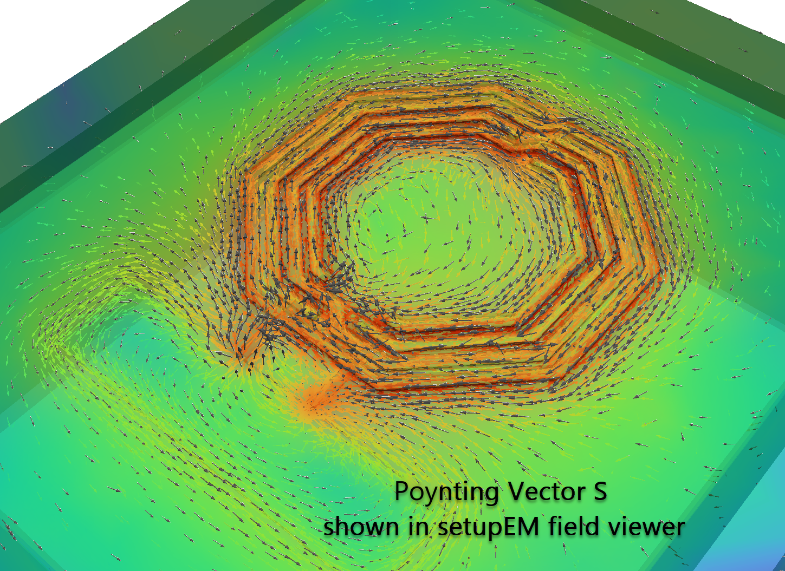

**Abstract.** A 4-turn inductor in IHP SG13G2 is simulated with AWS Palace in 12 model variants and compared to its measured differential L, Q and SRF.
Four model details decide the accuracy: 
- corrected via resistance in merged via arrays
- conductors meshed as volumes (`conductor_model = 'solve_inside'`)
- conformal passivation over TopMetal2 and 
- simulation margin large enough for a coil without ground frame.

With all four, the best model is within 1 % in L and SRF and 3.3 % in peak Q of the measurement. Run times are 2 to 9 minutes on 16 cores.

> ## Workflow update: the same results in less time
>
> 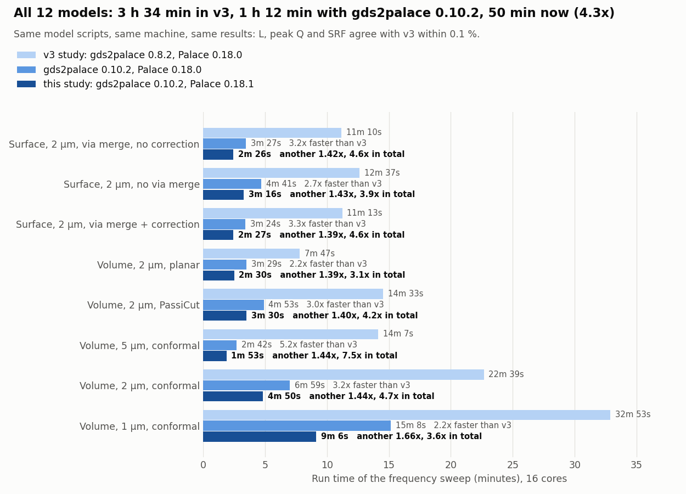
>
> **All 12 models of this study took 50 min instead of 3 h 34 min in v3, with the same results.**
>
> - **gds2palace 0.10.2, 3.0x faster:** only a diagnostic step changed. After each field solution, Palace computes an error estimate of the mesh, a number that is only reported when adaptive mesh refinement is off. In v3 this step took two thirds of the run time. gds2palace 0.10.2 lets Palace compute that number with less effort. Nothing to set: it does this by default.
> - **Palace 0.18.1, another 1.4x:** v3 was run with Palace 0.18.0. This study uses Palace 0.18.1, a bug-fix and performance release, from the [published image](../../../doc/building-palace-apptainer.md). If you downloaded that image, you already have this gain.
> - **Neither step changes the results:** the field solution and the S-parameters are computed exactly as before, with the same solver settings. L, peak Q and SRF agree with v3 within 0.1 %.
> - **Same model scripts and machine as v3.** See [section 10](#10-run-times-v3-and-v4) for all 12 runs and both steps.

## Contents

- [Simulation boundary: margin around the layout](#simulation-boundary-margin-around-the-layout)
- [Conductor model: surface vs. solve_inside](#conductor-model-surface-vs-solve_inside)
- [Over-estimate of via cross section due to via array merging](#over-estimate-of-via-cross-section-due-to-via-array-merging)
- [True conformal passivation](#true-conformal-passivation)
- [The details of this study](#the-details-of-this-study)
- [0. Layout](#0-layout)
- [1. Margin: how far the absorbing boundary must be](#1-margin-how-far-the-absorbing-boundary-must-be)
- [2. Via array merging and effective via array cross section](#2-via-array-merging-and-effective-via-array-cross-section)
- [3. Conductor loss: surface vs. solve_inside](#3-conductor-loss-surface-vs-solve_inside)
- [4. Conformal passivation over TopMetal2](#4-conformal-passivation-over-topmetal2)
- [5. Cheaper model for TopMetal2 dielectrics](#5-cheaper-model-for-topmetal2-dielectrics)
- [6. Cheaper model, revisited](#6-cheaper-model-revisited)
- [7. The ultimate model?](#7-the-ultimate-model)
- [8. Solver setting: complex coarse solve](#8-solver-setting-complex-coarse-solve)
- [9. Shunt parameters: the ground of the model decides](#9-shunt-parameters-the-ground-of-the-model-decides)
- [10. Run times: v3 and v4](#10-run-times-v3-and-v4)
- [Summary](#summary)

This study looks for the best possible model with highest accuracy for an inductor example, including comparison to measured data. It evaluates the effect of four potential error sources:

## Simulation boundary: margin around the layout
The model ends with absorbing boundaries at some distance from the layout. Earlier versions of this study used a 100 µm margin, which was perfectly fine in the initial model where the inductor was surrounded by a metal frame. That metal frame "shields" the inductor to some extent, although it creates eddy currents in the metal frame and that metal cutout underneath the inductor becomes part of the overall device.

The model was then changed: the metal frame was removed, to be more consistent with the measured layout, which has no metal frame. **However, the `margin` was not increased at that moment, it was simply forgotten.** Without the metal frame, the fringing fields around the inductor can spread out much further, and that's what version 3 of the study investigated: the impact of the forgotten distance to the absorbing boundary conditions.

Since version 3, the study has a margin check and uses a converged margin of 400 µm for all models.

## Conductor model: surface vs. solve_inside
In the User's Guide, there is a detailed analysis on the limitations of the "surface impedance sheet" loss model that gds2palace uses for modelling conductor layers. Here, we investigate the benefit of meshing the conductors as volumes with their conductivity (`conductor_model = 'solve_inside'`) for such cases. At high frequency, where the skin depth is much smaller than the mesh cells, `'solve_inside'` overestimates the loss. `'solve_inside_skin'` adds thin layers along the conductor faces for that case, see the [conductor model study](../../conductor_models/README.md). For L6n2, with peak Q at 5 GHz, both build the same model.

## Over-estimate of via cross section due to via array merging
In most models, we want to merge via arrays into bigger blocks, to speed up simulation. Leaving all individual vias would be more accurate, causing much more complex mesh and increase simulation time. Via array merging replaces the individual vias by their outer bounding box, and here's the problem: the effective total cross section is now much larger than before, so this under-estimates the resulting via resistance. Only a minor error in many models, because the relative impact of via resistance is small. However, in this model investigated here, it does show up in results, and we will use an option in gds2palace to restore the correct via resistance by applying a correction factor internally.

NOTE: The [first version of this study](../more_accurate_models_L6n2/README.md) showed great agreement to measured, but for the wrong reason. That model had used via array merging with no correction (under-estimated resistance) and a lossy common ground plane for the ports in Metal1 (adding series resistance), and both errors had compensated by pure coincidence. The [second version](../more_accurate_models_L6n2_v2/README.md) fixed this, but used a 100 µm margin, which underestimated L by 1.3 % and peak Q by 3.5-4.7 % in all models (section 1). The [third version](../more_accurate_models_L6n2_v3/README.md) repeated all models with a 400 µm margin. All conclusions of v2 hold; the absolute values moved closer to the measurement. This fourth version repeats the models of v3 unchanged with gds2palace 0.10.2 and Palace 0.18.1: the results are the same, and the run times are less than a quarter (section 10).

## True conformal passivation
The stackup used so far covers TopMetal2 with another thick **flat** layer of SiO2 plus Passivation. This is efficient for simulation, but we can do better now, if we are willing to spend additional simulation time for a more detailed model. A recent extension of the stackup file format now offers "derived layers", so that we can now create a stackup that models the true **conformal** shape of dielectrics above TopMetal2. We will see that this is indeed useful to match the measured SRF of the testcase, with more accurate prediction of the true capacitance between the sidewalls of closely spaced TopMetal2 traces.

## The details of this study:

- **Model:** `L6n2_with_ports.gds` (cell `L_6n2`), 2 via ports from a common PEC ground plane to TopMetal1, Z0 = 50 Ω
- **gds2palace:** version 0.10.2, with `complex_coarse_solve` enabled (the default since 0.8.0, see section 8) and the cheaper error estimate for models without mesh refinement (new in 0.10.2, see section 10)
- **EM stackups:** SG13G2_200um plus individual modifications (reported below)
- **Solver:** AWS Palace (FEM), order 2, ABC boundaries, **400 µm margin** (section 1), 50 µm air around
- **Sweep:** 0–14 GHz in 0.1 GHz steps, using Palace's adaptive frequency sweep. 14 GHz is about 1.2x the measured self-resonant frequency (SRF).
- **Port de-embedding:** not used here, calculated 1.6 pH port parasitic per side is negligible here
- **Measurement:** `meas_L5_6n2_THRU_deemb.S2P`, already de-embedded, 100 MHz–50 GHz. The measured differential values are L = 5.01 nH at 1 GHz, peak Q = 15.96 and SRF = **11.07 GHz**.
- **Execution:** Simulated on `hpz2` with Palace 0.18.1 (the [published image](../../../doc/building-palace-apptainer.md)), one model at a time, using 16 cores, 109 GB RAM available.

## 0. Layout

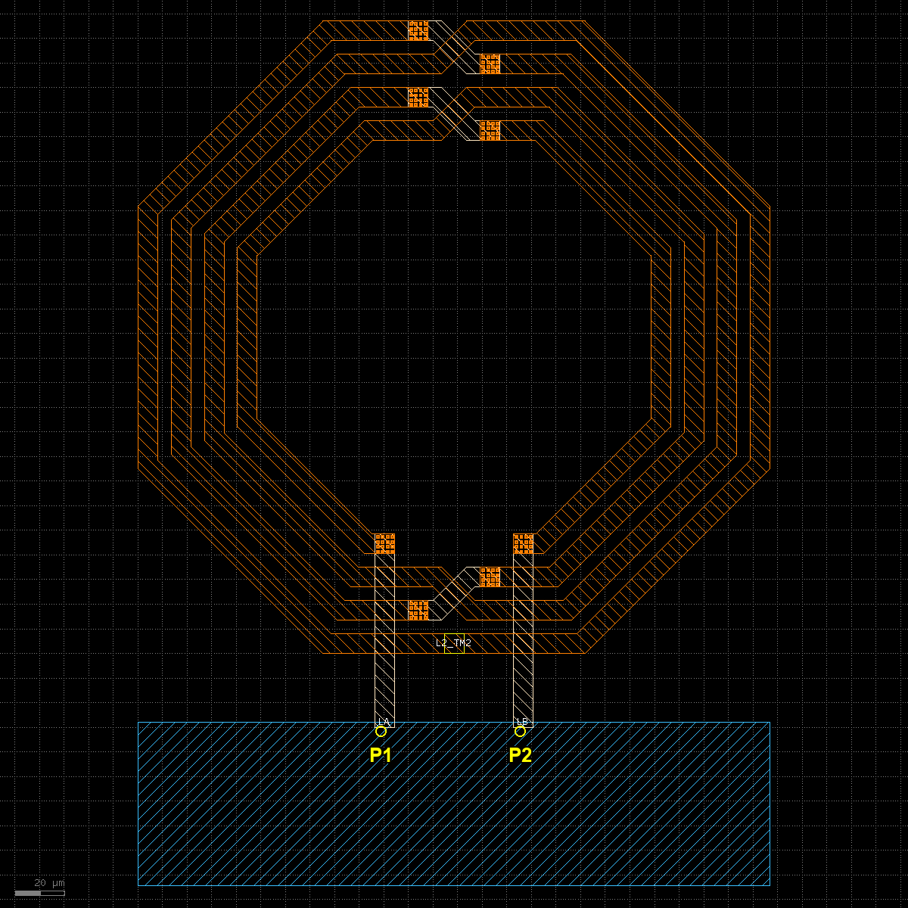

The inductor is a 4-turn octagonal spiral on TopMetal2. It is about 257 × 352 µm in size. Where the turns cross each other, the path drops down to TopMetal1 through TopVia2. Each crossing uses an array of vias, 128 vias in total. The two leads (`L_A` and `L_B` in the GDS) end at the via ports **P1** and **P2** at the bottom.

Different from the initial version of this study, the **common ground plane** for ports is on the SUB_GND layer. This is (almost) perfect conductor and does not introduce extra series resistance.

## 1. Margin: how far the absorbing boundary must be

`settings['margin']` sets how far the dielectrics and the substrate extend beyond the layout before the air box (`settings['air_around']`, kept at 50 µm here) and the absorbing boundary. With a Metal1 ground frame around the inductor, the return currents and much of the field stay inside the frame. Without a frame, as here, the magnetic near field of the coil reaches out by about its own diameter, and an absorbing boundary inside that region both truncates the field (lower L) and absorbs energy (lower Q).

The most accurate practical model of this study (conformal passivation, `'solve_inside'`, 2 µm mesh, section 4) was simulated with margins of 100, 200, 400 and 800 µm:

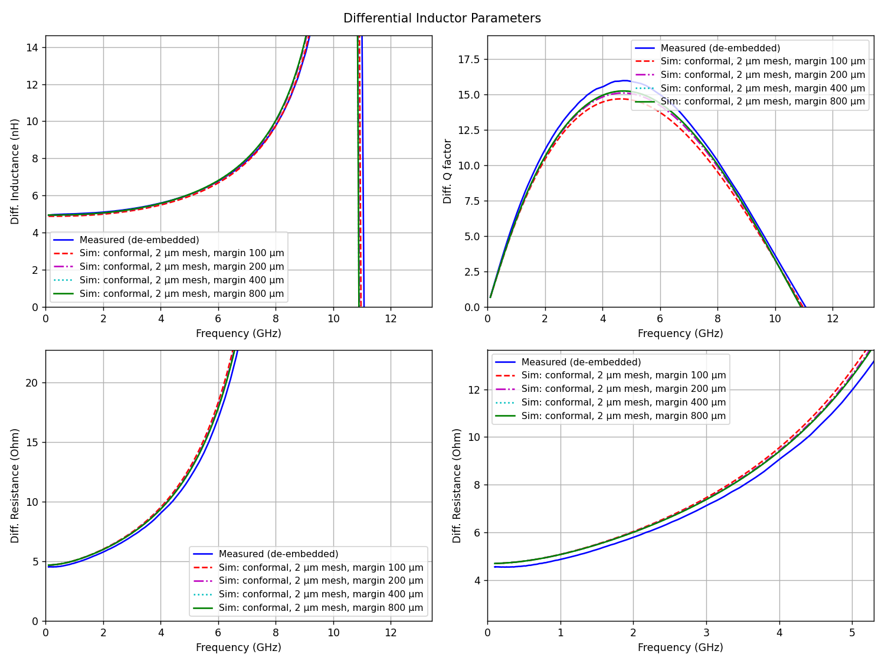

| Margin | L at 1 GHz | Peak Q | SRF | DOF | Solve time | Peak RAM |
|---:|---:|---:|---:|---:|---:|---:|
| 100 µm | 4.898 nH | 14.67 | 10.97 GHz | 1,449,368 | 5m 4s | 22.78 GB |
| 200 µm | 4.949 nH | 15.08 | 10.91 GHz | 1,475,110 | 4m 47s | 22.76 GB |
| 400 µm | 4.963 nH | 15.22 | 10.90 GHz | 1,505,676 | 4m 50s | 23.40 GB |
| 800 µm | 4.965 nH | 15.23 | 10.89 GHz | 1,596,716 | 5m 10s | 24.62 GB |
| measured | 5.009 nH | 15.96 | 11.07 GHz | | | |

(differential values, L at 1 GHz, peak Q below the SRF)

A 100 µm margin underestimates L by 1.3 % and peak Q by 3.7 %, and slightly overestimates the SRF. At 400 µm, the result is within 0.0 % (L) and 0.1 % (Q) of 800 µm, so 400 µm is used for all models in this study. The larger margin costs very little: the region beyond the layout is meshed coarsely, so DOF and memory grow by only 3 to 4 % from 100 µm to 400 µm, and the solve time stays the same. In v3, the 100 µm run reproduced the v2 result exactly, so all differences between v2 and v3 are due to the margin.

How much margin is needed depends on the coil size: as a rule of thumb, at least the outer diameter of the coil when there is no ground frame. All models of this study changed by about the same amount from 100 µm to 400 µm (L +1.3 %, peak Q +3.5 to +4.7 %, SRF -0.6 %), so the comparisons between model variants in the following sections are not affected by the margin, only their absolute values.

## 2. Via array merging and effective via array cross section

The effect of via array merging was investigated for this inductor because we have several via arrays, and the 8 μm line width requires small via arrays with only 4x4 vias.

With 8 via arrays and 16 vias each, we have a total of 8/16*1.1 Ohm nominal resistance from the vias = 0.55 Ohm. Via array merging replaces the individual vias by the overall bounding box, roughly a 4x increase in effective cross section. We expect to see a difference of ~ 0.4 Ohm, which sounds like a small effect only, but that is already ~10% of the total inductor resistance in this case (looking at DC values).

The plot below shows 4 curves:
- baseline: measurement results
- simulation result **with** via array merging, **no** fill factor correction
- simulation result **without** via array merging
- simulation result **with** via array merging, **with** fill factor correction

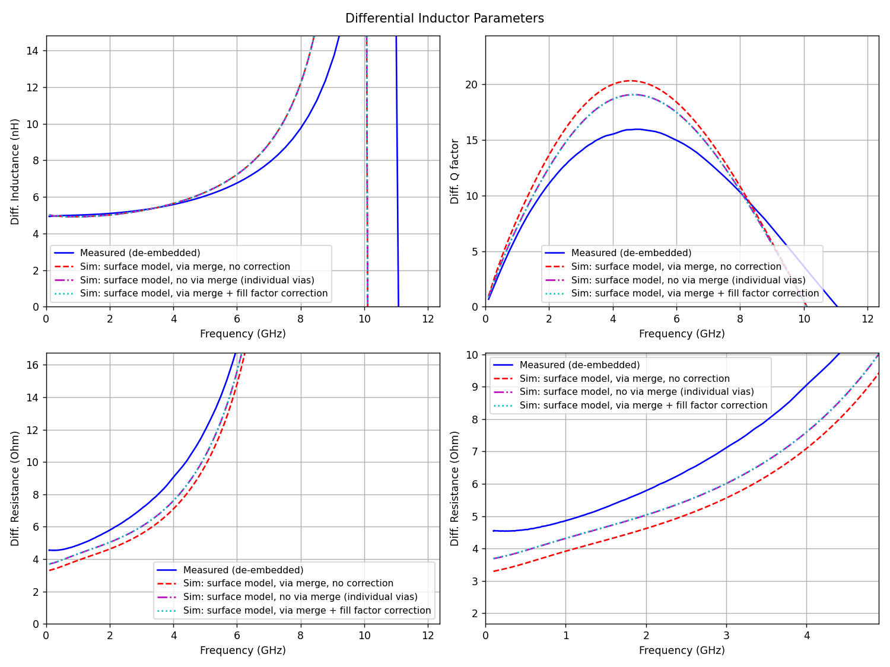

The measurement does **not** agree yet with our simulation in multiple aspects, including peak Q and SRF, and in this study we will address (and improve) all of this. For now, focus on the **series resistance** on the bottom right side.

Conclusion: The ~0.4 Ohm offset from simple via array merging (no correction for fill factor) is confirmed. This error source can be removed, without falling back to the slow individual via simulation: Results with via array merging **plus** the `settings['fill_factor_correction']=True` option are **visually identical** to the data with no via array merging, but at **lower simulation cost**:

| Via array handling | Conductor model | Mesh | DOF | Mesh elements | Solve time | Peak RAM |
|---|---|---:|---:|---:|---:|---:|
| no merge | Surface | 2 µm | 1,099,794 | 157,914 | 3m 16s | 16.54 GB |
| merge | Surface | 2 µm | 1,012,554 | 145,226 | 2m 26s | 15.42 GB |
| merge + correction | Surface | 2 µm | 1,012,554 | 145,226 | 2m 27s | 15.39 GB |

The correction factor for effective cross section is calculated by gds2palace as 28% and that value can be seen in the physical volume name for that merged via group also.

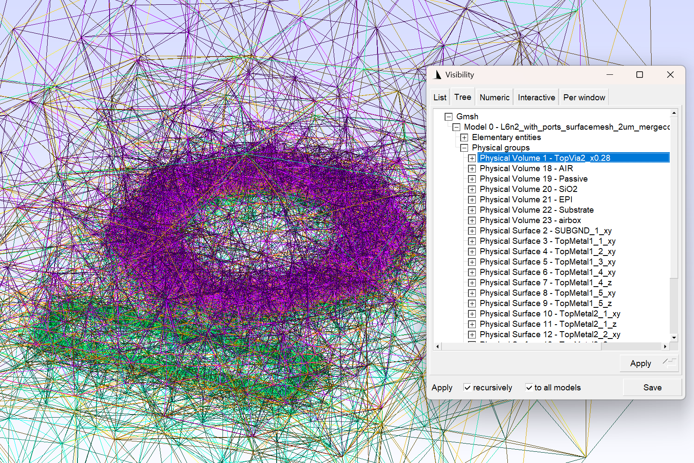

Internally, gds2palace groups correction factors in buckets where the value agrees within 20%, to avoid creating excessive number of via groups for larger designs.

## 3. Conductor loss: surface vs. solve_inside
Simulations above used the **surface impedance sheet** conductor loss model, where the conductor is represented by a hollow volume with surface impedance mapped to all sides of that conductor shell. Skin effect and a low frequency limit resulting from "thickness" are built into each surface. Until September 2026, there was no other option for conductor layer loss modelling in gds2palace.

In the User's Guide, there is a detailed analysis on the limitations of that surface sheet loss model. Here in this study, we investigate the benefit of meshing the conductors as volumes (**`'solve_inside'`**) for such cases.

    settings['conductor_model'] = 'solve_inside'   # before gds2palace 0.9.0: settings['filled_metals'] = True

At high frequency, where the skin depth is much smaller than the mesh cells, `'solve_inside'` overestimates the loss. `'solve_inside_skin'` adds thin layers along the conductor faces for that case, see the [conductor model study](../../conductor_models/README.md). For L6n2, with peak Q at 5 GHz, both build the same model.

The next plot compares the two different conductor loss models. Blue is the measured baseline, red is the surface loss model and purple is the `'solve_inside'` model. Both models use refined_cellsize=2 µm with via array merging plus fill factor correction.

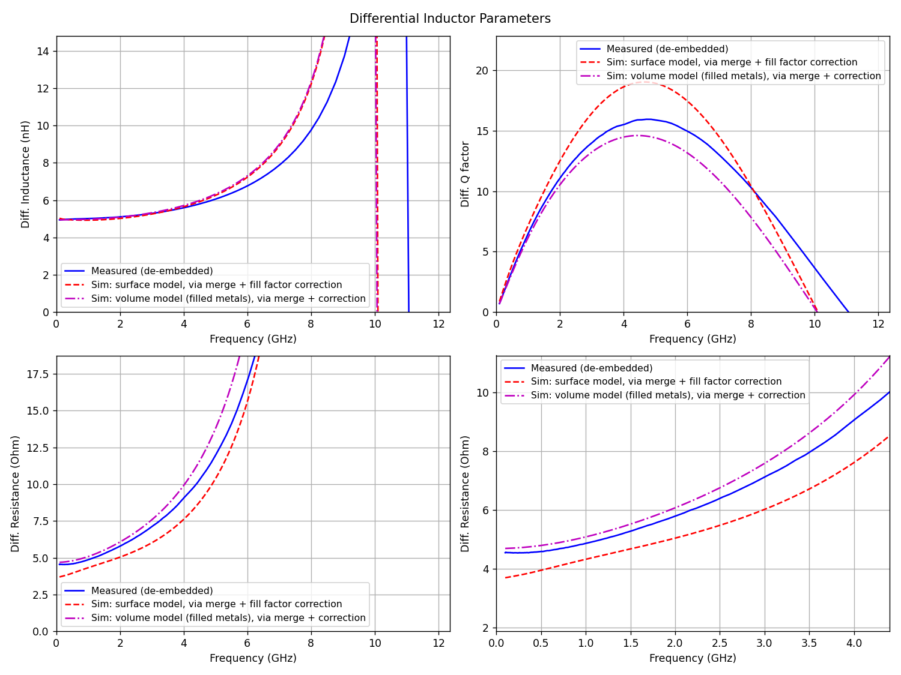

Series resistance for the `'solve_inside'` model (purple) is now closer to the measured values across the entire frequency band. Q factor has changed from optimistic (predicted peak Q too large for surface model) to pessimistic for the `'solve_inside'` model, and the SRF is lower than measurement, as before. Series L is very robust, as before, and agrees well except for the SRF difference.

Meshing the conductors as volumes means more mesh cells and more memory. The solve time is about the same here, because the adaptive sweep needed fewer solves for this model (10 instead of 12):

| Via array handling | Conductor model | Mesh | DOF | Mesh elements | Solve time | Peak RAM |
|---|---|---:|---:|---:|---:|---:|
| merge + correction | Surface | 2 µm | 1,012,554 | 145,226 | 2m 27s | 15.39 GB |
| merge + correction | Volume | 2 µm | 1,216,074 | 191,574 | 2m 30s | 18.31 GB |

What is not shown in this table: Palace also calculates internal "quality" metrics from the FEM solution. These error indicator values are approximately twice as much for the volume mesh model. This indicates that we might need a smaller refined_cellsize value for the volume mesh model. We will come back to that later, for the "ultimate" final model with best accuracy.

**Note on skin effect:** with a volume mesh, the current distribution inside the conductor must be resolved, and the skin depth of TopMetal2 is smaller than the 2 µm mesh above a few GHz (δ = 0.91 µm @ 10 GHz, 0.41 µm @ 50 GHz). This turned out to be much less critical than expected: the second order finite elements used by Palace follow the current decay into the metal even when a mesh cell is several skin depths thick. The plot below compares them with the exact solution for the 3 µm thick TopMetal2, where a 2 µm mesh means two cells of 1.5 µm through the metal. Left: current density from the surface to the centre of the metal at 75 GHz. Right: RF resistance per square of TopMetal2, which starts at the DC value of 11 mΩ and rises as the current moves to the surfaces.

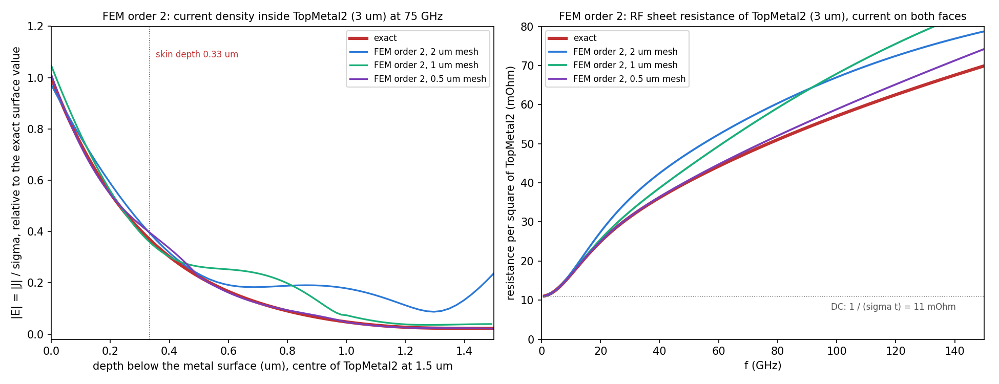

Only when the skin depth is a fraction of the cell size, some current is left too deep in the metal, and the resistance comes out too high:

| mesh | 10 GHz | 20 GHz | 50 GHz | 100 GHz |
|---|---:|---:|---:|---:|
| 2 µm | +2.4 % | +10 % | +18 % | +17 % |
| 1 µm | +0.5 % | +2.3 % | +9 % | +19 % |
| 0.5 µm | 0 % | 0 % | +0.7 % | +3 % |

For this inductor, with SRF at 11 GHz, the 2 µm mesh is good enough: about 2 % in conductor loss at 10 GHz, and the 1 µm "ultimate" model in section 7 indeed changes peak Q by only 1.4 %. For inductors and lines at mm-wave frequencies, the error of the 2 µm mesh grows to 10-20 %, and a finer mesh is needed in the conductors.

## 4. Conformal passivation over TopMetal2

We will continue from the best case so far, volume mesh model with via array merging + correction factor, and explore another error source: the conformal passivation above TopMetal2.

According to the SG13G2 process specification, we have a conformal coating on top of TopMetal2 with 1.5µm of SiO2 and 0.4µm passivation layer.

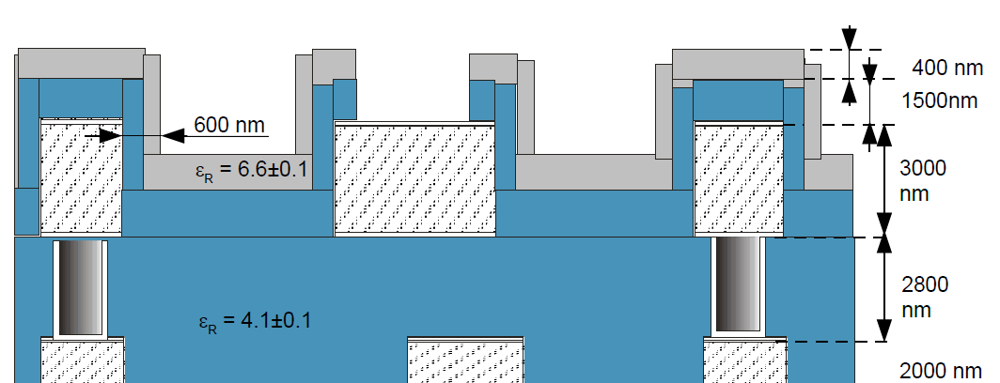

For simplicity and simulation efficiency and due to tool restrictions, all SG13G2 EM stackups so far had used a planarized model, with those 1.5µm + 0.4µm modelled as a solid block that extends from the bottom of TopMetal2 to well above it. There is no "valley" on the sides of the conductors, it is all filled up with SiO2 dielectric.

Simple planarized stackup used so far:
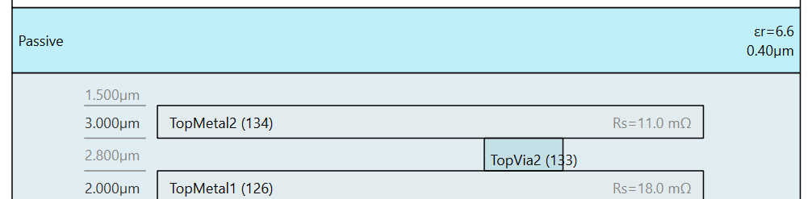

It is obvious that this will over-estimate capacitance between sidewalls of close spaced TopMetal2 traces: that metal is 3µm thick and there would be a good fraction of air above the dielectrics in the valleys, but that is all filled with SiO2 in the EM model.

Utilizing the **derived layers** introduced recently in gds2palace XML file format, we can now do better, and create an XML stackup file that
- provides correct SiO2 and Passivation thickness in the valleys and
- adds conformal SiO2 around all TopMetal2 polygons (on top + hanging on sides)

There is still one simplification built into that "3D conformal" stackup: IHP only provides a combined thickness value for the dielectrics hanging on the side walls, and we model that as SiO2 here, not a mixture of mostly 4.4 (SiO2) with a little 6.6 (Passivation). No details in the Process Spec, so this is an approximation.

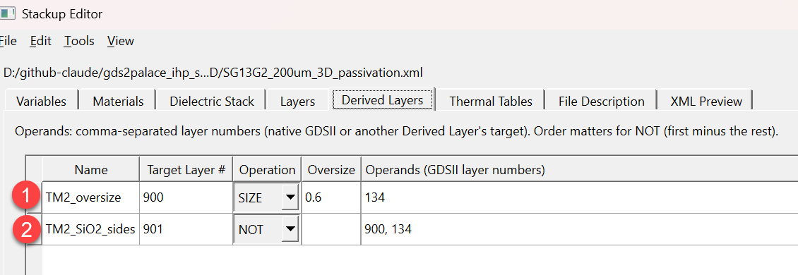

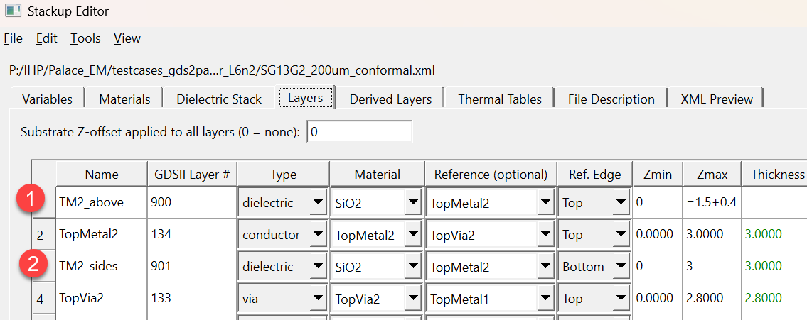

The stackup preview in setupEM (the GUI for gds2palace) is somewhat limited to show the result, but maybe you get the idea. TopMetal2 is drawn there inside SiO2 because the bottom side starts inside that dielectric. The top side of TopMetal2 is actually 1.5µm **above** the SiO2 dielectric, shown here as negative distance to the dielectric above.

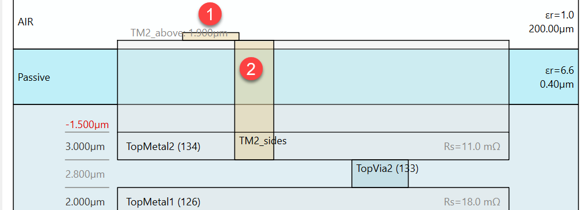

In mesh preview, you can find two more groups: the cover above TopMetal2 shapes and the side wall cover. Both are identified by the layer names used when mapping derived layers to their stackup position.

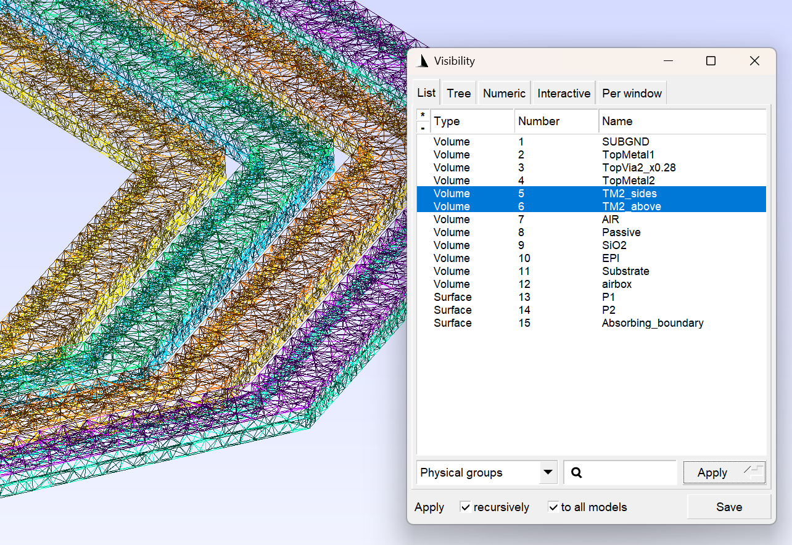

Simulation results agree nicely with measurement on SRF now (10.90 GHz, -1.6 %), and the higher SRF also brings the peak Q factor closer to measurement (15.22, -4.6 %). It is indeed a combination of multiple improvements to the model that enabled this more accurate result:
- correction factor for effective cross section in via array merging
- conductors meshed as volumes (`'solve_inside'`) at these low frequencies
- more accurate modelling of conformal coating above TopMetal2
- a margin large enough that the absorbing boundary does not touch the coil's near field

When all this comes together, simulation and measurement agree nicely.

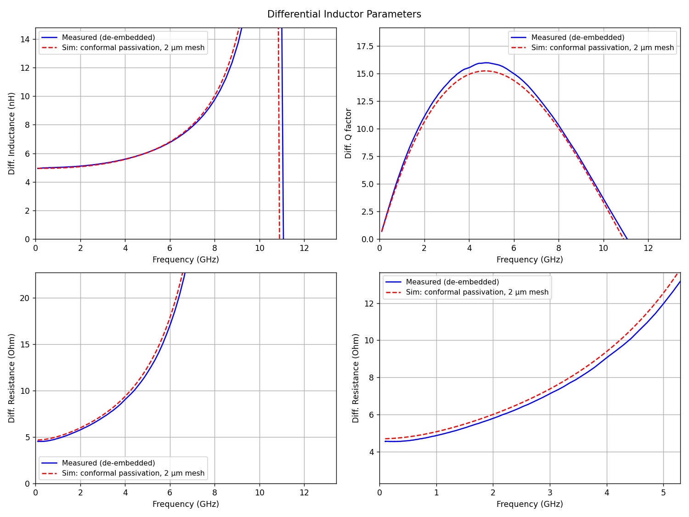

This model is numerically more expensive because we now create additional mesh cells for that conformal passivation, but it also has a nice side effect: even with rather large values of mesh refinement specified by the user, this adds some extra mesh cells around TopMetal2 trace, which can possibly help to capture the field gradients there.

 Stackup | Via array handling | Conductor model | Mesh | DOF | Mesh elements | Solve time | Peak RAM |
|---|---|---|---:|---:|---:|---:|---:|
| Planar | merge + correction | Volume | 2 µm | 1,216,074 | 191,574 | 2m 30s | 18.31 GB |
| Conformal | merge + correction | Volume | 2 µm | 1,505,676 | 237,453 | 4m 50s | 23.40 GB |

From here, we can now go two directions:
- investigate a "cheaper" model that places the SiO2 + Passivation correct for the valleys, but skips the dielectrics on top and sides of TopMetal2
- investigate an "ultimate accuracy" model with refined_cellsize=1 µm to see how much closer this brings us to measurement (hopefully).

## 5. Cheaper model for TopMetal2 dielectrics

The "cheaper" model leaves out the conformal cover over TopMetal2, and just places the correct thickness of SiO2 and Passivation in the valleys between TopMetal2 shapes. This avoids the over-estimate of sidewall capacitance from the original stackup, and avoids the extra effort of dielectrics conformal around TopMetal2. At least that's the idea here ...

In reality, it turns out that the dielectrics hitting TopMetal2 half way on the sides create a rather similar mesh: about the same DOF and memory, as shown in the comparison table below. It does solve faster, because Palace's linear solver needs fewer iterations for this model (27 instead of 36 per solve) and the adaptive sweep fewer solves (10 instead of 12).

 Stackup | Via array handling | Conductor model | Mesh | DOF | Mesh elements | Solve time | Peak RAM |
|---|---|---|---:|---:|---:|---:|---:|
| Conformal | merge + correction | Volume | 2 µm | 1,505,676 | 237,453 | 4m 50s | 23.40 GB |
| PassiCut | merge + correction | Volume | 2 µm | 1,528,972 | 240,786 | 3m 30s | 22.25 GB |

Results are very similar to the full 3D conformal simulation.

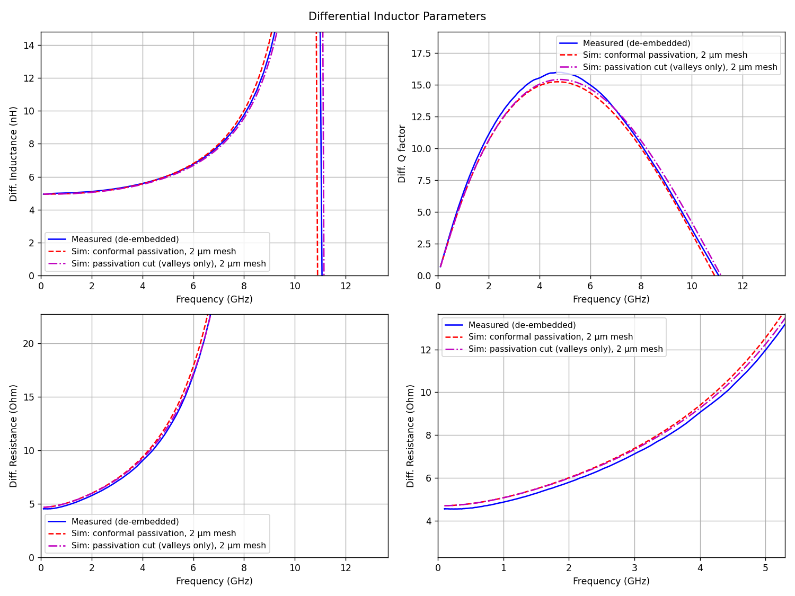

Below is a comparison of the resulting mesh, cutting plane near the middle of the model, fdump=6 GHz. (These field and mesh views are from the v2 models with 100 µm margin; the mesh near the coil is the same.)

Top view of overall mesh:
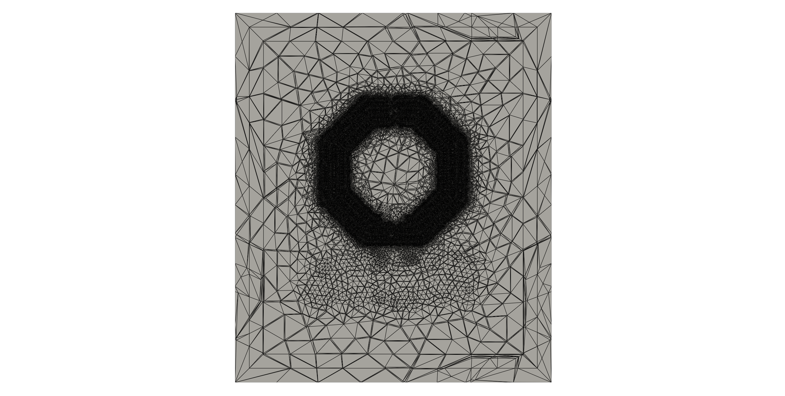

Side view of the overall mesh, the "tilted" mesh lines on the periphery are from airbox surrounding the SG13G2 stackup:
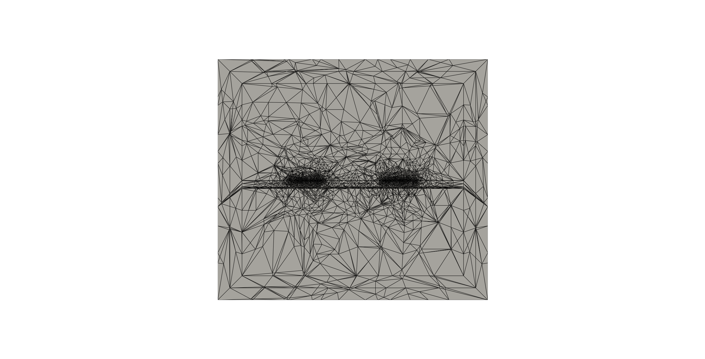

Detail view cut at y=40 µm plane, E field  with mesh overlay, stackup "3D conformal". We can clearly see the dielectric top cover and side walls in the mesh lines:
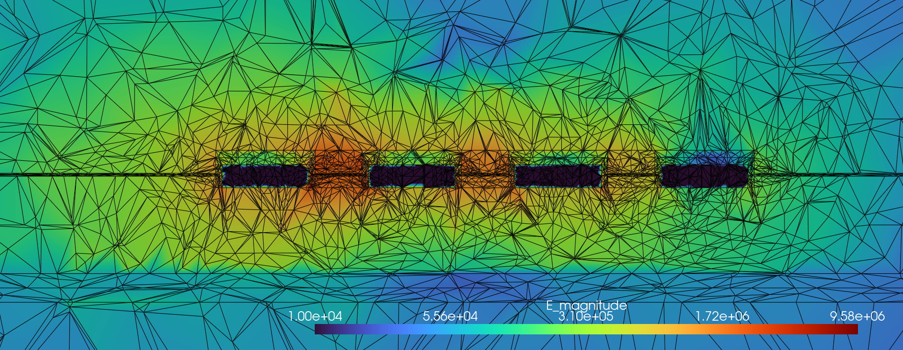

Detail view cut at y=40 µm plane, E field  with mesh overlay, stackup "passicut" which was meant to be "cheaper" alternative to true 3D conformal passivation. Note the passivation at approximately half the TopMetal2 height, with air above:
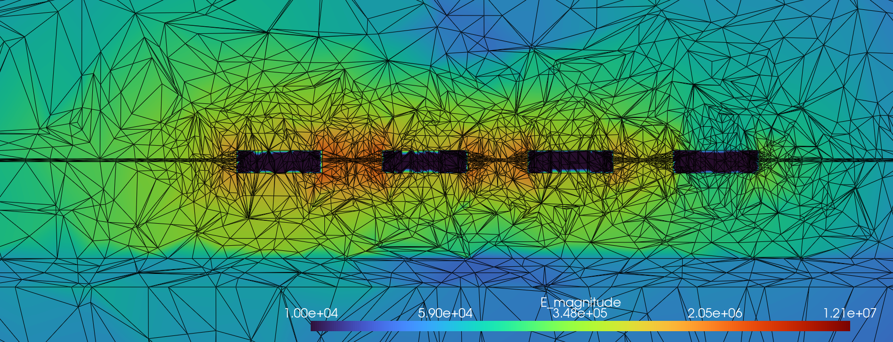

Detail view cut at y=40 µm plane, E field  with mesh overlay, stackup "SG13G2_200um" which is the present default, with thick planar layer of dielectric. We can clearly identify the big SiO2 block extending further up, with the thin Passivation layer on top. Due to the log scale used in this plot, we can't really see much difference in fields above/around TopMetal2.
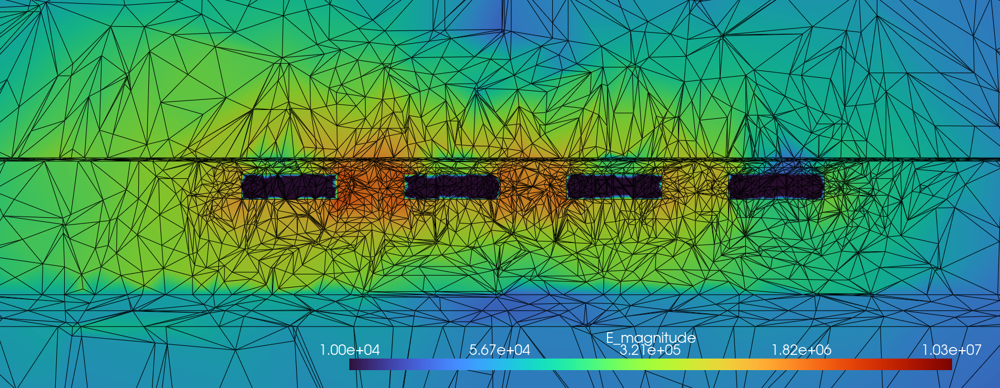

For the sake of completeness, we can also compare the mesh and fields resulting for that "SG13G2_200um" stackup with hollow conductors using the default "surface impedance" model.
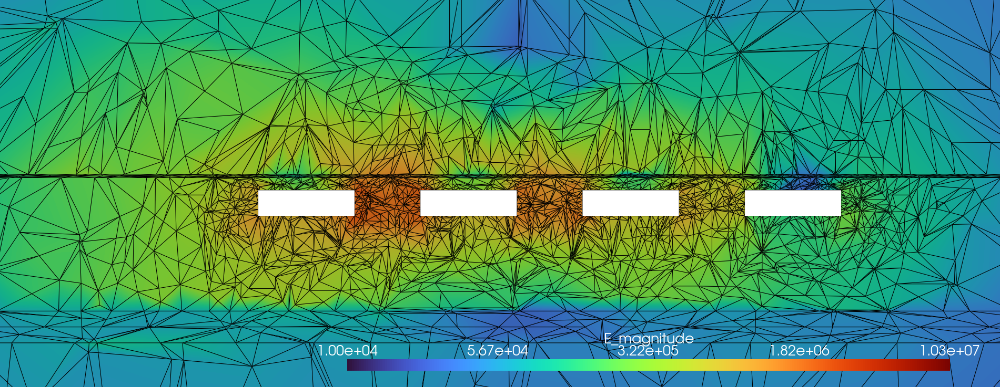
This surface impedance model took 2m 27s and 1,012,554 DOF, the more accurate 3D conformal passivation model took 4m 50s and 1,505,676 DOF.

## 6. Cheaper model, revisited

We have seen that all models create really dense mesh in the gap between conductors, and also on the conductor edges, much finer than the 2 µm refined cellsize value enforced in the model. So here is another idea to get a "cheap" model: can we use refined_cellsize = 5 micron, for less mesh vertices along the conductors (where fields changes only slowly) and get dense mesh in the critical region (perpendicular to the metal surface) from conformal passivation stackup? Let's try this!

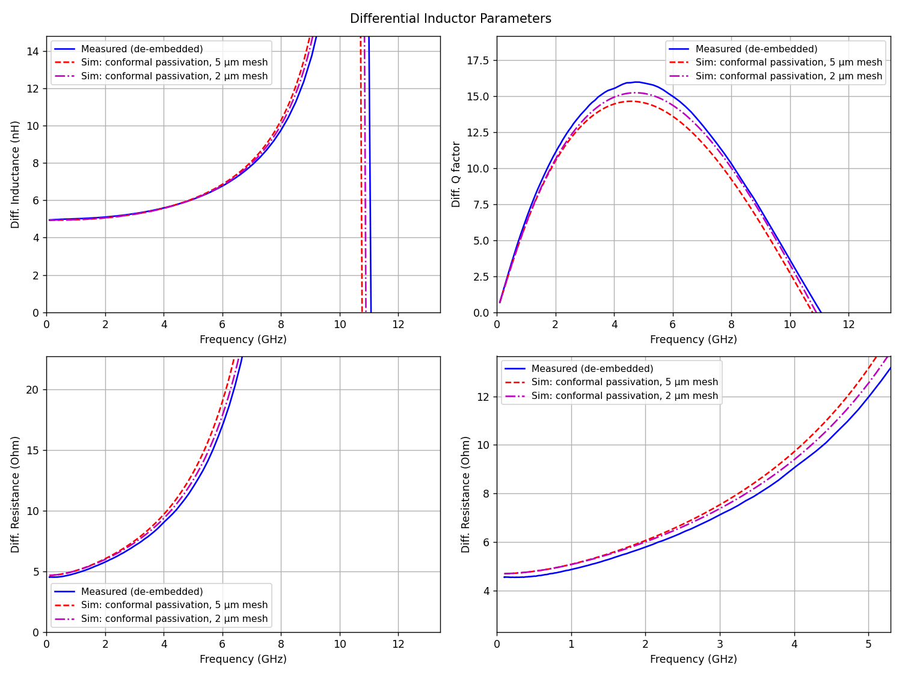

Compared to the 2 micron mesh, we lose accuracy in peak Q (-8.3 % vs. measurement instead of -4.6 %) and also a little bit in SRF. It uses only 42 % of the memory and is 2.6x faster. (The adaptive sweep needed 12 solves here, as in v2. In the v3 run of this model it needed 17 solves, and the gain was only 1.6x.) At under 2 minutes for the sweep, this could be a reasonable "daily driver" for the development phase, with some high accuracy check done later.

 Stackup | Via array handling | Conductor model | Mesh | DOF | Mesh elements | Solve time | Peak RAM |
|---|---|---|---:|---:|---:|---:|---:|
| Conformal | merge + correction | Volume | 2 µm | 1,505,676 | 237,453 | 4m 50s | 23.40 GB |
| Conformal | merge + correction | Volume | 5 µm | 600,518 | 94,686 | 1m 53s | 9.91 GB |

Detail view cut at y=40 µm plane, E field  with mesh overlay, stackup "3D conformal". We can clearly see the top cover and side walls in the mesh lines:
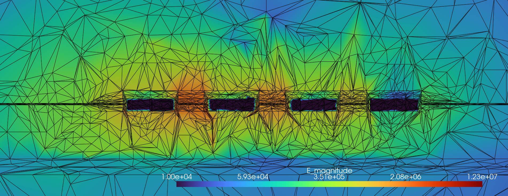

The idea with the side wall dielectric as an additional mesh refinement **around** the trace, while refining at only 5 µm rate **along** the trace, seems to work as expected.

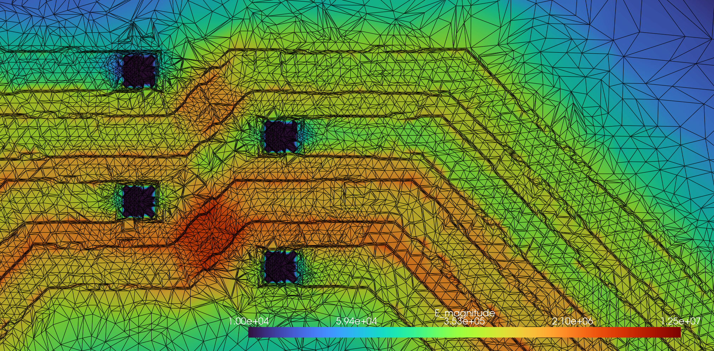

## 7. The ultimate model?

If we are striving for most accurate results, regardless of simulation "cost", we can combine

- via array merging with correction factor, to get effective cross section right
- conformal passivation stackup, to get the true sidewall coverage above TopMetal2
- conductors meshed as volumes (`'solve_inside'`) in this rather low frequency case
- small refined_cellsize to make sure field resolution can capture skin effect properly
- a margin that keeps the absorbing boundary out of the coil's near field

For our inductor testcase, this was implemented using refined_cellsize = 1 µm instead of the 2 µm mesh resolution used above.

Results show only a minor change between the refined_cellsize=1 micron (purple) and 2 micron (red) results: peak Q 15.43 instead of 15.22, SRF 10.96 instead of 10.90 GHz. This is not worth the simulation effort, but only **after** this check, we know for sure!

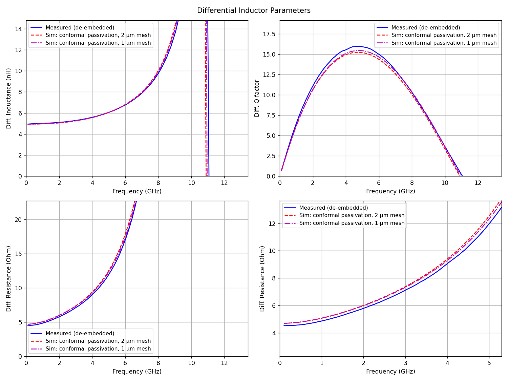

This is still a feasible simulation on a machine with 64 GB RAM or more, and took 9 minutes here. Such a "sign off" simulation or reference study helps to establish trust in the simulation setup and helps to learn about mesh and simulation strategies.

 Stackup | Via array handling | Conductor model | Mesh | DOF | Mesh elements | Solve time | Peak RAM |
|---|---|---|---:|---:|---:|---:|---:|
| Conformal | merge + correction | Volume | 2 µm | 1,505,676 | 237,453 | 4m 50s | 23.40 GB |
| Conformal | merge + correction | Volume | 1 µm | 2,992,908 | 471,759 | 9m 6s | 44.00 GB |

If you like the field and mesh plots in this study: they were all created using the built-in field viewer in setupEM, based on simulation model data with just one `fdump` frequency. That's enough for visualization, simulating fast.

 At high frequency, where the skin depth is much smaller than the mesh cells, `'solve_inside'` overestimates the loss. `'solve_inside_skin'` adds thin layers along the conductor faces for that case, see the [conductor model study](../../conductor_models/README.md). For L6n2, with peak Q at 5 GHz, both build the same model.

## 8. Solver setting: complex coarse solve

All run times above are with `settings['complex_coarse_solve']` enabled, which is the default since gds2palace 0.8.0. Palace's iterative solver uses a sparse direct solve on the coarsest mesh level as part of its preconditioner. By default, Palace factorizes only the real part of the system there, which leaves out the absorbing boundary, the port resistances and all losses. With `complex_coarse_solve`, it factorizes the full complex system instead. The [v2 study](../more_accurate_models_L6n2_v2/README.md#7-solver-setting-complex-coarse-solve) compares all models with and without it: the S-parameters are the same (largest difference 1e-4), the linear solver needs about a quarter of the iterations, and all 8 sweeps together ran 1.9x faster.

## 9. Shunt parameters: the ground of the model decides

Read this before you take single-ended values or the shunt elements of a pi model from these results.

All values in this study are differential: L, Q and SRF between the two ports. They are set by the current in the coil and do not depend on where the ground is. The shunt path is different. Current that leaves the coil through the oxide flows through the substrate to the nearest ground conductor, so its resistance and capacitance depend on the size and position of that ground.

- **In the model**, the only ground is the SUB_GND plate below the ports (section 0): 257 × 66 µm, on one side of the coil.
- **In the measurement**, the inductor sits in a GSG test frame. Its Metal1 ground is 580 µm wide, has 7 times the area of the plate and reaches up beside the lower corners of the coil. The substrate current finds a wider and shorter path.

One more model checks this: `L6n2_with_ports_2um_passi3D_testframe_ground.py`. It is the 2 µm conformal model of section 4 with a different ground. Its layout `L6n2_with_ports_testframe_ground.gds` has a SUB_GND plate with the simplified outline of the test frame's Metal1 ground. The dashed line is the plate of all other models.

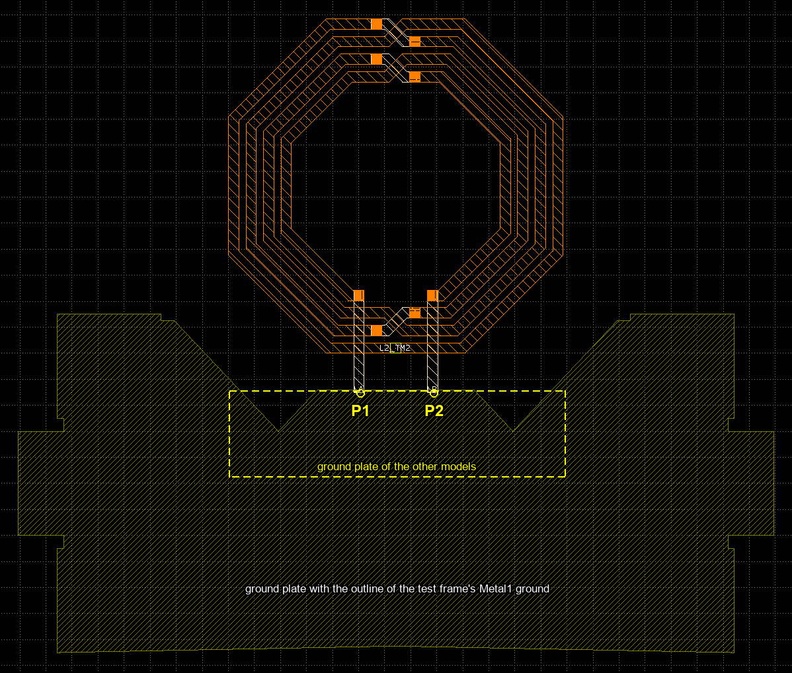

The shunt branch is taken from the common-mode admittance (both ports tied together). It is fitted from 0.3 to 5 GHz as an oxide capacitance in series with the substrate, Rsub parallel to Csub. `results/shunt_parameters.py` calculates these values and the plot, also for your own Touchstone files.

| | Measured | Small plate | Ground plate of test frame size |
|---|---:|---:|---:|
| Substrate resistance Rsub | 623 Ω | 1141 Ω | 710 Ω |
| Substrate capacitance Csub | 109 fF | 53 fF | 85 fF |
| Shunt capacitance at 2.4 GHz, both ports | 77 fF | 49 fF | 69 fF |
| Single-ended SRF (port 2 grounded) | 9.53 GHz | 9.88 GHz | 9.55 GHz |

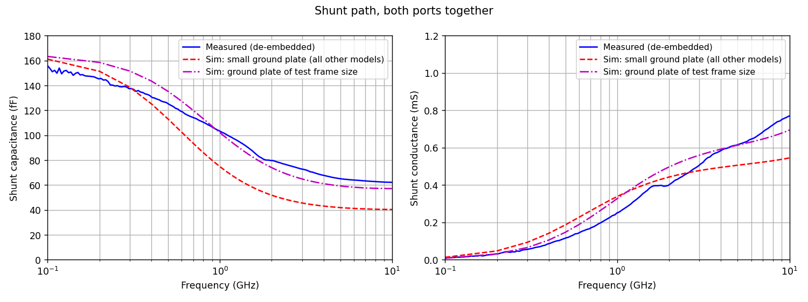

- **With the small plate**, the substrate resistance is nearly twice the measured value and the substrate capacitance half of it. The shunt capacitance at 2.4 GHz is 37 % low and the single-ended SRF 3.7 % high. All other models of this study have this plate.
- **With the ground of test frame size**, the shunt capacitance is 10 % low and the single-ended SRF within 0.3 %. The differential values stay the same: peak Q 15.13 instead of 15.22, SRF 10.91 instead of 10.90 GHz.
- **A difference remains**: Rsub is 14 % high and Csub 22 % low. It is not resolved here.

For your own inductor, draw the ground that it really sees: the test frame for a comparison with a measurement, the ground ring or mesh of the circuit for a design. Use the differential values of this study as they are.

## 10. Run times: v3 and v4

This version of the study has the same model scripts as v3. Two things are newer: gds2palace 0.10.2 instead of 0.8.2, and Palace 0.18.1 instead of 0.18.0. The 12 models were run with gds2palace 0.10.2 and both Palace versions, so each step can be seen on its own.

### gds2palace 0.10.2

After every field solution, Palace computes an error estimate for the mesh. With adaptive mesh refinement, this estimate decides where the mesh is refined. Without it, as in all models of this study, the estimate is only reported (`error-indicators.csv`). Palace still computes it with a tolerance of 1e-6 by default, and in v3 that took 54 to 73 % of each run.

gds2palace 0.10.2 sets the tolerance of this estimate to 1e-2 (`EstimatorTol`) when adaptive mesh refinement is off. This tolerance applies to the estimate only. The field solution, and with it the S-parameters, is computed with the same solver tolerance as before (`solver_tol`, 1e-6). The estimate now takes 7 to 30 seconds per model.

Both columns of run times in this table are with Palace 0.18.0, the image of v3:

| Model | Solves | v3 run time | of which error estimate | gds2palace 0.10.2 | Faster by |
|---|---:|---:|---:|---:|---:|
| Surface, 2 µm, via merge, no correction | 12 | 11m 10s | 7m 19s | 3m 27s | 3.2x |
| Surface, 2 µm, no via merge | 12 | 12m 37s | 8m 22s | 4m 41s | 2.7x |
| Surface, 2 µm, via merge + correction | 12 | 11m 13s | 7m 18s | 3m 24s | 3.3x |
| Volume, 2 µm, planar | 10 | 7m 47s | 4m 11s | 3m 29s | 2.2x |
| Volume, 2 µm, PassiCut | 10 | 14m 33s | 9m 46s | 4m 53s | 3.0x |
| Volume, 5 µm, conformal | 12 (v3: 17) | 14m 7s | 10m 17s | 2m 42s | 5.2x |
| Volume, 2 µm, conformal | 12 | 22m 39s | 15m 35s | 6m 59s | 3.2x |
| Volume, 1 µm, conformal | 12 | 32m 53s | 18m 37s | 15m 8s | 2.2x |
| Volume, 2 µm, conformal, margin 100 µm | 12 | 22m 17s | 15m 58s | 6m 57s | 3.2x |
| Volume, 2 µm, conformal, margin 200 µm | 12 | 22m 35s | 15m 57s | 6m 44s | 3.4x |
| Volume, 2 µm, conformal, margin 800 µm | 12 | 23m 43s | 16m 37s | 7m 19s | 3.2x |
| Volume, 2 µm, conformal, test frame ground | 11 | 18m 5s | 12m 6s | 6m 26s | 2.8x |
| **All 12 models** | | **3h 34m** | **2h 22m** | **1h 12m** | **3.0x** |

- **The saving is the error estimate.** Without it, the 12 runs took 72 minutes in v3 and 70 minutes with gds2palace 0.10.2.
- **The 5 µm model gains more than the others** because its adaptive sweep also needed fewer solves in this run (12 instead of 17).
- **The results are the same.** L at 1 GHz, peak Q and SRF of all 12 models agree with v3 within 0.1 %. The meshes are not identical: the number of unknowns differs from v3 by up to 1.4 %.
- **The reported error estimate is still usable.** For the 2 µm conformal model its norm is 0.185 instead of 0.181 in v3.
- **Memory is about the same.** Peak RAM is within 3 % of v3, except for the 5 µm model (8 % less).

### Palace 0.18.1

The same meshes and Palace input files were then solved with Palace 0.18.1, from the published image. Nothing else was changed. These are the run times of all other sections.

| Model | Palace 0.18.0 (image of v3) | Palace 0.18.1 (published image) | Faster by |
|---|---:|---:|---:|
| Surface, 2 µm, via merge, no correction | 3m 27s | 2m 26s | 1.42x |
| Surface, 2 µm, no via merge | 4m 41s | 3m 16s | 1.43x |
| Surface, 2 µm, via merge + correction | 3m 24s | 2m 27s | 1.39x |
| Volume, 2 µm, planar | 3m 29s | 2m 30s | 1.39x |
| Volume, 2 µm, PassiCut | 4m 53s | 3m 30s | 1.40x |
| Volume, 5 µm, conformal | 2m 42s | 1m 53s | 1.44x |
| Volume, 2 µm, conformal | 6m 59s | 4m 50s | 1.44x |
| Volume, 1 µm, conformal | 15m 8s | 9m 6s | 1.66x |
| Volume, 2 µm, conformal, margin 100 µm | 6m 57s | 5m 4s | 1.37x |
| Volume, 2 µm, conformal, margin 200 µm | 6m 44s | 4m 47s | 1.41x |
| Volume, 2 µm, conformal, margin 800 µm | 7m 19s | 5m 10s | 1.42x |
| Volume, 2 µm, conformal, test frame ground | 6m 26s | 5m 5s | 1.26x |
| **All 12 models** | **1h 12m** | **50m** | **1.4x** |

- **Most of the gain is Palace 0.18.1 itself.** Its release notes name faster operator applications on CPU, with 3 to 27 % less run time on lossy problems. Here the preconditioner stage takes about half the time.
- **A small part is the build of the image.** In the image of v3, the libCEED library was compiled with optimization level `-O`, in the published image with `-O3`. A Palace 0.18.0 image with `-O3` was 6 % faster than the image of v3 for the surface model with via merge and correction (3m 13s instead of 3m 24s).
- **The results are the same.** L at 1 GHz, peak Q and SRF of all 12 models are the same to all digits shown in this document. The S-parameters differ by 6e-5 at most. In the five models where the solver needed exactly the same number of iterations, they agree within 5e-9.
- **Two models needed a different number of solves** in the adaptive sweep: the 1 µm model 10 instead of 12, the test frame model 13 instead of 11. That explains their larger and smaller gain.
- **Memory is 5 to 7 % higher** with the published image.

All runs: `hpz2`, 16 processes, one model at a time, as in v3. `results/study_tables.py` collects the numbers of all tables from the Palace output, and `results/plot_speedup.py` draws the chart at the top. The run data is in `results/run_data.csv` (this study), `results/run_data_v3_image.csv` (the same models with Palace 0.18.0, the image of v3) and `results/run_data_v3.csv`.

## Summary

All models with a 400 µm margin, differential values, relative to the measurement (L = 5.01 nH at 1 GHz, peak Q = 15.96, SRF = 11.07 GHz). Single-ended and shunt values depend on the ground of the model, see section 9.

| Model | L at 1 GHz | Peak Q | SRF | Solve time |
|---|---:|---:|---:|---:|
| Surface, 2 µm, via merge, no correction | -1.7 % | +27.3 % | -8.7 % | 2m 26s |
| Surface, 2 µm, no via merge | -1.7 % | +19.5 % | -8.7 % | 3m 16s |
| Surface, 2 µm, via merge + correction | -1.7 % | +19.4 % | -8.7 % | 2m 27s |
| Volume, 2 µm, planar | -0.8 % | -8.5 % | -9.0 % | 2m 30s |
| Volume, 2 µm, PassiCut | -0.9 % | -3.5 % | +0.7 % | 3m 30s |
| Volume, 5 µm, conformal | -1.0 % | -8.3 % | -2.7 % | 1m 53s |
| Volume, 2 µm, conformal | -0.9 % | -4.6 % | -1.6 % | 4m 50s |
| **Volume, 1 µm, conformal** | **-0.9 %** | **-3.3 %** | **-1.0 %** | 9m 6s |

The most accurate model (1 µm, conformal passivation, `'solve_inside'`, via merging with correction, 400 µm margin) is within 1 % in L and SRF and 3.3 % in peak Q of the measurement. The cheaper PassiCut model comes close at 40 % of the run time.
