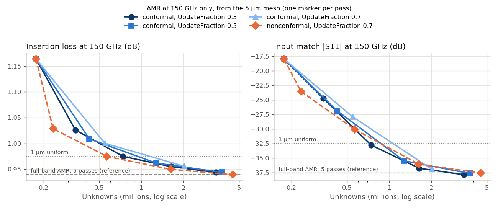
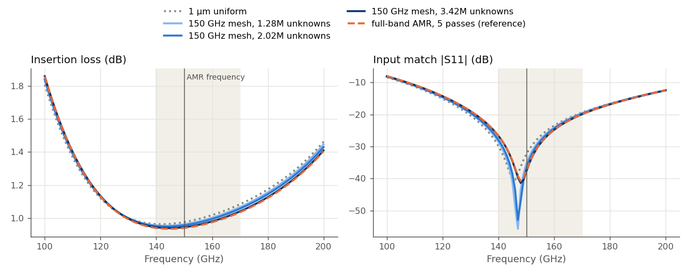
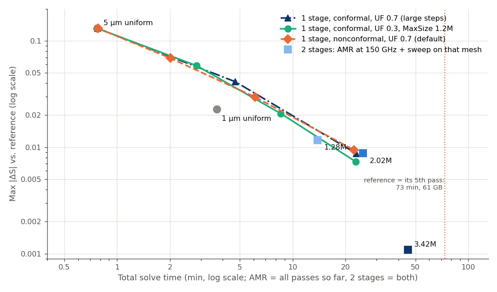

# AMR settings for the D-band balun: conformal refinement, UpdateFraction, AMR at one frequency

In the [D-band balun mesh study](../README.md), adaptive mesh refinement (AMR) found the converged answer, but it took 20× as long as a uniform 1 µm mesh. This follow-up looks at the AMR settings that could make it cheaper:

1. **Conformal refinement and a smaller `UpdateFraction`.** Do they reach the same accuracy with fewer unknowns?
2. **AMR at a single frequency.** Refine the mesh at 150 GHz only, then run the full sweep once on that mesh, as many commercial FEM solvers do. Does that mesh work for the whole band?
3. **Cost.** How do these options compare with the default full-band AMR, at the same accuracy?

As in the parent study, the findings apply to this balun, with this stackup, in this frequency range.

## The details of this study

- **Model:** the same balun, stackup, ports, sweep (100–200 GHz) and settings as the parent study. Every AMR run starts from the 5 µm mesh (176,676 unknowns).
- **Execution:** `hpz2`, Palace 0.18, 16 processes, one run at a time. The parent study used Palace 0.17, and today's gds2palace builds a slightly different mesh. So the uniform 5 µm and 1 µm meshes and the full-band AMR run were rerun here. They reproduce the parent study's results within Max|ΔS| = 0.0075, 0.0014 and 0.0002. The run times are not comparable, though: the full-band AMR run took 2h 23m before and 1h 14m now. Most of this comes from `settings['complex_coarse_solve']`, which gds2palace has enabled by default since 30 September 2026 (see step 3).
- **Reference:** the full-band AMR run of this study (Palace's default nonconformal refinement, `UpdateFraction` 0.7, 5 passes, 4.6 million unknowns). Max|ΔS| is taken over all S-parameters and all frequencies, linear, as in the parent study.

## The AMR settings

After each pass, Palace estimates the error of every mesh element and refines some of them. Three settings in `config.json` decide how:

- **`UpdateFraction`** (default 0.7) sets how many elements are refined. Palace refines the smallest set of elements that together carry this fraction of the total error estimate (Dörfler marking). It is not a fraction of the elements. A smaller value refines fewer elements per pass, so the mesh grows in smaller steps.
- **`Nonconformal`** (default `true`) sets how an element is split. Nonconformal refinement splits only the marked elements and leaves hanging nodes on their faces. Conformal refinement also splits neighbouring elements, so that no hanging nodes remain. gds2palace sets it with `settings['adaptive_mesh_conformal']`.
- **`MaxSize`** (gds2palace: `settings['amr_max_dof']`, default 2 million unknowns) stops AMR, but Palace checks it after refining. The last mesh can therefore be several times larger than `MaxSize`.

gds2palace has no setting for `UpdateFraction` or for AMR at a single frequency. The model scripts of this study change the `config.json` that gds2palace wrote, with `amr_patch.py`. The mesh is always built for the full 100–200 GHz sweep, so all runs start from the same mesh.

## 1. AMR at 150 GHz: how fast the mesh grows

The first runs refine at 150 GHz only, the centre of the target band. With one frequency, each pass is just one solve per port, so trying several settings is cheap. We tried conformal refinement with `UpdateFraction` 0.3, 0.5 and 0.7, and the default nonconformal refinement with 0.7. All runs had up to 8 passes and `MaxSize` 2 million.



| AMR at 150 GHz | Growth per pass | Passes | Final unknowns | Time | Peak RAM |
|---|---|---:|---:|---:|---:|
| conformal, `UpdateFraction` 0.3 | ×1.9–2.2 | 5 | 3.42 M | 13 min | 41 GB |
| conformal, `UpdateFraction` 0.5 | ×2.4–3.0 | 4 | 3.79 M | 13 min | 45 GB |
| conformal, `UpdateFraction` 0.7 | ×3.1–3.7 | 3 | 2.02 M | 8 min | 26 GB |
| nonconformal, `UpdateFraction` 0.7 | ×1.3, then ×2.4–2.8 | 5 | 4.51 M | 22 min | 57 GB |

- **The runs that went on to 3.4 million unknowns or more end at the reference.** At 150 GHz, their final meshes are within Max|ΔS| = 0.0006 of the full-band AMR result. Conformal refinement with 0.7 stopped at 2.02 million, 0.009 away.
- **At the same number of unknowns, all four give about the same answer.** In the plot, the curves lie on top of each other. Conformal refinement doesn't place the unknowns better than nonconformal refinement here.
- **`UpdateFraction` sets the step size, not the result.** With 0.3, the mesh roughly doubles per pass. With 0.7, conformal refinement triples it. Smaller steps give more points to stop at.
- **`MaxSize` was overshot by up to 2.3×.** With a limit of 2 million, the runs ended at 2.0–4.5 million unknowns.
- **No run reached Palace's own tolerance** (`Tol` 0.01). The error estimate ended at 0.055–0.085, while the S-parameters had long settled. This is the same as in the other mesh studies.

## 2. The full sweep on the 150 GHz mesh

Palace can save the last mesh of an AMR run (`SaveAdaptMesh`). `make_stage2.py` makes a new model that loads this mesh and runs the full 100–200 GHz sweep on it, without further AMR. We did this for three meshes: 1.28 million unknowns (`UpdateFraction` 0.5 after 3 passes), 2.02 million and 3.42 million.

At 150 GHz, each sweep agrees with its AMR run to Max|ΔS| = 0.00001, with exactly the same number of unknowns. So the mesh is handed over without loss.



- **A mesh refined at 150 GHz works for the whole band.** Over 100–200 GHz, the three sweeps differ from the reference by Max|ΔS| = 0.012, 0.009 and 0.001. That is about what they differ by at 150 GHz alone. The band edges are 33 % away from the AMR frequency, and the mesh still holds there.
- **The S11 null sits at 147–148 GHz on all three meshes**, as in the reference, compared with 146 GHz on the 1 µm mesh. Its depth varies from −41 to −56 dB. As in the parent study, a null this deep is very sensitive to small changes, and only its position matters for the design.

## 3. Accuracy vs. cost

This chart compares all the ways to get close to the reference. For the full-band AMR runs, every pass is one marker, at the time spent so far. A run stopped after that pass would have cost that much. For two-stage AMR, the time is AMR at 150 GHz plus the full sweep.



| Variant | Unknowns | Time | Peak RAM | Max\|ΔS\| vs. reference |
|---|---:|---:|---:|---:|
| 1 µm uniform | 0.68 M | 4 min | 10 GB | 0.023 |
| 2 stages, 1.28 M mesh | 1.28 M | 14 min | 17 GB | 0.012 |
| full-band AMR, nonconformal, after 4 passes | 1.66 M | 22 min | 23 GB | 0.009 |
| same, with the real-only coarse solve | 1.66 M | 41 min | 20 GB | 0.009 |
| full-band AMR, conformal, `UpdateFraction` 0.7 (3 passes) | 2.06 M | 23 min | 27 GB | 0.009 |
| full-band AMR, conformal, `UpdateFraction` 0.3, `MaxSize` 1.2 M (4 passes) | 1.70 M | 23 min | 22 GB | 0.007 |
| 2 stages, 2.02 M mesh | 2.02 M | 25 min | 26 GB | 0.009 |
| 2 stages, 3.42 M mesh | 3.42 M | 45 min | 43 GB | 0.001 |
| full-band AMR, nonconformal, 5 passes (reference) | 4.60 M | 1h 14m | 61 GB | (reference) |

- **For a moderate accuracy, all AMR variants cost about the same.** Down to Max|ΔS| ≈ 0.01, the three full-band runs and the two smaller two-stage meshes lie on one curve. Conformal refinement and AMR at one frequency don't make that curve any lower.
- **Conformal refinement saved time only with the old coarse solve.** Palace solves each frequency point iteratively with GMRES. The preconditioner of these iterations contains a coarse solve, which factorizes either only the real part of the system or the full complex system. With the real-only coarse solve (`settings['complex_coarse_solve'] = False`, the gds2palace default until 30 September 2026), GMRES needed about 105 iterations per solve on the refined nonconformal meshes, but only about 55 on the conformal ones. Conformal AMR was then about a third faster at the same accuracy (30 instead of 41 minutes). With the complex coarse solve, both need 22–32 iterations per solve and take 23 minutes. The coarse solve doesn't change the S-parameters (Max|ΔS| = 0.00001 on the same mesh).
- **Most of the cost is in the last pass.** Each pass of full-band AMR runs the complete frequency sweep on a mesh two to three times larger than the one before. In the reference run, the 5th pass alone took 51 of 74 minutes. Where AMR stops matters more than how it refines.
- **For the converged answer, two stages are cheaper.** The 3.42 M mesh from 150 GHz reaches the reference within 0.001, in 45 minutes and 43 GB instead of 74 minutes and 61 GB. Its five AMR passes at one frequency took only 13 minutes. Only the one full sweep on the final mesh is expensive.
- **The uniform 1 µm mesh is still the cheap working point.** Compared with the reference, its insertion loss in the target band is 0.02–0.05 dB higher, and its S11 null sits 2 GHz lower. AMR needs 3–6 times as long to halve that difference.

## Summary for this balun

- **Conformal refinement gives no advantage here.** At the same number of unknowns, conformal and nonconformal AMR give the same accuracy, and at the same accuracy they take the same time. Conformal refinement with the default `UpdateFraction` 0.7 grows the mesh in large steps (about ×3 per pass). With the real-only coarse solve used before 30 September 2026, conformal AMR was a third faster, because GMRES converged in half the iterations on its meshes.
- **A smaller `UpdateFraction` gives finer control.** With 0.3, the mesh about doubles per pass, so AMR can stop closer to the size you want. The accuracy at a given size stays the same.
- **Set `MaxSize` below your budget.** Palace checks it only after refining, and the last mesh was up to 2.3× larger.
- **AMR at the centre frequency gives a mesh for the whole band.** Refined at 150 GHz only, the mesh was as good over 100–200 GHz as at 150 GHz.
- **Two stages pay off for a converged reference, not for design work.** Down to Max|ΔS| ≈ 0.01, they cost the same as stopping full-band AMR earlier. For the converged answer, they saved 40 % of the time and 30 % of the memory.
- **For design iterations, the parent study's recommendation stands:** a 2 µm uniform mesh, and 1 µm for final numbers.

## How to run AMR at one frequency (two stages)

gds2palace doesn't have settings for this, so this study does it by hand:

1. Build the model as usual, with the full frequency sweep and `settings['adaptive_mesh_iterations']`, `settings['adaptive_mesh_conformal']` and `settings['amr_max_dof']`.
2. Change `config.json` with `amr_patch.patch_config()`: one `Point` sample at the AMR frequency, no `AdaptiveTol`, `SaveAdaptMesh: true`, and the `UpdateFraction`. It keeps the unchanged file as `config_original.json`.
3. Run Palace. The final mesh is written as `output/<model>/<model>.mesh` (or `.meshgz`).
4. `python make_stage2.py <model>` makes `palace_model/<model>_s2_data/` with this mesh, `MaxIts` 0 and the original frequency sweep. Run Palace on it.

## Files

```
amr_conformal/
├── palace_balun_mesh{5,1}_ref.py              # uniform 5 / 1 µm, rerun on Palace 0.18
├── palace_balun_amrc_f150_uf{03,05,07}.py     # stage 1: conformal AMR at 150 GHz, UpdateFraction 0.3/0.5/0.7
├── palace_balun_amrnc_f150_uf07.py            # stage 1: nonconformal AMR at 150 GHz
├── palace_balun_amrc_f150_uf05_p3.py          # stage 1: as uf05, stopped after 2 refinements (1.28 M mesh)
├── palace_balun_amrc_uf07_full.py             # full-band conformal AMR, UpdateFraction 0.7
├── palace_balun_amrc_uf03_full.py             # full-band conformal AMR, UpdateFraction 0.3, MaxSize 1.2 M
├── palace_balun_amrnc_full.py                 # full-band nonconformal AMR, 5 passes (reference)
├── palace_balun_amrnc_full_realcs.py          # as amrnc_full, 4 passes, complex_coarse_solve = False
├── amr_patch.py                               # changes the AMR settings in config.json
├── make_stage2.py                             # stage 2: full sweep on a saved AMR mesh (<model>_s2)
├── remote_runs.py, lane.sh                    # upload, run one at a time on hpz2, collect
└── results/
    ├── collect_results.py   # Touchstone files and costs from palace_model/ (not in git) to results/
    ├── story_plots.py       # the plots and numbers in this report
    ├── runs.csv             # unknowns, time, peak RAM, error estimate of every run and AMR pass
    ├── snp/                 # de-embedded Touchstone files, one per run and AMR pass (_passN)
    └── plots/
```

Run `python results/story_plots.py` in the `d:\venv\palace` venv to regenerate the plots and numbers from `results/`.
