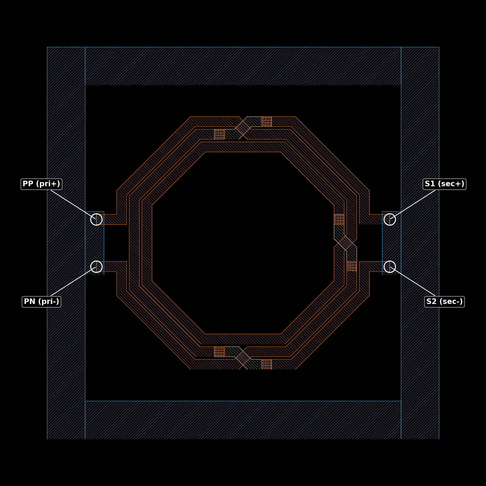
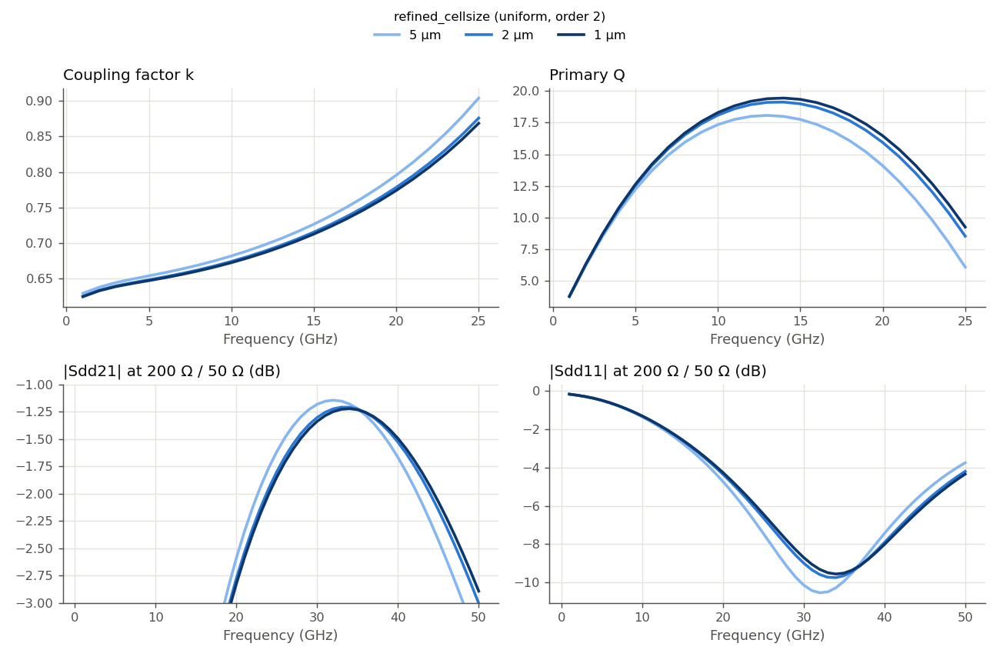
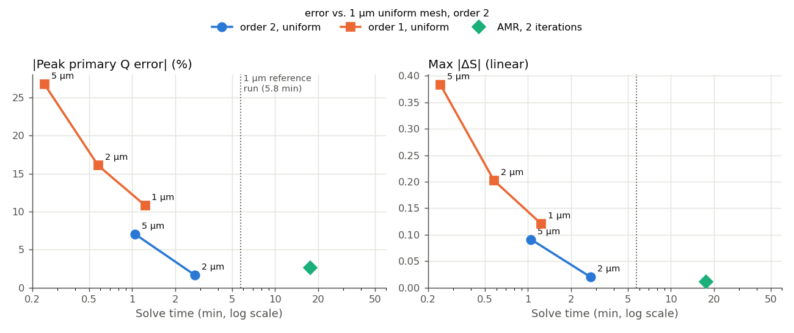
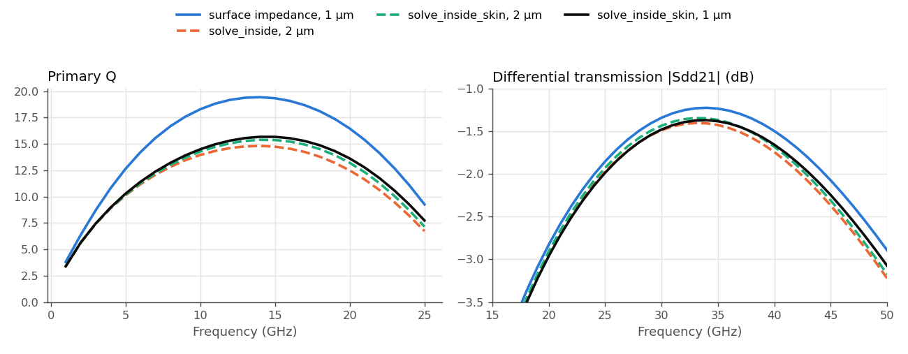

# How fine a mesh does this 2:1 edge-coupled balun need? (IHP SG13G2)

This study asks a practical question for one specific layout: a 2:1 balun made of edge-coupled lines with a 2 µm gap, simulated from 1 to 50 GHz. How fine must the Palace mesh be to get its coil properties and its transmission right? And do FEM order 1 or adaptive mesh refinement help?

We answer this in three steps:

1. **Refine a uniform mesh** from 5 µm to 1 µm and see which properties move.
2. **Cross-check the finest result** with adaptive mesh refinement (AMR).
3. **Try FEM order 1** as a fast alternative, and compare everything on accuracy vs. cost.

The findings apply to this balun, with this stackup, in this frequency range. Other structures can behave quite differently. The [overview page](../README.md) collects the other mesh studies.

## The details of this study

- **Model:** `balun2x1_edgecoupled_do200_w8_s2.gds`, stackup `SG13G2_200um.xml`
- **Ports:** 4 via ports (Metal1 → TopMetal2), Z0 = 50 Ω, de-embedded: 1/2 = primary pair, 3/4 = secondary pair, no center tap. The de-embedding was redone in October 2026 with the corrected `combine_extend_snp.py`, which before had put the inductance of all ports at port 1 (see `doc/CHANGES.md`, 12 October 2026); it changed L, k and Q by up to about 1.5% and |Sdd21| by about 0.03 dB, not the convergence trends.
- **Solver:** AWS Palace (FEM), ABC boundaries, 200 µm margin and air around, far enough that the boundary doesn't change the result (see [`simulation_boundary`](../../simulation_boundary/README.md)), order 2 unless noted
- **Sweep:** 1–50 GHz in 1 GHz steps (adaptive frequency sweep)
- **Execution:** `hpz2`, 16 of 32 cores, Palace 0.19.0, models from gds2palace 0.10.7 (rerun in November 2026)
- **Scope:** this is the bare balun. A real matching network would add MIM capacitors that are not in this model, so no matching or real-load result is reported.

**What changed with the November 2026 rerun.** The first version of this study used Palace 0.16 (steps 1–3) and 0.18.0 (step 4), gds2palace from before October 2026, and 100 µm margin with 20 µm air. The rerun moves the boundary out to 200 µm, so the absolute values changed a little (peak primary Q at 1 µm 19.4 instead of 19.1, L 0.3% higher). The runs are about 5 times faster, because gds2palace now sets Palace's complex coarse solve by default (since 30 September 2026); it needs more memory. The conclusions about the mesh did not change.

## 0. Layout



A single octagonal loop of 4 edge-coupled lines on TopMetal2, 8 µm wide with a **2 µm gap**, about 200 µm outer diameter. The primary (ports 1/2, left) uses two of the lines in series through the crossovers at top and bottom. The secondary (ports 3/4, right) uses one line. That gives a 2:1 turns ratio, so the system impedances are 200 Ω (primary) and 50 Ω (secondary).

**What we look at.** From the 4-port Z-matrix we form the differential impedances of primary and secondary and read:

- **Coupling factor** k, **inductance** L and **Q factor** of each coil. These are only meaningful below the primary's self-resonance at about 29 GHz.
- **|Sdd21|** and **|Sdd11|**: differential transmission and reflection at 200 Ω / 50 Ω. |Sdd21| peaks at about −1.2 dB near 34 GHz.

## 1. Uniform mesh refinement

We ran the model at `refined_cellsize` = 5, 2 and 1 µm, all at FEM order 2.



- **The 5 µm mesh stands apart; 2 µm and 1 µm nearly coincide.** A 5 µm cell is wider than the 2 µm coupling gap, so it can't resolve the field there. (gmsh also reported a few ill-shaped elements at this setting.)
- **Coupling and inductance change little.** At 10 GHz, 5 µm overestimates k by 1.3% and L by 0.5%.
- **Q is the most sensitive coil property.** Peak primary Q is 7.0% low at 5 µm and 1.6% low at 2 µm (1 µm: 19.4 at 14 GHz).
- **Transmission shifts in frequency.** The |Sdd21| peak moves from 32 GHz (5 µm) to 34 GHz (1 µm). The 5 µm mesh also shows about 0.07 dB less loss than the finer meshes.

The step from 2 to 1 µm is much smaller than the step from 5 to 2 µm, on every quantity. The mesh is converging.

| Mesh | DOF | Solve time | Peak RAM |
|---|---:|---:|---:|
| 5 µm | 323,980 | 1m 3s | 6.2 GB |
| 2 µm | 860,902 | 2m 45s | 13.0 GB |
| 1 µm | 1,757,854 | 5m 45s | 24.5 GB |

## 2. Cross-check with AMR

AMR started from the 5 µm mesh and ran 2 refinement iterations, ending at 1.10 million DOF.

| | Peak primary Q | \|Sdd21\| peak | Max\|ΔS\| vs. 1 µm | Total time | Peak RAM |
|---|---:|---:|---:|---:|---:|
| 2 µm uniform | 19.11 | −1.21 dB at 33 GHz | 0.020 | 2m 45s | 13.0 GB |
| 1 µm uniform | 19.43 | −1.22 dB at 34 GHz | (reference) | 5m 45s | 24.5 GB |
| AMR, 2 iterations | 18.93 | −1.22 dB at 34 GHz | 0.011 | 17m 39s | 17.1 GB |

- **For the S-parameters, AMR confirms the 1 µm result.** Its |Sdd21| peak is identical, and its Max|ΔS| distance to 1 µm is smaller than that of the 2 µm mesh.
- **For Q, AMR is less accurate than the 2 µm uniform mesh.** It ends between the 2 µm and 5 µm results. AMR refines where Palace's error estimate is largest, and for this model that isn't where Q is decided.
- The uniform Q steps shrink quickly (+5.8%, then +1.7%). So we take 1 µm as the reference for Q, and expect it to be within about 1% of the converged value.

## 3. Order 1 as a shortcut? Accuracy vs. cost

FEM order 1 runs 4–5× faster than order 2 on the same mesh. We re-ran all three meshes at order 1. The chart shows every run's error against the 1 µm order-2 reference, over its solve time:



- **Order 1 is far off on this balun.** At 5 µm, peak Q is 27% low and the |Sdd21| peak sits at 26 GHz instead of 34 GHz. The error shrinks with a finer mesh, but at 1 µm Q is still 11% low and the peak is at 31 GHz.
- **Order 1 also makes the balun look better than it is.** Its |Sdd21| peak is −0.92 dB at 5 µm and −1.09 dB at 1 µm, compared with −1.22 dB for the reference.
- **Order 2 at 5 µm is more accurate than order 1 at 1 µm**, in Q, in frequency and in Max|ΔS|, and here it is even a little faster (1.0 vs. 1.2 minutes).

## 4. Conductor model: surface, solve_inside, solve_inside_skin

Steps 1–3 use the default surface impedance conductor model, so they show how well the mesh converges *for that model*. Here we rerun the balun with the conductors meshed as volumes: `settings['conductor_model'] = 'solve_inside'`, and `'solve_inside_skin'` with thin layers along all conductor faces (0.17 and 0.43 µm deep in TopMetal1/TopMetal2 for 50 GHz). The reference is `'solve_inside_skin'` at 1 µm.



| Model | DOF | Time | L at 10 GHz | k at 10 GHz | Peak primary Q | Peak secondary Q | Peak \|Sdd21\| |
|---|---:|---:|---:|---:|---:|---:|---:|
| `'solve_inside_skin'`, 1 µm (reference) | 3.85 M | 18 min | 1.186 nH | 0.665 | 15.7 | 12.2 | −1.37 dB |
| `'solve_inside_skin'`, 2 µm | 1.70 M | 9 min | +0.1% | +0.3% | −1.8% | −2.0% | −1.34 dB |
| `'solve_inside_skin'`, 5 µm | 0.61 M | 3 min | +0.4% | +1.5% | −7.6% | −8.9% | −1.30 dB |
| `'solve_inside'`, 2 µm | 1.04 M | 5 min | +0.1% | +0.3% | −5.5% | −7.2% | −1.40 dB |
| surface impedance, 1 µm | 1.76 M | 6 min | −0.7% | +1.2% | +24% | +20% | −1.22 dB |
| surface impedance, 2 µm | 0.86 M | 3 min | −0.6% | +1.4% | +22% | +18% | −1.21 dB |

- **The surface model's Q is about 20% too high**, and its |Sdd21| peak is 0.15 dB too optimistic. That is much more than the mesh changes in steps 1–3 (Q within 1.7% from 2 to 1 µm).
- **The volume models at 2 µm are slightly pessimistic.** With `'solve_inside'`, Q is 5–7% low and |Sdd21| 0.03 dB low. `'solve_inside_skin'` at the same mesh brings Q within 2%, at 1.6× the unknowns.
- **A coarse mesh does not pay off with skin layers here.** At 5 µm, the cell is wider than the 2 µm coupling gap (see step 1), and Q is 8–9% low, worse than `'solve_inside'` at 2 µm.

## Summary for this balun

- **2 µm uniform mesh, order 2, is the working point.** Q is within 1.7%, |Sdd21| within 0.01 dB and 1 GHz of the finest result, in under 3 minutes.
- **5 µm is too coarse for this geometry**, because the cell is wider than the 2 µm coupling gap. It's still usable for a first look at L and k.
- **Don't use order 1 for this balun**, not even on a fine mesh. It shifts the response down in frequency and underestimates loss.
- **AMR matched the S-parameters but not Q.** When Q matters, check it on a uniform mesh.
- **For Q and loss, the conductor model matters more than the mesh.** The default surface impedance gives about 20% higher Q than the volume models. `'solve_inside'` at 2 µm is within 7%, `'solve_inside_skin'` within 2%.

These numbers belong to this layout. Other gap widths, line widths or frequency ranges will change them.

## Files

```
mesh_convergence_balun2x1/
├── balun2x1_edgecoupled_do200_w8_s2.py                # original model (refined_cellsize=5)
├── balun2x1_edgecoupled_do200_w8_s2_mesh{5,2,1}.py    # uniform mesh, order 2
├── balun2x1_edgecoupled_do200_w8_s2_mesh{5,2,1}_order1.py  # uniform mesh, order 1
├── balun2x1_edgecoupled_do200_w8_s2_amr2.py           # AMR, 5 µm start, 2 iterations
├── balun2x1_edgecoupled_do200_w8_s2_skin_mesh{5,2,1}.py    # 'solve_inside_skin' (step 4)
├── balun2x1_edgecoupled_do200_w8_s2_filled_mesh2.py        # 'solve_inside' (step 4)
├── palace_model/balun2x1_edgecoupled_do200_w8_s2_<name>_data/  # mesh, config and full Palace output per run
└── results/
    ├── story_plots.py            # the story_*.png plots and numbers in this report
    ├── analyze_convergence.py    # mixed-mode Sdd ΔS tables (CSV) and Sdd overlays
    ├── order_comparison.py       # order 1 vs. order 2 overlays and timing table
    ├── story_conductor_models.py # step 4 plot and numbers
    ├── delta_S_table.csv, delta_S_vs_finest.csv, order_comparison_table.csv
    ├── snp/                      # de-embedded 4-port Touchstone files, one per run and AMR iteration
    └── plots/
```

Run the scripts from this folder in the `d:\venv\palace` venv to regenerate plots and tables from the archived Touchstone files.
