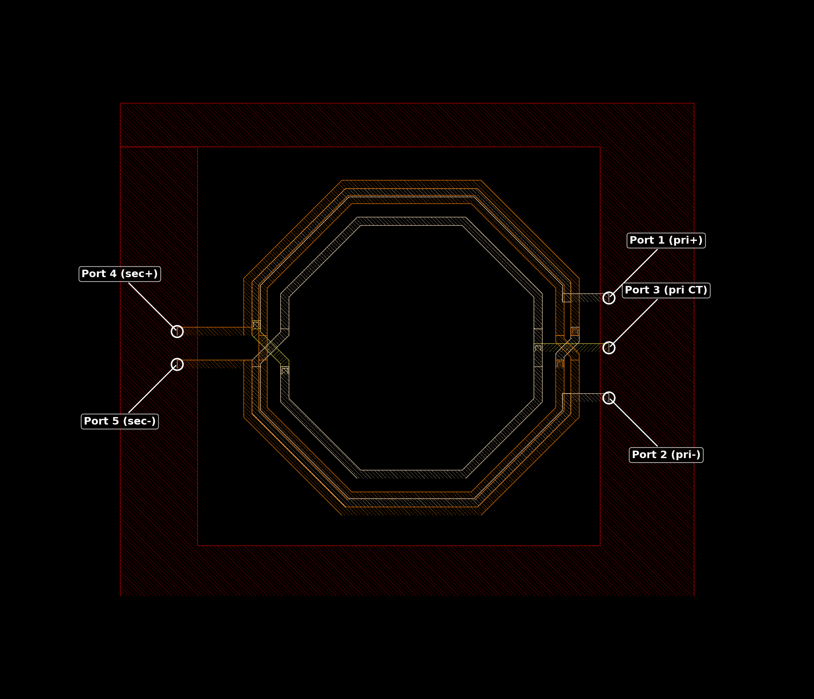
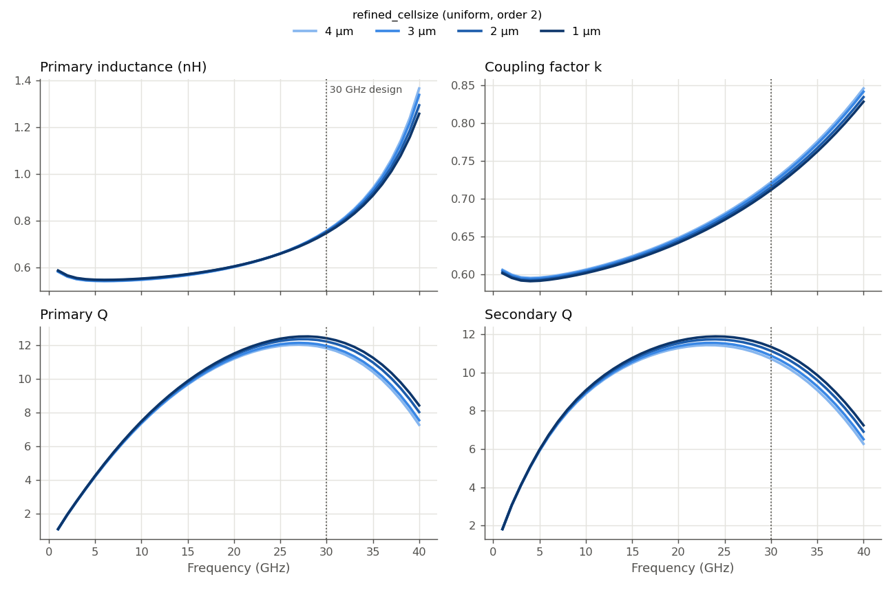
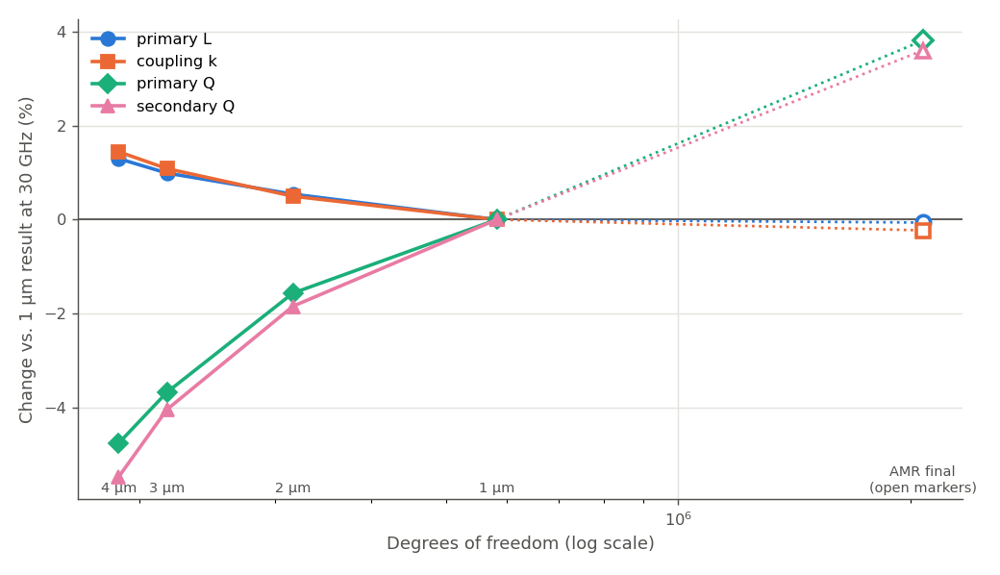
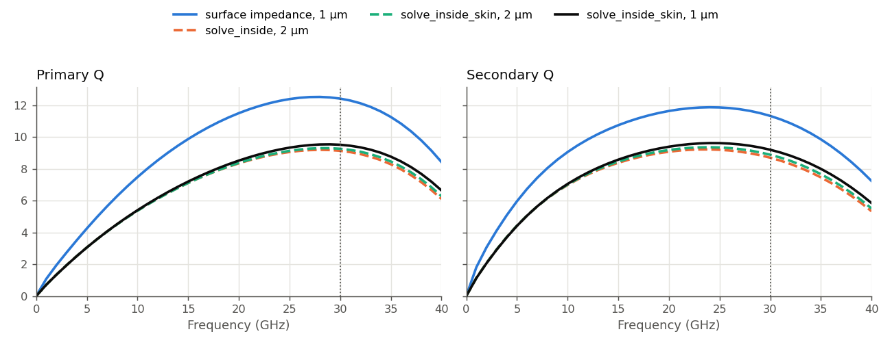

# How fine a mesh does this 30 GHz transformer need? (IHP SG13G2)

This study asks a practical question for one specific layout: a 1:1 transformer coil pair designed for 30 GHz. How fine must the Palace mesh be to get the numbers a transformer designer uses, which are inductance, coupling and Q factor? And does adaptive mesh refinement add anything here?

We answer this in three steps:

1. **Refine a uniform mesh** from 4 µm to 1 µm and see which coil properties move.
2. **Look at the trend at 30 GHz** and ask whether each quantity has settled.
3. **Cross-check with adaptive mesh refinement (AMR)**, which goes to a much larger mesh than the uniform sweep.

The findings apply to this transformer, with this stackup, in this frequency range. Other structures can behave quite differently. The [overview page](../README.md) collects the other mesh studies.

## The details of this study

- **Model:** `Transformer_IMN_ports.gds`, stackup `SG13G2_200um.xml`
- **Ports:** 5 via ports, Z0 = 50 Ω, de-embedded: 1/2 = primary (TopMetal1), 3 = primary center tap, 4/5 = secondary (TopMetal2). The de-embedding was redone in October 2026 with the corrected `combine_extend_snp.py`, which before had put the inductance of all ports at port 1 (see `doc/CHANGES.md`, 12 October 2026); it changed L by about 1% and Q by about 1%, not the convergence trends.
- **Solver:** AWS Palace (FEM), order 2, ABC boundaries, 100 µm margin and air around, far enough that the boundary doesn't change the result (see [`simulation_boundary`](../../simulation_boundary/README.md))
- **Sweep:** 0–200 GHz in 1 GHz steps (adaptive frequency sweep). This report looks at 1–40 GHz, below the primary self-resonance near 48 GHz.
- **Mesh:** `refined_cellsize` varied as described below. The Metal3 ground plane is always kept at 5 µm (`refined_cellsize_override`).
- **Execution:** `hpz2`, 16 of 32 cores, Palace 0.19.0, models from gds2palace 0.10.7 (rerun in November 2026)
- **Scope:** this is the bare coil pair. The real matching network adds MIM capacitors that are not in this model, so no matching or real-load result is reported, only the coil properties.

**What changed with the November 2026 rerun.** The first version of this study used Palace 0.17 (steps 1–3) and 0.18.0 (step 4), gds2palace from before October 2026, and 50 µm margin with 50 µm air. The rerun moves the boundary out to 100 µm, so the absolute values changed a little (primary Q at 30 GHz, 1 µm: 12.4 instead of 12.3; L and k unchanged). The runs are 4 to 5 times faster, because gds2palace now sets Palace's complex coarse solve by default (since 30 September 2026); it needs more memory. The conclusions did not change.

## 0. Layout



Both coils are single-turn octagons with **2 µm trace width**: the primary on TopMetal1 (about 46 µm radius, center tap on the right) and the secondary on TopMetal2 (about 50 µm radius). The narrow traces are the finest feature in this model.

**What we look at.** From the 5-port Z-matrix we form the differential impedances of the primary (ports 1/2) and the secondary (ports 4/5), with the center tap left open, and read:

- **Inductance** L = Im(Z)/ω of each coil
- **Coupling factor** k between the coils
- **Q factor** Q = Im(Z)/Re(Z) of each coil

## 1. Uniform mesh refinement

We ran the model at `refined_cellsize` = 4, 3, 2 and 1 µm, all at FEM order 2. A 5 µm mesh was also tried, but Palace stops on it: the gmsh mesh contains a degenerate element with zero volume. A cell size of more than twice the 2 µm trace width is likely too coarse for this geometry. The 30 GHz design frequency is marked.



On this scale, **inductance and coupling look identical for every mesh**, while **Q visibly rises** with each refinement step. The rise gets larger toward higher frequencies.

| Mesh | DOF | Solve time | Peak RAM |
|---|---:|---:|---:|
| 4 µm | 187,956 | 48 s | 3.9 GB |
| 2 µm | 316,408 | 1m 15s | 6.1 GB |
| 1 µm | 581,542 | 2m 28s | 9.6 GB |

## 2. Has it settled? The trend at 30 GHz

To see the small changes, the next plot shows each quantity at 30 GHz relative to its 1 µm value, over the size of the model (degrees of freedom). The solid lines are the uniform mesh. The open markers on the right are from step 3.



Follow the solid lines from left (4 µm) to the 1 µm point:

- **Inductance and coupling are settled.** They change by about 1.5% over the whole sweep, in shrinking steps.
- **Q is not settled.** It rises about 5% from 4 µm to 1 µm, and the steps don't shrink (+1.1%, +2.3%, +1.6%). The 1 µm result is still moving.

At 1 µm there are only two cells across the 2 µm traces. A plausible reason for the slow Q convergence is that the loss depends on how current distributes across such a narrow trace, which this mesh only coarsely resolves. This study doesn't isolate the cause.

## 3. Cross-check with AMR

AMR started from the 2 µm mesh and ran 3 iterations, refining wherever Palace's error estimate was largest. It ended at 2.08 million DOF, 3.6× the 1 µm model. These are the open markers in the plot above.

| | Primary L | Coupling k | Primary Q | Secondary Q | Total time | Peak RAM |
|---|---:|---:|---:|---:|---:|---:|
| 2 µm uniform | 0.751 nH | 0.715 | 12.24 | 11.13 | 1m 15s | 6.1 GB |
| 1 µm uniform | 0.747 nH | 0.712 | 12.43 | 11.34 | 2m 28s | 9.6 GB |
| AMR, 3 iterations | 0.747 nH | 0.710 | 12.91 | 11.75 | 36m | 31.5 GB |

- **L and k confirm the uniform result**: AMR agrees with 1 µm within 0.3%.
- **Q continues the upward trend**: AMR is another 4% above the 1 µm result, for both coils. This confirms what step 2 suggested. The Q of this transformer is not converged at 1 µm, and the true value is likely at least a few percent higher.
- AMR's last iteration changed the S-parameters nearly as much as the one before (Max|ΔS| 0.020, then 0.017), so AMR itself had not settled either. More iterations would cost at least another hour here.

## 4. Conductor model: surface, solve_inside, solve_inside_skin

Steps 1–3 use the default surface impedance conductor model, so they show how well the mesh converges *for that model*. Here we rerun the transformer with the conductors meshed as volumes: `settings['conductor_model'] = 'solve_inside'`, and `'solve_inside_skin'` with thin layers along all conductor faces. The sweep goes to 200 GHz, so the skin layers are only 0.08 and 0.21 µm deep in TopMetal1/TopMetal2. The reference is `'solve_inside_skin'` at 1 µm.



| Model (values at 30 GHz) | DOF | Time | Primary L | k | Primary Q | Secondary Q |
|---|---:|---:|---:|---:|---:|---:|
| `'solve_inside_skin'`, 1 µm (reference) | 1.45 M | 10 min | 0.753 nH | 0.710 | 9.53 | 9.21 |
| `'solve_inside_skin'`, 2 µm | 0.67 M | 4 min | +0.2% | +0.6% | −2.6% | −3.4% |
| `'solve_inside_skin'`, 4 µm | 0.37 M | 3 min | +0.9% | +1.6% | −4.5% | −6.1% |
| `'solve_inside'`, 2 µm | 0.37 M | 2 min | +0.4% | +0.6% | −4.0% | −5.4% |
| surface impedance, 1 µm | 0.58 M | 2 min | −0.8% | +0.2% | +30% | +23% |
| surface impedance, 2 µm | 0.32 M | 1 min | −0.2% | +0.7% | +29% | +21% |

- **The surface model's Q is 21–31% too high**, much more than anything the mesh changes in steps 1–3. L and k agree within 1% for all models.
- **All volume models agree within a few percent**, and all are slightly low in Q. `'solve_inside_skin'` at 2 µm brings the error from 4–5.5% down to 2.5–3.5%.

## Summary for this transformer

- **For inductance and coupling, 2 µm is enough** (within 1% of the finest results, under 1.5 minutes).
- **Q is the hard quantity.** Even the finest run here (AMR, 36 minutes) is still rising. Treat simulated Q at 30 GHz as a lower bound: the 2 µm mesh underestimates it by roughly 5% compared with AMR, and the true value may be higher still.
- **5 µm is too coarse for this geometry**: its mesh has a degenerate element and the solver stops. The cell size should not be much larger than the 2 µm trace width.
- **For Q, the conductor model matters more than the mesh.** The default surface impedance gives 21–31% higher Q at 30 GHz than the volume models. `'solve_inside'` and `'solve_inside_skin'` at 2 µm are within 2.5–5.5% of the finest `'solve_inside_skin'` result.

These numbers belong to this layout. Wider traces or a different frequency range will change them. When Q matters, check it with one finer run, since L and k settling doesn't mean Q has settled.

## Files

```
mesh_convergence_transformer/
├── palace_transformer_imn_mesh{5,4,3,2,1}.py    # uniform mesh (mesh5 fails, kept for reference)
├── palace_transformer_imn_amr3.py                # AMR, 2 µm start, 3 iterations
├── palace_transformer_imn_skin_mesh{4,2,1}.py    # 'solve_inside_skin' (step 4)
├── palace_transformer_imn_filled_mesh2.py        # 'solve_inside' (step 4)
├── palace_model/palace_transformer_imn_<name>_data/   # mesh, config and full Palace output per run
└── results/
    ├── story_plots.py            # the story_*.png plots and numbers in this report
    ├── analyze_convergence.py    # mixed-mode Sdd ΔS tables (CSV) and Sdd overlays
    ├── story_conductor_models.py # step 4 plot and numbers
    ├── delta_S_table.csv, delta_S_vs_finest.csv
    ├── snp/                      # 5-port Touchstone files, one per run and AMR iteration
    │                             #   (_raw = without port de-embedding)
    └── plots/
```

Run the scripts from this folder in the `d:\venv\palace` venv to regenerate plots and tables from the archived Touchstone files.
