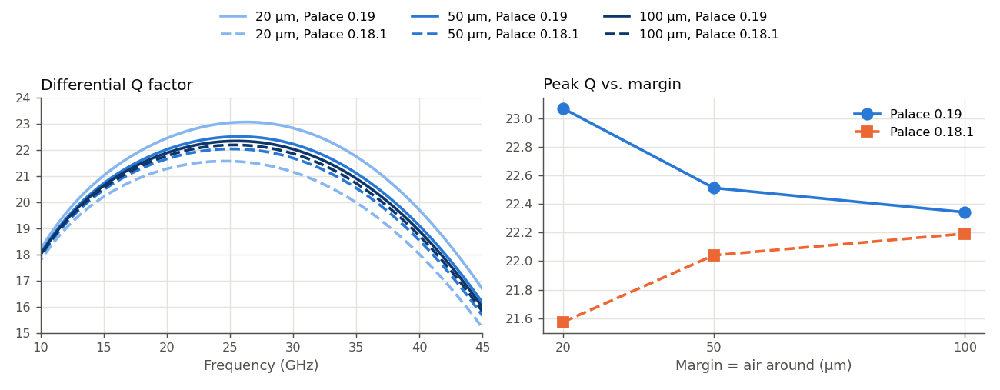
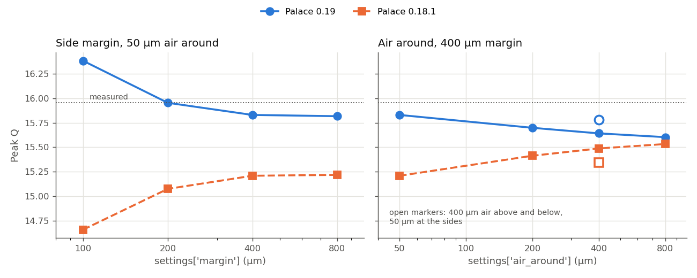

# How far must the simulation boundary be from a coil? (IHP SG13G2)

Many gds2palace models end at absorbing boundaries: the dielectrics extend `settings['margin']` beyond the layout, then `settings['air_around']` of air follows, then the boundary. An absorbing boundary is only an approximation of open space. If it sits inside the near field of a coil, it changes the result: it cuts off part of the magnetic field, which lowers L, and it takes or returns energy, which changes Q.

Palace 0.19 fixed a mistake its second-order absorbing boundary. That gives us a probe: if a model's Q changes between Palace 0.18.1 and 0.19, the boundary is close enough to matter. As the boundary moves out, both versions must approach the same answer.

We look at this in three steps:

1. **A small inductor with a ground frame**: margin and air from 20 to 100 µm.
2. **A larger coil without a frame**: the side margin from 100 to 800 µm, with the air kept thin.
3. **The same coil with more air** above, below and around it.

The findings apply to these two coils. Other structures, other stackups and other frequency ranges can need a different distance.

## The details of this study

- **Coils:** the 4-turn spiral `ind_frame_with_ports.gds` of the [inductor mesh study](../mesh_convergence/mesh_convergence_inductor/README.md) (about 110 µm across, with a Metal1 ground frame, stackup `SG13G2_200um.xml`), and the L6n2 inductor of the [L6n2 study](../measured_vs_simulated/more_accurate_models_L6n2_v5/README.md) (about 257 × 352 µm, no ground frame, stackup `SG13G2_200um_conformal.xml`), which also has a measurement.
- **Models:** the small inductor at 1 µm mesh with the surface impedance model; L6n2 at 2 µm mesh with `'solve_inside'` and conformal passivation, the most accurate practical model of the L6n2 study. Ports de-embedded in both.
- **Boundary:** ABC (second order) on all six sides. `margin` and `air_around` as given per run; a single `air_around` value applies to all six sides, including above the chip and below the substrate.
- **Solver:** every model solved twice, with Palace 0.19.0 and with Palace 0.18.1, on the same mesh and configuration. Models from gds2palace 0.10.7 (the L6n2 side-margin runs from 0.10.2, which gives the same model; the 400 µm run is identical with both).
- **Execution:** `hpz2`, 16 of 32 cores, November 2026.

## 1. A small inductor with a ground frame

The small inductor is enclosed by a Metal1 ground frame. The margin is measured from the frame. Here `air_around` is not set, so it equals the margin, and the boundary moves out on all sides together.



| Margin = air around | Peak Q, Palace 0.18.1 | Peak Q, Palace 0.19 | Difference | L at 10 GHz |
|---:|---:|---:|---:|---:|
| 20 µm | 21.57 | 23.07 | 7.0% | 0.7752 nH |
| 50 µm | 22.04 | 22.51 | 2.1% | 0.7769 nH |
| 100 µm | 22.19 | 22.34 | 0.7% | 0.7774 nH |

- **The two versions approach the same Q from opposite sides.** With the boundary 20 µm away, the old boundary made Q 3% too low and the fixed one makes it 3% too high. At 100 µm, about the size of the coil, they agree within 0.7%.
- **L hardly depends on it**: 0.3% low at 20 µm, the same with both versions.
- **The larger distance is nearly free.** The added region is meshed coarsely: 100 µm instead of 20 µm adds 1.3% unknowns and about 12% solve time.

## 2. A larger coil without a frame: the side margin alone is not enough

The L6n2 coil has no ground frame, so its field reaches further out. The L6n2 study chose its margin with a sweep of `margin` from 100 to 800 µm, with `air_around` kept at 50 µm. Solved with both Palace versions, the same sweep gives the left half of this plot:



- **Each version levels off at 400 µm**, which is why the L6n2 study chose it.
- **But the two versions level off at different Q**: 15.22 and 15.82 at 800 µm, 4% apart. The side boundary is far enough away, but something else is still close.

## 3. The air above and below matters as much

With `air_around` at 50 µm, the boundary above the chip and below the substrate is only 50 µm away. The right half of the plot keeps the 400 µm margin and raises the air:

| Air around (margin 400 µm) | Peak Q, Palace 0.18.1 | Peak Q, Palace 0.19 | Difference | L at 1 GHz |
|---:|---:|---:|---:|---:|
| 50 µm | 15.21 | 15.83 | 4.1% | 4.960 nH |
| 200 µm | 15.41 | 15.70 | 1.9% | 5.004 nH |
| 400 µm | 15.49 | 15.64 | 1.0% | 5.015 nH |
| 800 µm | 15.53 | 15.60 | 0.5% | 5.020 nH |
| 400 µm above and below, 50 µm at the sides | 15.34 | 15.78 | 2.9% | 5.007 nH |
| measured | | 15.96 | | 5.009 nH |

- **With more air, the two versions meet.** At 800 µm they are 0.5% apart.
- **L rises by 1.2%**, which the side-margin sweep could not show. With 400 µm of air or more, the simulated L is within 0.2% of the measured value.
- **The boundary must be far in all directions.** Air only above and below (open markers) closes less than a third of the difference. With the air above and below at 50 µm, the side sweep in step 2 looked converged only because the close boundary above dominated.
- **The cost is small**: 800 µm of air adds 4% unknowns, at about the same solve time.

## Summary

- **A Q value that changes between Palace versions, or when the boundary moves, means the boundary is too close.** In both coils here, Palace 0.19 approaches the converged Q from above and Palace 0.18.1 from below.
- **Keep the boundary about one coil size away in every direction.** For these two coils, `margin` and `air_around` each about the coil's outer size brought the two versions within about 1%. A coil without a ground frame needs more than one with a frame.
- **Moving the boundary out is cheap**, because the extra region is meshed coarsely. When in doubt, double `margin` and `air_around` and compare Q.
- **A side-margin sweep alone can mislead.** Vary the air too, or move the boundary out on all sides together.

These distances belong to these two coils. A large structure, a structure that radiates, or a different frequency range needs its own check.

Related: [ground_cutout_inductor](../ground_cutout_inductor/README.md) is about the distance from a coil to a ground frame in the layout, which changes the device itself, not the simulation boundary.

## Files

```
simulation_boundary/
├── inductor/
│   ├── palace_ind_frame_margin{20,50,100}.py          # 1 µm mesh, margin = air around
│   ├── ind_frame_with_ports.gds, SG13G2_200um.xml
│   └── results/
│       ├── story_margin.py                            # step 1 plot and numbers
│       ├── snp/                                       # de-embedded results; *_palace0181 = Palace 0.18.1
│       └── plots/
└── L6n2/
    ├── L6n2_2um_passi3D_margin{100,200,400,800}_air50.py   # step 2
    ├── L6n2_2um_passi3D_margin400_air{200,400,800}.py      # step 3
    ├── L6n2_2um_passi3D_margin400_airz400.py               # step 3, air above and below only
    ├── L6n2_with_ports.gds, SG13G2_200um_conformal.xml
    └── results/
        ├── story_boundary.py                          # steps 2 and 3 plot and numbers
        ├── snp/                                       # de-embedded results, both Palace versions
        └── plots/
```

Run the scripts in `results/` in the `d:\venv\palace` venv to regenerate the plots and numbers from the archived Touchstone files. The measured L6n2 data is read from the L6n2 v5 study folder.
